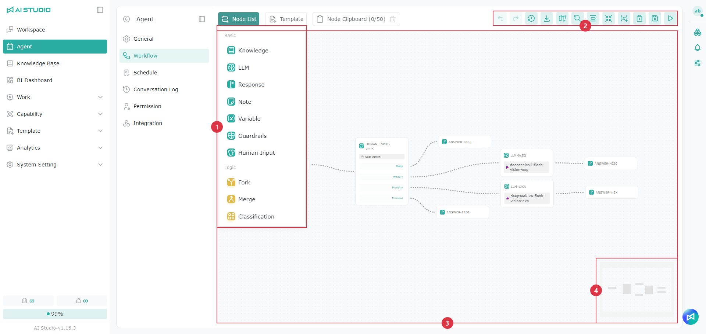
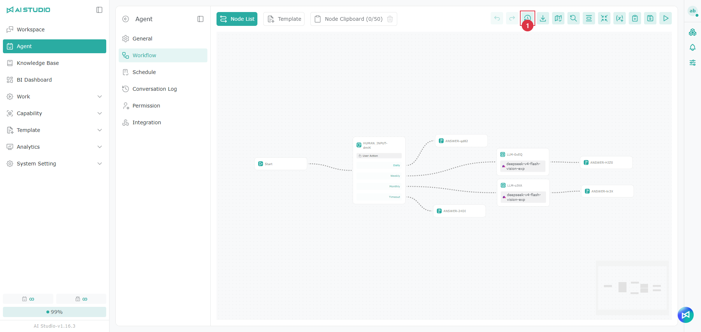
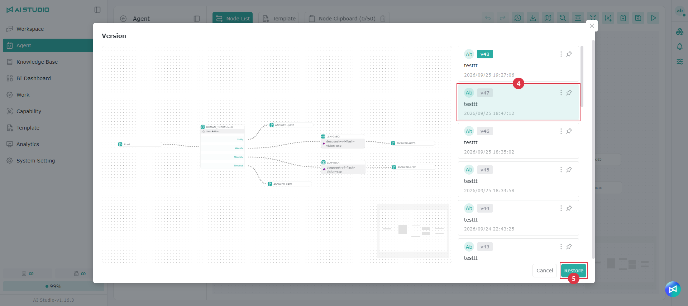

# ワークフロー

## **ページの概要**

下図はワークフローの編集画面で、次のコントロールがあります。

1. **ノードリスト**：AI Studio が提供するワークフローの機能コンポーネントです。利用できるノードの詳細はワークフローのノードのページを参照してください。
2. **ワークフローメニュー**：エディターの操作を提供します。詳しくは下記の説明を参照してください。
3. **ワークフロー編集エリア**：機能ノードをこのエリアにドラッグ＆ドロップしてワークフローを編集します。
4. **エディターマップ**：エディターの特定の場所にすばやく移動するのに役立ちます。

<table data-search="false"><thead><tr><th width="183">ワークフローメニューの項目（上図の左から順）</th><th>説明</th></tr></thead><tbody><tr><td>元に戻す、やり直す</td><td>1 つ前の手順に戻る、または次の手順に進みます</td></tr><tr><td>履歴</td><td>ワークフローの編集履歴を管理します</td></tr><tr><td>ファイルのエクスポート</td><td>このワークフローをファイルとしてエクスポートします</td></tr><tr><td>ミニマップの表示</td><td>画面右下のミニマップを表示／非表示にします</td></tr><tr><td>表示のリセット</td><td>ワークフロー全体を中央に表示します</td></tr><tr><td>折りたたむ</td><td>エディター内のすべてのノードを折りたたみます</td></tr><tr><td>グローバル変数の編集</td><td>ワークフローのグローバル変数を編集します</td></tr><tr><td>クリップボード</td><td>選択したノードを保存して、いつでも利用できます</td></tr><tr><td>保存</td><td>ワークフローの変更を保存します</td></tr><tr><td>テストプレビュー</td><td>チャットウィンドウを開いてワークフローをテストします（ワークフローテンプレートから編集している場合、このボタンは表示されません）</td></tr></tbody></table>

## **ワークフローの作成／編集**

> 注意：Agent の設定からワークフローエディターを開くと、編集後にすぐ **テストプレビュー** でテストできるのでおすすめです。

空のワークフローを例にすると、画面には既定で **"Start"** ノードが 1 つあります。このノードをクリックすると、複数の基本変数が表示されます。

| 変数名                          | 説明                       | 表示される情報                                        |
| ---------------------------- | ------------------------ | ---------------------------------------------- |
| `(x)${{start}.{query}}`      | ユーザーが入力したプロンプト           | _ユーザーの入力。例：_ `summarize the attached document` |
| `(x)${{start}.{files}}`      | ユーザーがチャット入力欄で添付したファイルの一覧 | `metadata of the files in a JSON array`        |
| `(x)${{system}.{time}}`      | 現在のシステム時刻                | `17:19:13`                                     |
| `(x)${{system}.{date}}`      | 現在のシステム日付                | `2025-06-06 Friday`                            |
| `(x)${{system}.{dateTime}}`  | 現在のシステム日時                | `2025-06-06 Friday 17:19:13`                   |
| `(x)${{system}.{userId}}`    | ログイン中のユーザーのアカウント ID      | ログインしたアカウントによって異なります                           |
| `(x)${{system}.{sessionId}}` | 現在の会話の ID                | 会話によって異なります                                    |
| `(x)${{system}.{account}}` | ログイン中のユーザーのアカウント | ログインしたアカウントによって異なります |
| `(x)${{system}.{userName}}` | ログイン中のユーザーの名前 | ログインしたアカウントによって異なります |
| `(x)${{system}.{userEmail}}` | ログイン中のユーザーのメールアドレス | ログインしたアカウントによって異なります |
| `(x)${{system}.{loginProvider}}` | ユーザーのログイン方法（AI Studio アカウント、Google、Azure Entra ID、AD など） | ログイン方法によって異なります |
| `(x)${{system}.{externalUserId}}` | 外部ログインサービスでのユーザー ID | ログイン方法によって異なります。AI Studio アカウントでログインした場合は空の場合があります |
| `(x)${{system}.{externalTenantId}}` | 外部ログインサービスのテナント ID | ログイン方法によって異なります。AI Studio アカウントでログインした場合は空の場合があります |

> システム変数はチャット Agent の指示事項でも使用できます。詳しくは [チャット Agent](liao-tian-agent.md) を参照してください。挿入した変数はグレーのタグで表示されます。

前のノードを現在のノードに接続すると、「/」を入力してそのノードの出力変数も選べるようになります。以下は LLM ノードの例です（「ノード名」には実際のノード名が表示されます）。

| 変数名                       | 説明                                                                                                                              | 表示される情報                                                                                |
| ------------------------- | ------------------------------------------------------------------------------------------------------------------------------- | -------------------------------------------------------------------------------------- |
| `(x)ノード名.{result}`        | ノードの出力結果です。LLM ノードではモデルの回答テキストです。ナレッジ検索、分類、ガードレールなどのノードにもこの変数があり、内容はノードによって異なります                                                | ノードによって異なります                                                                           |
| `(x)ノード名.{usage}`         | このノードの Token 使用量とコスト（JSON 形式）です。totalTokens は合計 Token 数、completionTokens は出力 Token 数、promptTokens は入力 Token 数、price はコスト（米ドル）です | `{"totalTokens":56349,"completionTokens":637,"promptTokens":55712,"price":0.148835}`   |
| `(x)ノード名.{executionTime}` | このノードの実行時間（JSON 形式、単位はミリ秒）です。totalDuration は合計時間です                                                                              | `{"totalDuration":46600,"loadDuration":0,"promptEvalDuration":0,"evalDuration":46600}` |

以下は、基本的なワークフロー操作を示す簡単な例です。

1. 新しいワークフローで「Start」ノードをクリックし、基本変数を確認します。
2. ノードリストから「応答」ノードを編集エリアにドラッグ＆ドロップします。
3. 「Start」ノードの出力を「応答」ノードの入力に接続します。
4. この例では基本変数の内容を表示します。「応答」ノードをクリックして編集ウィンドウを開き、入力欄で Agent の回答内容を編集します。
5. 「/」を入力すると利用できるワークフロー変数の一覧が表示されるので、上の表を参考に回答に表示する変数を選びます。
6. 編集が終わったら、メニューの「Save」ボタンをクリックし、続けて「Test Preview」をクリックしてワークフローをテストします。
7. 「Test Preview」のチャットエリアでファイルを添付し、プロンプトを入力して送信すると、Agent の処理の流れをリアルタイムで確認できます。
8. Agent の処理が完了したら、チャットエリアの「応答」項目を展開して、ワークフローの結果を確認できます。

この手順を参考に、さまざまなノードを試して、用途に合ったワークフローを作成してみてください。

### シナリオの例

#### ワークフローノード（Fork / Merge）を使ったニュース検索 Agent

ユーザーが 1 回クエリを送信するだけで、複数のデータソースから並行して情報を検索し、結果を自動的に統合して AI が要点をまとめるシナリオです。Fork と Merge を組み合わせることで、データ収集と分析の効率が大きく向上し、複雑なフローもすばやくわかりやすくなります。

## ノードのコピー＆ペースト

ワークフローではノードの設定をすばやくコピー＆ペーストできます。似たノードを複数作成する場合や、既存のロジックを別のフローに移す場合に便利です。

使い方：

* キャンバス上で 1 つまたは複数のノードを選択します。
* コピー／ペーストの操作を行います。
* ペーストしたノードは同じ設定のままキャンバスに表示されるので、違う部分を微調整します。

補足：

* ワークフロー間のコピー＆ペースト：フロー A のノードをコピーしてフロー B に貼り付けられるため、フローの組み立てが速くなります。
* 一括操作：複数のノードをまとめて選択してコピー＆ペーストでき、ノードの設定内容も保持されます。
* 名前の重複：ペースト後にノード名や変数名が重複した場合、保存する前に名前の変更を求められることがあります（メッセージに従って修正してください）。

> 注意：ノードの設定で「ほかのノードの出力変数」を参照している場合、新しいフローに貼り付けると、上流のノードとの接続がないため解決できないことがあります。ペースト後は、接続と変数の参照が揃っているかを先に確認してください。

## 一時保存と同期の仕組み

ブラウザーの再読み込みや予期しない終了で編集内容が失われないよう、エディターは下書きの一部をローカル（Local Storage）に一時保存し、複数のタブ間で同期します。

<figure><figcaption></figcaption></figure>

## バージョン履歴

バージョン履歴には、保存ボタンをクリックするたびの内容が記録されます。バージョンごとの編集履歴を確認でき、復元して古いバージョンに戻すこともできます。

> 注意：右上の保存ボタンをクリックしたときのみ、内容がバージョン履歴に記録されます。

### 以前のワークフローのバージョンに戻す

1. ワークフローメニューで **バージョン履歴** をクリックします。
2. 表示されたウィンドウの左側はリアルタイムのプレビューです。
3. 右側はバージョン履歴で、カードをクリックしてバージョンを切り替えられます。
4. 切り替えたいバージョンをクリックします。
5. **復元** をクリックしてワークフローに適用します。

### バージョンの保持

ワークフローごとに最大 **20** 件のバージョン履歴を保持できます。

**21** 番目のバージョンを作成すると、**最も古い** バージョンが自動的に削除され、最新の 20 件が保持されます。

**例：**

**Version 1** から **Version 20** までの 20 件がある状態で **Version 21** を作成すると、**Version 1** が自動的に削除され、**Version 2** から **Version 21** が残ります。

## グローバル変数の編集

グローバル変数は「このワークフロー全体で共有する定数・設定」です。会社の方針、口調のルール、決まった形式、回答テンプレートの一部、API パラメーターの既定値など、複数のノードで繰り返し使う内容に適しています。一か所で管理することで、複数のノードをそれぞれ修正する手間が省けます。

<figure><figcaption></figcaption></figure>

1. ワークフローメニューで **グローバル変数の編集** をクリックします。
2. 表示されたウィンドウで変数を追加または編集します。
3. 完了したら **保存** をクリックしてワークフローに適用します。

### 変数の追加／編集

* 名前：参照に使う識別名です。英数字のみ使用できます。
* 内容：変数の値です。複数行のテキスト（ルール、テンプレート、段落など）も入力できます。

> 注意：変数名を変更すると、ワークフロー内の参照も同期して更新されます（実際の画面の表示に従ってください）。変数を「プレーンテキスト」としてノードの内容に手動でコピー＆ペーストした場合、そのテキストは変数の参照ではないため、ご自身で更新する必要があります。

### ノードでグローバル変数を参照する

ノードの設定（LLM ノードの「コンテキスト / Context」やそのほかの入力欄など）で / を入力すると、変数一覧から利用できるグローバル変数を挿入できます。挿入するとグレーの変数タグとして表示され、以降は常に最新の内容が反映されます。

<figure><figcaption></figcaption></figure>

### システムプロンプトでグローバル変数を参照する

複数の LLM ノードで役割、口調、出力ルールを統一したい場合は、ルールをグローバル変数に書き、各ノードのシステムプロンプトでその変数を参照することをおすすめします。

メリット：ルールを更新するときは 1 回修正するだけで、参照しているすべてのノードに反映されます。

> 注意：保存時に「変数を解決できません／参照に失敗しました」などのメッセージが表示された場合は、次の点を確認してください。

1. 変数名に特殊記号や予約語が含まれていないこと
2. そのノードの欄が変数の参照に対応していること
3. 変数が正常に保存されていること

### シナリオの例

#### グローバル変数を使った多言語翻訳 Agent



グローバル変数を 1 回設定するだけで、ワークフロー内のすべての AI ノードの出力（出力言語など）をまとめて制御できるシナリオです。ノードを 1 つずつ修正しなくても中国語・英語などの言語をすばやく切り替えられ、出力全体の一貫性を保てます。多言語や海外向けの用途に特に適しています。
