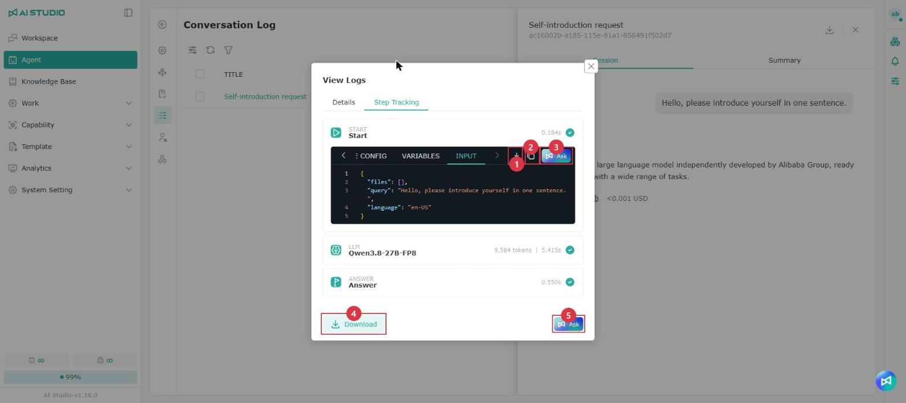

# 会話ログ

会話ログには、この Agent のすべての会話履歴が保存されます。管理者はタイトル、ユーザー、日付の範囲で履歴を絞り込めるほか、列見出しをクリックして並べ替えることもできます。履歴には処理の流れも含まれるため、エラーが発生したり回答が遅かったりした場合に、管理者が処理の詳細を確認して問題を診断できます。

* **会話の要約**：各会話履歴で、システムが生成した会話の要約を確認でき、その会話の要点をすばやく把握できます。
* **会話の内容**：会話ログの会話は、ワークスペースと同じ会話スタイルで表示されます。開くと、クリックしたメッセージの先頭が表示されます。
* **ウィンドウの幅**：会話ログのウィンドウは、既定でワークスペースの会話と同じ幅で表示されます。ウィンドウの左端をドラッグすると幅を調整できます。

> 注意：ユーザーがワークスペースで会話を削除しても、会話ログにはその会話の記録が残ります。デバッグプレビューで削除したテスト会話も同様に残り、ソースは「デバッグプレビュー」と表示されます。

## 処理の流れ

<figure><figcaption></figcaption></figure>

会話履歴で Agent の回答の下にある「ログを表示」アイコンをクリックすると、「ログを表示」ウィンドウが開きます。「詳細」タブには、今回の回答の実行状態、実行時間、使用したモデル、ソースなどの情報が表示されます。「ステップの追跡」タブには、今回の回答で通過した各ノードとイベントが順に表示されます。

* **実行状態**：各ノードとツールの応答は、色とステータスラベル（失敗、タイムアウトなど）で実行結果が示されるため、1 件ずつ展開しなくてもエラーの発生箇所を見つけられます。展開すると、エラーの詳細をすべて確認できます。
* **使用量と所要時間**：ノードのタイトルの右側に、そのノードの Token 使用量と実行時間が表示されます。モデルを呼び出さないノード（Start、応答など）は時間のみ表示されます。
* **ノードの詳細**：NODE CONFIG、VARIABLES、INPUT などの内容はタブで切り替えて確認できます。スクロールすると、ノードのタイトルが上部に固定されます。

各ノードと回答全体は、それぞれダウンロードしたり、そのまま Copilot に渡して質問したりできるため、内容を自分でまとめる必要はありません。

<table data-search="false"><thead><tr><th width="90">項目</th><th width="157">操作名</th><th>説明</th></tr></thead><tbody><tr><td>1</td><td>ダウンロード</td><td>このノードの記録をダウンロードします</td></tr><tr><td>2</td><td>コピー</td><td>現在のタブの内容をコピーします</td></tr><tr><td>3</td><td>Ask</td><td>このノードの内容を Copilot に渡して質問します。たとえば、エラーの原因を Copilot に説明してもらえます</td></tr><tr><td>4</td><td>ダウンロード</td><td>この回答のすべてのノードの記録をまとめてダウンロードします</td></tr><tr><td>5</td><td>Ask</td><td>この回答の実行記録全体を Copilot に渡して質問します</td></tr></tbody></table>

Copilot の使い方は [AI Studio Copilot](../ping-tai-zhi-nan/ai-studio-copilot.md) を参照してください。

## メモリーの抽出

<figure><figcaption></figcaption></figure>

会話ログから 1 件または複数の会話を選択し、会話に含まれる再利用可能な情報を Agent メモリーとして抽出できます。

1. メモリーを抽出したい会話履歴を選択します。
2. ツールバーに表示される選択数を確認し、**メモリーの抽出** ボタンをクリックします。
3. システムが LLM で選択した会話を分析し、抽出の状態を表示します。スキップのアイコンは抽出に適した情報がなかったこと、成功のアイコンは抽出に成功したこと、失敗のアイコンは抽出に失敗したことを示します。
4. 抽出に成功した内容は [メモリー](ji-yi.md) ページに追加され、そこで確認・管理できます。

## 会話のダウンロード

<figure><figcaption></figcaption></figure>

会話履歴は JSON 形式でダウンロードできます。ユーザーの質問、Agent の実行プロセスやツールの使用状況を後から分析したり、ほかの AI ツールに読み取らせたりする際に便利です。

* **Session 全体**：その Session 内のすべての会話をダウンロードします。
* **単一の会話**：1 件の会話の完全な記録のみをダウンロードします。会話の内容、ツールの実行記録、時間の情報が含まれます。
