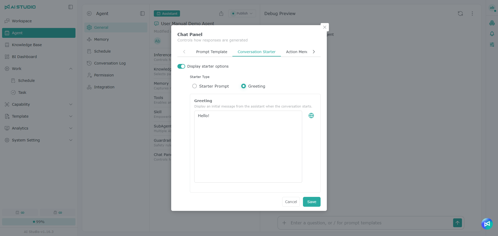

# ワークフロー Agent

## **基本設定**

<figure><figcaption></figcaption></figure>

ワークフロー Agent のホームは、主に次の部分で構成されています。

1. **Agent の機能メニュー**：以下のリンクがあり、それぞれ対応する設定ページが開きます。
2. **基本情報**：Agent 名、作成・編集の日時と担当者、有効状態を確認できます。
3. **アプリケーション設定：** Agent の種類に応じて、Agent の動作に関する設定を行います。
4. **デバッグプレビュー：** 回答が期待どおりかをテストできます。

## **会話パネル**

会話パネルには、プロンプトテンプレート、Agent のウェルカムページ、操作メニューの設定があります。

### **プロンプトテンプレート**

既存の、またはお気に入りに追加したアプリケーションテンプレート（プロンプトテンプレート）を Agent に紐づけると、必須項目を入力するだけで Q\&A をすばやく行えます。

<figure><figcaption></figcaption></figure>

### **Agent のウェルカムページ**

#### **クイック質問**

あらかじめ会話の内容を設定しておくと、会話を始める前に Agent がクリックできる質問の候補を表示し、ユーザーがすばやくやり取りを始められるようにします。

<figure><figcaption></figcaption></figure>

#### **グリーティング**

Agent の最初のあいさつメッセージを設定します。ユーザーがこの Agent を選んで会話を始めると、Agent がまずこのメッセージを自動的に送信して会話を始めます。

<figure><figcaption></figcaption></figure>

### **操作メニュー**

<figure><figcaption></figcaption></figure>

#### **ファイル処理**

オンにすると、ユーザーは会話の入力欄でファイルをアップロードできます。ファイルがアップロードされると、**Agent がファイルの種類とユーザーの質問に応じて処理方法を自動的に判断します**。たとえば、ファイルの内容を直接読み取ったり、適切なツールを呼び出したりします。

#### **Canvas**

有効にすると、会話の入力メニューに Canvas の選択肢が表示されます。

Agent の作成時、Canvas のスイッチは既定でオンになっています。

### **チャット表示**

<figure><figcaption></figcaption></figure>

#### **ヒューマンアクション**

オンにすると、Agent がユーザーに判断への参加、操作の確認、追加情報の提供を求める際に、回答の下に Action Card が表示されます。ユーザーは必要に応じて操作を完了するか、カードをスキップして会話を続けられます。

#### **実行プロセス**

オンにすると、Agent が回答するたびに、思考の流れ、ツールの実行、重要なステップ、実行状態などの実行プロセスが表示され、Agent がどのようにタスクを完了したかを把握できます。実行プロセスは回答内容と同期して更新され、思考中のメッセージは生成済みの内容の下に続けて表示されます。

#### **ナレッジベースのソース**

オンにすると、Agent の回答に引用したナレッジベースのソースが表示され、関連ファイルも **参照ファイル** に一覧表示されます。

オフにすると、回答にナレッジベースの引用は表示されず、**参照ファイル** にもナレッジベースのファイルは表示されません。この場合、どのナレッジベースが引用されたかは、Agent 管理者と Agent 編集者だけが会話ログで確認できます。

## **デバッグプレビュー**

<figure><figcaption></figcaption></figure>

このエリアで Agent の回答をテストし、その結果に応じて設定を調整します。

### テスト会話の切り替えと削除

<figure><figcaption></figcaption></figure>

デバッグプレビューでは、テスト会話がすべて保持されます。Agent のほかの設定ページに切り替えてから戻っても会話は残っているため、そのままテストを続けられます。以前のテスト会話に切り替えて、続けて質問することもできます。

<table data-search="false"><thead><tr><th width="90">項目</th><th width="157">操作名</th><th>説明</th></tr></thead><tbody><tr><td>1</td><td>テスト会話</td><td>タイトル横のドロップダウンメニューをクリックすると、この Agent のほかのテスト会話に切り替えられます。会話名は最初の質問から自動的に生成され、メニューには自分のテスト会話のみが表示されます</td></tr><tr><td>2</td><td>削除</td><td>メニュー内の会話にマウスカーソルを合わせ、ゴミ箱アイコンをクリックすると削除できます</td></tr><tr><td>3</td><td>新しい会話</td><td>新しいテスト会話を始めます</td></tr><tr><td>4</td><td>会話ファイル</td><td>このテスト会話でアップロードまたは生成されたファイルを確認します</td></tr></tbody></table>

> 注意：デバッグプレビューでテスト会話を削除しても、メニューから消えるだけです。会話ログにはその会話の内容がすべて保存され、ソースは「デバッグプレビュー」と表示されます。詳しくは [会話ログ](dui-hua-ri-zhi.md) を参照してください。

テスト中にエラーメッセージが表示された場合は、エラーメッセージにマウスカーソルを合わせ、電球ボタンをクリックして Copilot に質問できます。詳しくは [エラー発生時に Copilot に質問する](../ping-tai-zhi-nan/ai-studio-copilot.md#yu-dao-cuo-wu-shi-xun-wen-copilot) を参照してください。

### **デバッグプレビュー**でのファイルのアップロード方法

* 入力欄のプラス（+）をクリックしてファイルをアップロードできます。

<figure><figcaption></figcaption></figure>

* ドラッグ＆ドロップでのアップロードにも対応しています。

<figure><figcaption></figcaption></figure>

> 注意：デバッグプレビューでアップロードまたは生成されたファイルは 30 分間のみ保持されます。

## ワークフロー設定

Agent の機能メニューの **ワークフロー設定** では、Agent のワークフローを編集します。クリックすると、この Agent に紐づくワークフローの編集画面が開きます。

> フローの編集画面の説明と操作については、ワークフローの編集を参照してください。
