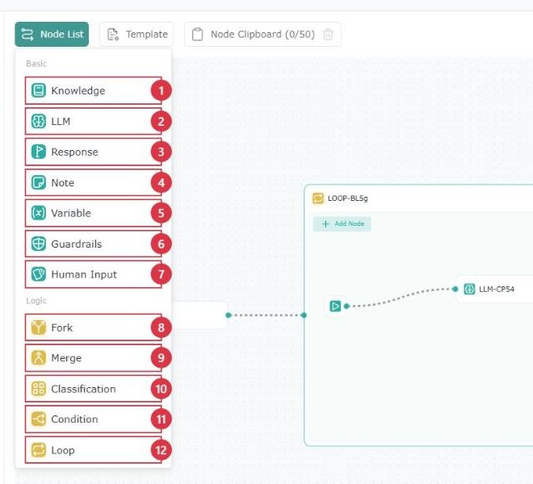
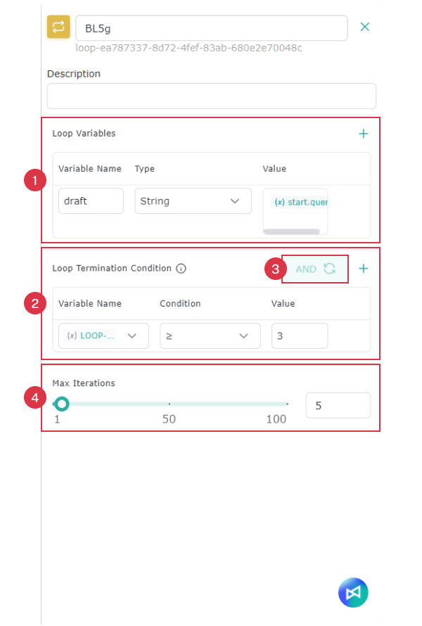
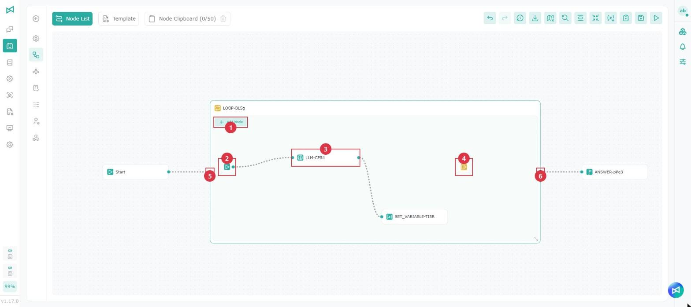
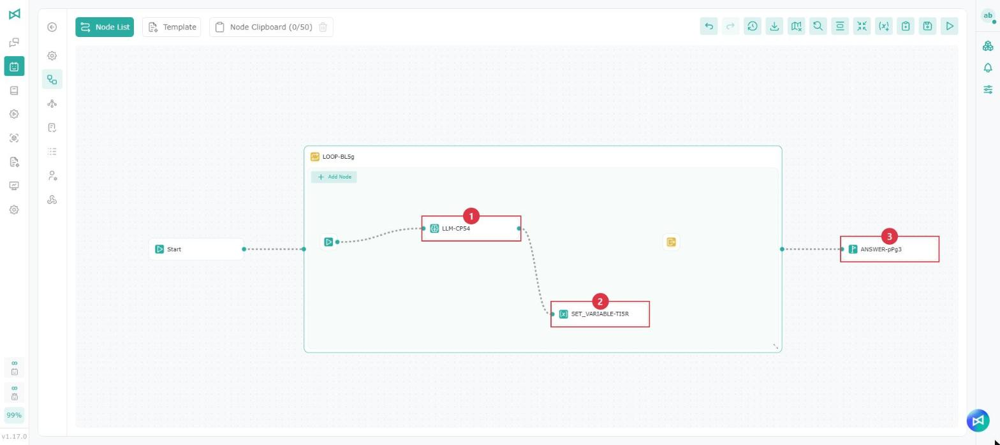
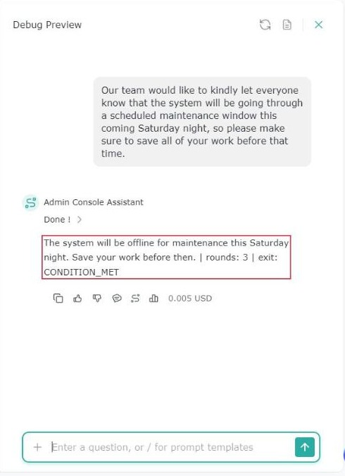

# ワークフローのノード

## 概要

ワークフローには多様なノードが用意されており、柔軟でインテリジェントな、モジュール化された Agent を構築できます。各ノードは、システムのロジック、ユーザーとのやり取り、バックエンドとの連携において、それぞれ異なる役割を担います。

<figure><figcaption></figcaption></figure>

<table data-search="false"><thead><tr><th width="80">項目</th><th width="160">ノード名</th><th>ワークフローでの用途</th></tr></thead><tbody><tr><td>1</td><td>知識</td><td>社内のナレッジベースやドキュメントデータベースから関連情報を検索します。</td></tr><tr><td>2</td><td>LLM</td><td>言語モデル（GPT-5.2 Thinking／GPT-5.2 Instant／Gemini 3 など）でプロンプトを実行し、現在の入力に基づいて生成や推論を行います。</td></tr><tr><td>3</td><td>応答</td><td>ユーザーに実際に表示される内容を定義し、Agent の回答を出力・表示します。</td></tr><tr><td>4</td><td>注釈</td><td>キャンバスに内部用の注釈やメモを追加します。実際のロジックとは接続されません。</td></tr><tr><td>5</td><td>変数</td><td>前のステップの値を取得・保存・変換し、後続のノードで使えるようにします。</td></tr><tr><td>6</td><td>ガードレール</td><td>フローの中で内容をチェック・制限し、個人データの漏えい、情報セキュリティ、コンプライアンスのリスクを低減して、出力を利用ルールと管理要件に沿ったものにします。</td></tr><tr><td>7</td><td>人による入力</td><td>ユーザーの選択を待ち、選ばれた操作に応じて対応する分岐を実行します。</td></tr><tr><td>8</td><td>フォーク</td><td>ノード間のデータの流れと順序を定義し、タスクを自動実行できるようにします。</td></tr><tr><td>9</td><td>マージ</td><td>複数の分岐の出力を 1 つのノードにまとめ、後続のノードにまとめて渡します。</td></tr><tr><td>10</td><td>分類</td><td>あらかじめ定義したロジックやモデルによる分類に基づいて、入力にラベルを付けたり経路を振り分けたりします。</td></tr><tr><td>11</td><td>条件分岐</td><td>IF、ELIF、ELSE の条件判定の結果に応じて、フローを対応する分岐に振り分けます。</td></tr><tr><td>12</td><td>ループ</td><td>枠内のノードを、終了条件を満たす、最大反復回数に達する、またはループ終了が実行されるまで繰り返し実行します。</td></tr></tbody></table>

## **知識**

社内のナレッジベースやドキュメントデータベースから関連情報を検索します。

<figure><figcaption></figcaption></figure>

<table><thead><tr><th width="80">項目</th><th width="160">機能名</th><th>説明</th></tr></thead><tbody><tr><td>1</td><td>ナレッジ検索</td><td>Input の内容（「/」を入力して query を選択するとユーザーの質問になります）</td></tr><tr><td>2</td><td>ナレッジベースの参照</td><td>必要なナレッジベースを選択します</td></tr><tr><td>3</td><td>検索パラメーター</td><td>「ナレッジベースのテスト - 検索パラメーターの設定」を参照してください</td></tr></tbody></table>

## **LLM**

言語モデル（GPT-5.2 Thinking／GPT-5.2 Instant／Gemini 3 など）でプロンプトを実行し、現在の入力に基づいて生成や推論を行います。

<figure><figcaption></figcaption></figure>

<table data-search="false"><thead><tr><th width="80">項目</th><th width="160">機能名</th><th>説明</th></tr></thead><tbody><tr><td>1</td><td>LLM 名</td><td>識別しやすいようにノード名を入力します</td></tr><tr><td>2</td><td>LLM パラメーターの調整</td><td>パラメーターを参照してください</td></tr><tr><td>3</td><td>モデル</td><td>ノードが使用する言語モデルを変更します（2 のモデル設定と同じです）</td></tr><tr><td>4</td><td>コンテキスト</td><td>Input の内容（「/」を入力して query を選択するとユーザーの質問になります）</td></tr><tr><td>5</td><td>ノードのファイルを使用</td><td>LLM が前のノードからどのファイルを取得できるかを設定します</td></tr><tr><td>6</td><td>ファイル処理</td><td>ファイル処理を参照してください</td></tr><tr><td>7</td><td>ナレッジベースを有効化</td><td>ナレッジベースのソースを参照してください</td></tr><tr><td>8</td><td>Coordination</td><td>Coordination を参照してください</td></tr><tr><td>9</td><td>スキル</td><td>スキルを参照してください</td></tr><tr><td>10</td><td>メモリーの参照</td><td>有効にすると、LLM が回答時にメモリーストアのメモリーを参照します。メモリーの保存方法は Agent Memory を参照してください</td></tr><tr><td>11</td><td>会話メモリー</td><td>パラメーター内の会話メモリーを参照してください</td></tr><tr><td>12</td><td>ツール</td><td>ツールを参照してください</td></tr></tbody></table>

## **応答**

応答ノード（Response Node）は **Agent の最終的な出力内容** を定義するノードで、フローの中でまとめた結果をユーザーに返したり、後続のシステム出力の応答として返したりします。

<figure><figcaption></figcaption></figure>

<table><thead><tr><th width="80">項目</th><th width="160">機能名</th><th>説明</th></tr></thead><tbody><tr><td>1</td><td>ノード名</td><td>識別しやすいようにノード名を入力します</td></tr><tr><td>2</td><td>説明</td><td>このノードの用途を記入できます</td></tr><tr><td>3</td><td>変数の設定</td><td>/ を入力して変数を設定します</td></tr></tbody></table>

応答ノードはループ内に配置できません。ループの後に配置し、ループの変数を参照して結果を出力してください。

応答ノードがループバックによる循環の中にある場合や、フォークの複数の分岐が直接接続されている場合は、複数回実行されることがあり、設定パネルの上部にヒントが表示されます。

* 循環の中で繰り返し実行された場合は、最後の回答だけが残ります。内容を蓄積したい場合は、先に変数ノードで蓄積してから、循環の外で出力してください。
* 複数の分岐が同時に到達した場合は、それぞれ回答が残ることがあります。1 件にまとめたい場合は、先にマージノードを接続してください。

ループバックについては、[ワークフロー](bian-ji-gong-zuo-liu-cheng.md)の「複数の接続とループバック」を参照してください。

## **注釈**

キャンバスに内部用の注釈やメモを追加します。実際のロジックとは接続されません。

<figure><figcaption></figcaption></figure>

<table><thead><tr><th width="80">項目</th><th width="160">機能名</th><th>説明</th></tr></thead><tbody><tr><td>1</td><td>ノード名</td><td>識別しやすいようにノード名を入力します</td></tr><tr><td>2</td><td>メモ</td><td>後から識別できるようにメモの内容を入力します</td></tr></tbody></table>

## **変数**

前のステップの値を取得・保存・変換し、後続のノードで使えるようにします。

<figure><figcaption></figcaption></figure>

<table><thead><tr><th width="80">項目</th><th width="200">機能名</th><th>説明</th></tr></thead><tbody><tr><td>1</td><td>変数（グローバル変数名）</td><td>書き込む<strong>グローバル変数のキー</strong>（例：<code>global.age</code>）を選択・指定し、後続のノードで同じ名前で読み取り・参照できるようにします。</td></tr><tr><td>2</td><td>変数の内容（変数の値）</td><td>そのグローバル変数の<strong>実際の値（Value）</strong>を設定し、後続のノードで直接利用できるようにします。</td></tr></tbody></table>

変数ノードをループ内に配置すると、「対象変数」で所属するループのループ変数（例：「ループ名.{draft}」）または既存のグローバル変数を選択でき、ラウンドごとにループ変数の値を更新できます。詳しくは下の「ループ」を参照してください。

## ガードレール

フローの中で内容をチェック・制限し、設定に応じてブロックまたはマスクを行って、個人データの漏えい、情報セキュリティ、コンテンツのコンプライアンスのリスクを低減します。

<figure><figcaption></figcaption></figure>

<table><thead><tr><th width="80">項目</th><th width="160">機能名</th><th>説明</th></tr></thead><tbody><tr><td>1</td><td>変数の設定</td><td>/ を入力して変数を設定します</td></tr><tr><td>2</td><td>ブロック／マスク</td><td>ガードレールの動作モードを選択します</td></tr><tr><td>3</td><td>カテゴリ</td><td>種類ごとにブロック／マスクする内容を選択します</td></tr></tbody></table>

## **分類**

あらかじめ定義したロジックやモデルによる分類に基づいて、入力にラベルを付けたり経路を振り分けたりします。

<figure><figcaption></figcaption></figure>

<table><thead><tr><th width="80">項目</th><th width="160">機能名</th><th>説明</th></tr></thead><tbody><tr><td>1</td><td>モデル</td><td>ノードが使用する言語モデルを変更します</td></tr><tr><td>2</td><td>コンテキスト</td><td>Input の内容（「/」を入力して query を選択するとユーザーの質問になります）</td></tr><tr><td>3</td><td>カテゴリ</td><td>質問を分類します。ノードに既定のカテゴリはなくなったため、必要に応じてカテゴリを追加してください</td></tr></tbody></table>

> 分類ノードを含む既存のワークフローを開くと、元の「デフォルト」カテゴリは自動的に「その他」に変更されます。保存すると新しい形式で保存されます。接続済みの分岐には影響しません。

## フォーク

ノード間のデータの流れと順序を定義し、タスクを自動実行できるようにします。

<figure><figcaption></figcaption></figure>

<table><thead><tr><th width="80">項目</th><th width="160">機能名</th><th>説明</th></tr></thead><tbody><tr><td>1</td><td>分岐</td><td>現在の分岐の数を確認します</td></tr><tr><td>2</td><td>分岐の状態</td><td>現在の分岐の状態を確認します</td></tr></tbody></table>

## マージ

複数の分岐の出力を 1 つのノードにまとめ、後続のノードにまとめて渡します。

<figure><figcaption></figcaption></figure>

<table><thead><tr><th width="80">項目</th><th width="160">機能名</th><th>説明</th></tr></thead><tbody><tr><td>1</td><td>待機</td><td>待機中のノードの数を確認します</td></tr><tr><td>2</td><td>入力の状態</td><td>現在の入力の状態を確認します</td></tr><tr><td>3</td><td>待機のタイムアウト</td><td>待機のタイムアウトを設定します</td></tr></tbody></table>

## ループ

枠内のノードを、ループ終了条件を満たす、最大反復回数に達する、またはループ終了が実行されるまで繰り返し実行し、その後ループ右側の出口から後続のノードを実行します。テキストを決まったラウンド数だけ繰り返し短くするなど、繰り返し修正・確認するフローに適しています。

<figure><figcaption></figcaption></figure>

<table><thead><tr><th width="80">項目</th><th width="160">機能名</th><th>説明</th></tr></thead><tbody><tr><td>1</td><td>ループ変数</td><td>「＋」をクリックして追加します。ループ内で共有する変数で、各ラウンドの終了時に現在の値が保持され、次のラウンドで引き続き使用されます。ループ内のノードとループ後のノードの両方から参照できます</td></tr><tr><td>2</td><td>ループ終了条件</td><td>任意です。「＋」をクリックして条件を追加します。各ラウンドの実行後に判定され、条件を満たすとループを抜けます</td></tr><tr><td>3</td><td>AND／OR</td><td>条件が 2 つ以上ある場合にクリックして組み合わせ方を切り替えます。「AND」はすべての条件を満たしたときに、「OR」はいずれかの条件を満たしたときにループを抜けます</td></tr><tr><td>4</td><td>最大反復回数</td><td>1～100 で設定でき、デフォルトは 10 です。この回数に達すると、終了条件を満たしていなくてもループを抜けるため、無限に実行され続けることはありません</td></tr></tbody></table>

### ループの追加

ノードリストから「ループ」をキャンバスにドラッグ＆ドロップするか、ノード右側の未接続のハンドルをクリックしてメニューから「ループ」を選択します。ループは枠になっており、枠内にはあらかじめループ開始、LLM、ループ終了の 3 つのノードがあります（下の画像は変数ノードを 1 つ追加した例です）。

<figure><figcaption></figcaption></figure>

<table><thead><tr><th width="80">項目</th><th width="160">名称</th><th>説明</th></tr></thead><tbody><tr><td>1</td><td>ノードを追加</td><td>ループ内にノードを追加します。ループ内のノード右側の未接続のハンドルをクリックして素早く追加することもできます。スペースが足りない場合はループの枠が自動的に広がります</td></tr><tr><td>2</td><td>ループ開始</td><td>各ラウンドはここから実行されます。削除できません</td></tr><tr><td>3</td><td>LLM</td><td>あらかじめループ開始と接続されています。設定の変更、置き換え、削除ができます</td></tr><tr><td>4</td><td>ループ終了</td><td>このノードが実行されると、すぐにループを抜けます。デフォルトでは接続されていないため、必要に応じて接続してください。不要な場合は削除できます</td></tr><tr><td>5</td><td>入口</td><td>前のノードをループ左側の入口に接続します</td></tr><tr><td>6</td><td>出口</td><td>ループの終了後、右側の出口から後続のノードを実行します</td></tr></tbody></table>

* ループ開始とループ終了は画面上ではアイコンのみ表示されます。アイコンにマウスを合わせると名前が表示されます。
* ループの枠の右下をドラッグするとサイズを変更できます。
* ループ内のノードをループ外のノードに直接接続することはできません。ループの入口から入り、出口から出るようにしてください。

ループ内に配置できるノード：知識、LLM、注釈、変数、ガードレール、人による入力、フォーク、マージ、分類、条件分岐、ループ終了。**応答**と**ループ**はループ内に配置できません。

ループ内の分類と条件分岐は、すべての出口を接続しないとワークフローを保存できません。

### ループの設定

#### ループ変数

<table><thead><tr><th width="160">項目</th><th>説明</th></tr></thead><tbody><tr><td>変数名</td><td>英字、数字、アンダースコアのみ使用でき、数字で始めることはできません。同じループ内で重複できず、システムの予約語 <code>executedRounds</code>、<code>exitReason</code> も使用できません</td></tr><tr><td>タイプ</td><td>String、Number、Boolean</td></tr><tr><td>値</td><td>変数の初期値で、最初にループに入ったときに 1 回だけ設定されます。固定値を直接入力するか（Number は数値、Boolean は <code>true</code> または <code>false</code>）、「/」を入力してループ外の同じタイプの変数（例：<code>start.query</code>）を参照します</td></tr></tbody></table>

ラウンドごとにループ変数を更新するには、ループ内に変数ノードを追加し、「対象変数」で「ループ名.{変数名}」を選択します。

#### ループ終了条件

各条件は「変数名」「条件」「値」で構成されます。

* **変数名**：システム変数、グローバル変数、このループの変数（`executedRounds` を含む）、ループ内ノードの出力を選択できます。タイプは String、Number、Boolean に限られます。
* **条件**：変数のタイプに応じて選択肢が変わります。

<table><thead><tr><th width="160">タイプ</th><th>使用できる条件</th></tr></thead><tbody><tr><td>Number</td><td>=、≠、>、&#x3C;、≥、≤</td></tr><tr><td>String</td><td>=、≠、含む、含まない、で始まる、で終わる、空である、空でない</td></tr><tr><td>Boolean</td><td>=、≠（値は <code>true</code> または <code>false</code> を選択）</td></tr></tbody></table>

* **値**：比較する固定値です。条件で「空である」または「空でない」を選択した場合は入力不要です。

注意事項：

* 条件は各ラウンドの実行後に判定されるため、ループは少なくとも 1 回実行されます。
* テキストの比較では大文字と小文字が区別され、前後の空白も比較されます。
* 終了条件を設定しない場合、ループは最大反復回数に達するか、ループ終了が実行されたときにのみ抜けます。決まったラウンド数だけ実行したい場合に使えます。
* 条件で参照している変数の名前が変更されたり削除されたりすると、その変数は赤い取り消し線で表示されるため、選択し直してください。

### 参照できる変数

ループには、設定不要で使えるシステム変数が 2 つあります。

<table><thead><tr><th width="240">変数</th><th width="100">タイプ</th><th>説明</th></tr></thead><tbody><tr><td><code>ループ名.{executedRounds}</code></td><td>Number</td><td>ループ内では現在のラウンド数（最初のラウンドは 1）、ループ後では実行した合計ラウンド数です</td></tr><tr><td><code>ループ名.{exitReason}</code></td><td>String</td><td>ループを抜けた理由です。ループ後のノードからのみ参照できます： • <code>CONDITION_MET</code>：ループ終了条件を満たした • <code>MAX_COUNT_REACHED</code>：最大反復回数に達した • <code>EXIT_LOOP</code>：ループ終了が実行された</td></tr></tbody></table>

最後のラウンドで終了条件を満たし、同時に最大反復回数にも達した場合、抜けた理由は `CONDITION_MET` と記録されます。

「/」を入力したときに選択できる変数は、ノードの位置によって異なります。

<table><thead><tr><th width="200">位置</th><th>参照できる変数</th></tr></thead><tbody><tr><td>ループ内のノード</td><td>システム変数、グローバル変数、Start の変数、ループより前のノードの出力、このループの変数と <code>executedRounds</code>、同じラウンド内の前のノードの出力</td></tr><tr><td>ループ後のノード</td><td>システム変数、グローバル変数、Start の変数、ループより前のノードの出力、このループの変数（最終値）、<code>executedRounds</code> と <code>exitReason</code></td></tr></tbody></table>


ループ後のノードは、ループ内ノードの出力を直接参照できません。使用したい場合は、ループ内で変数ノードを使って結果をループ変数に書き込み、ループ後にそのループ変数を参照してください。


### 例：テキストを繰り返し短くする

この例では、LLM がユーザーの入力したテキストを繰り返し短くし、3 ラウンド実行した後に結果を出力します。画像の 1 はループ内の LLM、2 は変数ノード、3 は応答ノードです。

<figure><figcaption></figcaption></figure>

1. 「Start」ノードをループ左側の入口に接続します。
2. ループのタイトルをクリックして設定を開き、「ループ変数」に行を追加します。変数名に `draft` と入力し、タイプで String を選択し、値に「/」を入力して `start.query` を選択します。
3. 「ループ終了条件」に行を追加します。変数名で「ループ名.{executedRounds}」を、条件で「≥」を選択し、値に `3` と入力します。「最大反復回数」は 5 に設定します。
4. ループ内の LLM をクリックし、コンテキストに書き換えの指示（例：「次のテキストをより短く分かりやすく書き換え、書き換えた内容だけを回答してください：」）を入力して、「/」で「ループ名.{draft}」を挿入します。
5. LLM 右側のハンドルをクリックして「変数」ノードを追加します。「対象変数」で「ループ名.{draft}」を選択し、値に「/」を入力して「LLM 名.{result}」を挿入します。
6. ループ右側の出口を応答ノードに接続し、応答に「ループ名.{draft}」を挿入します。`executedRounds` と `exitReason` も挿入すると、実行結果を確認できます。
7. 保存してから **テストプレビュー** を開き、テキストを送信します。応答には短くなったテキストが表示され、実行ラウンド数は 3、抜けた理由は `CONDITION_MET` になります。

<figure><figcaption>
テストプレビューの応答結果
</figcaption></figure>

会話の処理ステップを展開すると、各ラウンドで順に実行されたノードを確認できます。

### 保存時のチェック

ワークフローの保存時に次のいずれかに該当すると、警告が表示され、問題のあるノードの設定が開きます。

* ループ変数の名前が未入力、形式が正しくない、予約語を使用している、または重複している。あるいは初期値がタイプと一致しない、使用できない変数を参照している
* 名前が変更された、または削除されたループ変数をノードが参照している
* ループ終了条件の設定が不完全（変数が選択されていない、値がない、値がタイプと一致しないなど）
* ループ内の分類または条件分岐に未接続の出口がある

## **人による入力**

フローを一時停止してメッセージと操作ボタンを表示し、ユーザーの選択を待ってから、選ばれた操作に対応する分岐を実行します。ほかの人に確認を依頼することもでき、上長や担当者の承認を得てから続行するフローに適しています。

<figure><figcaption></figcaption></figure>

<table><thead><tr><th width="80">項目</th><th width="160">機能名</th><th>説明</th></tr></thead><tbody><tr><td>1</td><td>メッセージ</td><td>回答者に表示するメッセージです。/ を入力して変数を設定します。各操作の補足説明もここに記載してください</td></tr><tr><td>2</td><td>ユーザーの操作</td><td>選択できる操作を設定します。各操作に入力する値は 1 つだけで（100 文字まで）、ボタンに表示されると同時に分岐の判定にも使われます。少なくとも 1 つの操作が必要です</td></tr><tr><td>3</td><td>確認者</td><td>回答する人を選択します。フローは確認者の回答を待ってから続行します： • <strong>現在のユーザー</strong>：この会話で Agent とやり取りしているユーザーが回答します • <strong>指定ユーザー</strong>：Agent とやり取りしているユーザーにかかわらず、選択したユーザーが回答します。確認者を 1 人選択する必要があり、自分またはほかの人を選択できます</td></tr><tr><td>4</td><td>通知</td><td>システム通知はデフォルトでオンになっており、オフにすることはできません。フローが回答待ちになると確認者に通知されます。メール通知を選択すると、メールでも確認者に通知されます</td></tr><tr><td>5</td><td>タイムアウト</td><td>待機時間と単位（秒、分、時間、日）を設定します。期限内に回答がない場合、フローはタイムアウトの出口から続行します</td></tr></tbody></table>


操作のテキストはそのままボタンに表示されるため、1〜2 行程度の短く分かりやすい表現にしてください。ボタンにはマウスオーバー時の説明が表示されないため、各操作の意味を説明する必要がある場合は「メッセージ」に記載してください。


ユーザーの操作ごとにノード上に対応する出口が作成され、さらに **タイムアウト** の出口が 1 つ必ずあります。ワークフローを保存するには、すべての出口を後続のノードに接続する必要があります。

<figure><figcaption></figcaption></figure>

後続のノードで / を入力して「ノード名.{selected}」を選ぶと、ユーザーが選んだ操作の値を取得できます。フローがタイムアウトの出口から続行した場合、この値は空になります。

### 回答する人

「確認者」の設定によって、人による入力ノードに回答する人が決まります。どちらを選択した場合も、フローが回答待ちになるとシステム通知で確認者に知らせます。

<table><thead><tr><th width="240">設定</th><th>回答方法</th></tr></thead><tbody><tr><td>現在のユーザー</td><td>Agent と会話しているユーザーが回答します。会話内のカードで直接回答するか、通知から回答できます</td></tr><tr><td>指定ユーザー（確認者が会話中のユーザー本人の場合）</td><td>会話内のカードで直接回答するか、通知から回答できます</td></tr><tr><td>指定ユーザー（確認者が会話中のユーザー以外の場合）</td><td>カードに「○○ の回答を待っています」と表示されます。会話中のユーザーは回答できず、確認者が通知から回答するのを待つ必要があります</td></tr></tbody></table>

「指定ユーザー」を選択した場合、誰が Agent と会話していても、同じ確認者が回答します。たとえば確認者を上長に設定すると、誰がこのノードを実行しても、上長が確認するまでフローは続行しません。

確認者は Agent の権限がなくても回答できます。権限のない確認者も、システム通知やメールで操作をクリックして回答できますが、会話に戻ることはできません。

### 会話内のカード

フローが人による入力ノードに到達すると、会話にメッセージ、操作ボタン、期限が表示されたカードが表示されます。回答すると、フローは選ばれた操作の出口から続行します。

<figure><figcaption>
人による入力ノードのトリガー
</figcaption></figure>

<figure><figcaption>
人による入力ノードのタイムアウト
</figcaption></figure>

* 回答待ちの間は、回答が完了するまで同じ会話で新しいメッセージを送信できません。
* カードの状態には「回答待ち」「回答済み」「タイムアウト済み」「キャンセル済み」があります。確認者が指定されている場合、待機中のカードには「（確認者名） の回答待ち」と表示されます。回答済みでフローがまだ続行していない場合、カードには「待機中」と表示されます。ステータスラベルは省略されずにすべて表示されます。
* 会話を開き直しても待機中のカードは残っており、続けて回答できます。
* 待機中に回答を停止すると、カードはキャンセル済みと表示され、フローは続行しません。
* 確認者はシステム通知上で操作をクリックして直接回答するか、「会話に戻る」をクリックして元の会話で回答できます。回答後は通知上の操作ボタンが折りたたまれ、タイムアウトまたはキャンセル後は通知上の操作ボタンをクリックできなくなります。通知の表示については[システム通知](../ping-tai-zhi-nan/xi-tong-tong-zhi.md)を参照してください。
* メール通知を選択している場合、確認者はメール内で直接回答することもできます。下記の「メール通知」を参照してください。
* Coordination 経由で人による入力ノードを含むワークフロー Agent を呼び出すことには、現在対応していません。

### メール通知

メール通知を選択すると、フローが回答待ちになったときに、確認者に Profet AI AIS（ais@profetai.com）からメールが届きます。AIS を開かなくても、メール内で操作を選んで回答できます。

<figure><figcaption>
人による入力ノードのメール通知
</figcaption></figure>

メールには次の内容が含まれます：

<table><thead><tr><th width="160">項目</th><th>説明</th></tr></thead><tbody><tr><td>件名</td><td>送信元の Agent と「Your response is needed」に続けて、確認が必要な内容が表示されます</td></tr><tr><td>本文</td><td>Agent 名、確認が必要な内容、ノードで設定したメッセージが表示されます</td></tr><tr><td>回答期限</td><td>「有効期限」の後に回答期限が表示されます。現在は UTC で表示されます。期限を過ぎると、フローはタイムアウトの出口から続行します</td></tr><tr><td>操作ボタン</td><td>ノードで設定したユーザーの操作と同じです。クリックすると回答が送信されます</td></tr></tbody></table>

操作方法：

1. メールを開き、確認が必要な内容と回答期限を確認します。
2. メール内の操作ボタンのいずれかをクリックします。回答を送信する前に AIS へのサインインが必要です。
3. ブラウザーに結果ページが表示されます。「送信済み」 と表示されれば回答は完了し、フローは選んだ操作に従って続行します。
4. 「トップページに戻る」 をクリックすると、AIS のホームページに戻ります。

<figure><figcaption>
回答の送信完了
</figcaption></figure>

結果ページにエラーメッセージ（例：「The selected human input action does not exist.」）が表示された場合、回答は送信されていません。AIS の会話に戻り、カードの現在の状態（タイムアウト、キャンセル済み、すでに別の方法で回答済みなど）を確認してください。

<figure><figcaption>
回答の送信失敗
</figcaption></figure>
