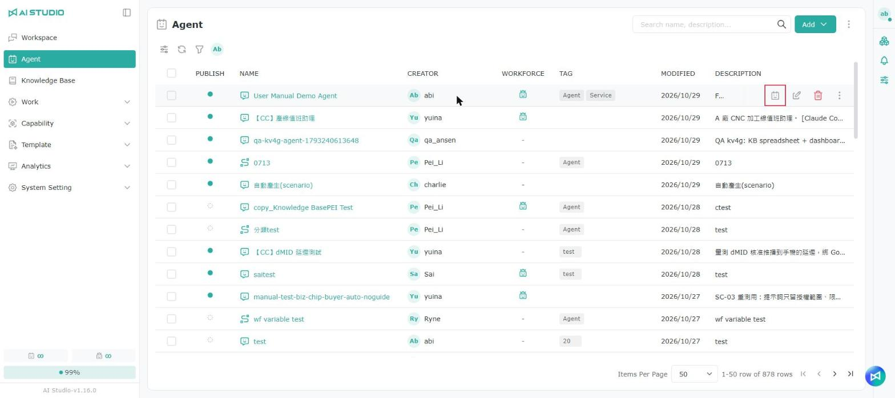
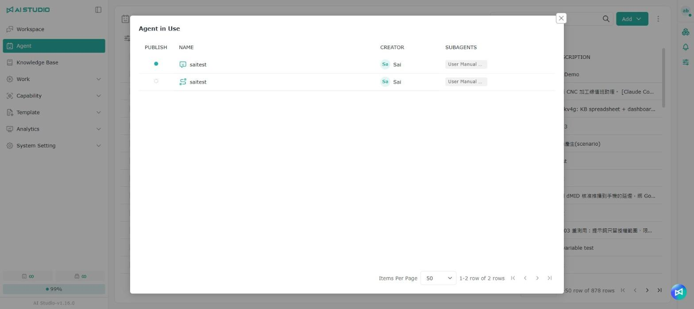

# Agent の管理

## **Agent の種類**

<figure><figcaption></figcaption></figure>

* **チャット Agent**：基本的な Q&A を通じて、社内または外部の大規模言語モデルと直接やり取りします。
* **ワークフロー Agent**：ワークフローを組み立てて、複雑な利用シナリオに対応できます。

## **Agent の作成**

<figure><figcaption></figcaption></figure>

<figure><figcaption></figcaption></figure>

1. 画面右上の **+ 作成** ボタンをクリックします。
2. 表示されたウィンドウで **Agent の種類** を選択します。
3. **名前** 欄に Agent 名を入力し、右側のボタンをクリックして多言語ラベルを作成します。[多言語設定](guan-li-agent.md#duo-guo-yu-yan-she-ding) を参照してください。
4. **説明** 欄に Agent の説明を入力し、右側のボタンをクリックして多言語ラベルを作成します。[多言語設定](guan-li-agent.md#duo-guo-yu-yan-she-ding) を参照してください。
5. **タグ** メニューをクリックし、この Agent に付けるタグを選択します。
6. **モデル** メニューをクリックし、この Agent が使用する大規模言語モデルを選択します。キーワードでモデルを検索することもできます。
7. **保存** ボタンをクリックして作成を完了します。Agent の編集画面が自動的に開くので、設定を完了します。

> 注意：Agent の作成後、**Agent の種類** は変更できません。**モデル** は推論パラメーターでいつでも変更できます。

### 多言語設定 

<figure><figcaption></figcaption></figure>

1. 画面の **地球** ボタンをクリックすると自動翻訳されます。内容は手動で編集することもできます。
2. 自動翻訳が完了したら **OK** ボタンをクリックして保存します。

> 注意：**モデル** メニューに表示される大規模言語モデルは、実際にインストールされた環境の構成によって異なります。本マニュアルに記載の選択肢は参考用です。

## Agent のクイック編集

<figure><figcaption></figcaption></figure>

Agent 一覧で該当する行の編集ボタンをクリックすると、クイック編集ウィンドウが開きます。名前と説明を変更でき、Agent の有効状態も直接切り替えられます。そのほかの設定（推論パラメーター、ナレッジベース、ツールなど）は、Agent 名をクリックして Agent の設定ページで行ってください。

## Agent のコピー

<figure><figcaption></figcaption></figure>

1. Agent 一覧で、コピーしたい Agent にマウスを合わせ、「コピー」をクリックします。
2. 確認ウィンドウには元の Agent の名前が自動で入力されます。元の Agent と区別しやすいよう、新しい名前に変更できます。
3. 確認をクリックするとコピーした Agent が作成されます。キャンセルをクリックすると作成されません。

## 使用中の Agent を確認する

<figure><figcaption></figcaption></figure>

Agent は、ほかの Agent の「Coordination」に追加され、SubAgent として使われることがあります。Agent を変更または削除する前に、どの Agent に使われているかを確認しておくと、それらの Agent の回答への影響を避けられます。

Agent 一覧の任意の行にマウスカーソルを合わせ、「使用中の Agent」ボタンをクリックすると、この Agent を SubAgent として使っている Agent を確認できます。

<figure><figcaption></figcaption></figure>

ウィンドウには、上位の各 Agent の公開状態、名前、作成者と、その Agent が使っている SubAgents が表示されます。どの Agent にも使われていない場合は、データがない旨が表示されます。

### 使用中の Agent を削除する

ほかの Agent に SubAgent として使われている Agent は、そのままでは削除できません。「この Agent は次の Agent で SubAgent として使用されています。これらの Agent から削除してから、削除してください。」というメッセージが表示されるので、表示された Agent の「Coordination」から先に削除し、その後で削除し直してください。

## Agent のエクスポート／インポート（JSON）

エクスポート／インポート機能は、Agent の設定のバックアップ、環境間での設定の移行、似た Agent のすばやい複製による設定作業の削減に利用できます。

### Agent のエクスポート

<figure><figcaption></figcaption></figure>

1. Agent 一覧を開くか、対象の Agent の編集ページを開きます。
2. エクスポートしたい Agent の行にマウスカーソルを合わせます。
3. **エクスポート（Export）** ボタンを選択すると、proas ファイルがダウンロードされます。

### Agent のインポート

<figure><figcaption></figcaption></figure>

<figure><figcaption></figcaption></figure>

1. 追加ボタンをクリックし、**デバイスから** を選択します。
2. 欄をクリックして、インポートするファイルを選択します。
3. **OK** をクリックして、選択したファイルをインポートします。

## Agent の公開

<figure><figcaption></figcaption></figure>

すべての種類の Agent のホームには共通の **基本設定** ブロックがあり、**有効状態** の切り替えスイッチと、Agent の名前と説明を更新する **設定** ボタンがあります。設定ボタンをクリックすると、次のダイアログが表示されます。

1. **Agent の公開状態**：Agent の有効状態を編集できます。スイッチを切り替えるとすぐに状態が変わります。
2. **基本設定の編集**：名前、説明、多言語の翻訳を編集できます。

### Agent をワークスペースに公開する

Agent を作成・保存しただけでは、ワークスペースの探索には表示されません。ワークスペース内のほかのユーザーがその Agent を見つけて利用できるようにするには、Agent の設定で **公開** を選択して保存する必要があります。

* **未公開：** Agent は **マイ Agent** にのみ表示されます。
* **公開済み：** Agent は **マイ Agent** と **探索** の両方に表示され、緑色の公開ランプが表示されます。

### Agent の**公開**状態の設定

<figure><figcaption></figcaption></figure>

<figure><figcaption></figcaption></figure>

1. 公開状態の欄をクリックして、画面を開きます。
2. 公開ボタンをクリックします。
3. **ワークスペースで会話** 欄のコピーボタンをクリックすると、この Agent のワークスペースでの会話画面の URL をコピーでき、ユーザーに共有して直接会話を開いてもらえます。
4. 会話ボタンをクリックすると、ワークスペースの会話が開きます。
5. 未公開ボタンをクリックすると、公開を取り消せます。

ユーザーが **ワークスペースで会話** の URL から開くと、ワークスペースに移動し、左側の機能メニューも表示されたままになります。詳しくは [ワークスペースの概要](../gong-zuo-kong-jian-zhi-nan/ai-studio-gong-zuo-kong-jian.md) を参照してください。

### Agent が見つからない場合

公開スペースで Agent が見つからない場合は、次の順に確認してください。

* **マイ Agent** を開き、Agent が表示されているかを確認します。
* その Agent の設定ページを開き、**公開** が選択されているかを確認します。
* 設定を保存した後、**ワークスペース > 探索** に戻って確認します。
* それでも表示されない場合は、ページを再読み込みし、Agent が正しいワークスペースに公開されているかを確認します。

> Agent の作成と Agent の公開は別の手順です。公開を完了して初めて、Agent がワークスペースの探索に表示されます。

## Agent 設定ページの URL をコピーする

Agent 一覧から Agent を開くと、画面上部の公開状態の横に共有ボタンがあります。クリックすると現在の Agent 設定ページの URL をコピーでき、ほかの Agent 管理者に共有して、この設定ページを直接開いてもらえます。

> 注意：共有ボタンでコピーされるのは **Agent 設定ページ** の URL です。ユーザーにすぐ会話を始めてもらいたい場合は、公開メニューの **ワークスペースで会話** 欄にあるコピーボタンを使ってください。

## 権限

一覧権限については [モジュール別の権限ロール - Agent 一覧の権限](../ru-men-zhi-nan/quan-xian-gong-neng-jie-shao.md#agent-qing-dan) を参照してください。

権限の設定方法については [権限の操作 - Root 権限](../ru-men-zhi-nan/quan-xian-cao-zuo-gong-neng-jie-shao.md#root-quan-xian) を参照してください。
