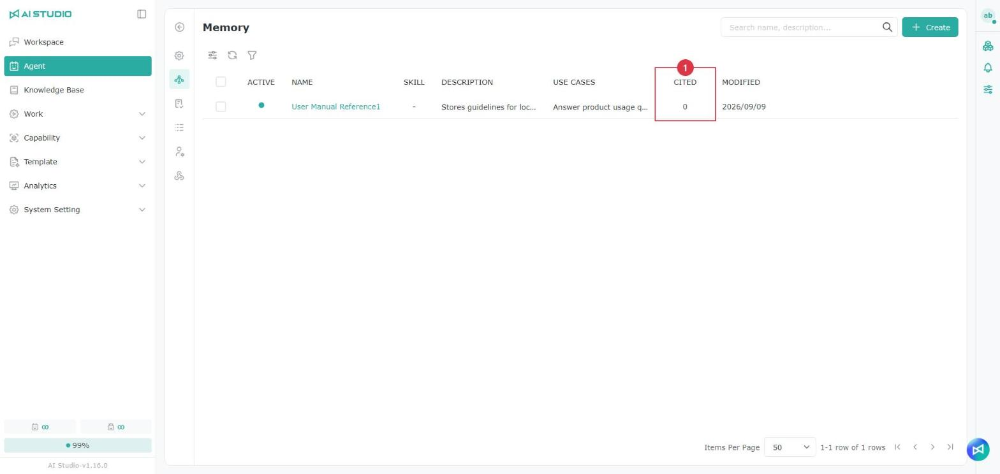

# メモリー

<figure><figcaption></figcaption></figure>

Agent のメモリーページでは作成済みのメモリーの一覧を確認でき、有効状態、名前、説明、利用シナリオから各メモリーの用途をすばやく把握できます。メモリーには特定のタスクの手順、判断ルール、前提条件、操作手順、注意事項などを保存でき、Agent がその後のやり取りで一貫した処理ロジックを保てるようにします。

### 参照回数

<figure><figcaption></figcaption></figure>

メモリー一覧の「参照回数」列には、各メモリーが Agent に参照された回数が表示されます。よく使われているメモリーや、長期間参照されていないメモリーを判断でき、無効化や統合を検討する際の目安になります。

## **Agent メモリーのソース**

Agent メモリーは、**その Agent とのすべての会話** から情報を抽出します。システムは会話の内容を自動的に分析し、長期的に保存する価値のある知識、好み、操作手順を識別して管理しやすいメモリー項目にまとめ、Agent がその後のやり取りで継続して利用できるようにします。

## Agent メモリーの設定

メモリー機能は過去の会話から情報を抽出し、Agent がその後の会話でより一貫した回答を行えるようにします。設定は Agent の調整画面のホームにある、メモリーの歯車アイコンから開きます。

<figure><figcaption></figcaption></figure>

### メモリー

メモリー機能は会話から再利用できる情報を整理し、Agent がその後の会話で関連するメモリーと会話の要約を引用できるようにします。

<table><thead><tr><th width="193">設定項目</th><th>使い方</th><th>設定値とシステムの動作</th></tr></thead><tbody><tr><td>メモリーの引用</td><td>Agent が回答時にメモリーと会話の要約を引用できるかどうかを制御します。</td><td>オンにすると、システムはまず既存の会話を整理し、その後は設定した時刻に新しい会話を処理します。オフにすると、Agent は回答時にこれらの内容を引用しません。</td></tr><tr><td>メモリーの自動最適化</td><td>システムが毎日自動的に会話から再利用できる情報を抽出・整理するかどうかを制御します。</td><td>オンにすると、<strong>メモリーの抽出時刻</strong> に毎日実行されます。オフにすると、毎日の自動整理は行われません。</td></tr><tr><td>メモリーの抽出時刻</td><td>システムが毎日自動的にメモリーを整理する時刻を設定します。</td><td>時刻選択で設定します。画面の例は <code>02:00</code> です。<strong>メモリーの自動最適化</strong> がオンの場合にのみ有効です。</td></tr><tr><td>抽出の指示</td><td>会話からメモリーを整理する際に、優先して残す内容を指定します。</td><td>Agent の用途に応じて抽出方針を入力できます。未入力の場合は既定のルールが使われます。</td></tr><tr><td>指示（任意）</td><td>具体的なメモリー抽出の要件を入力します。</td><td>自由に入力できます。例：「MCP の設定手順のみ抽出する。」</td></tr></tbody></table>

**メモリーの引用** は Agent がメモリーを使えるかどうかを制御し、**メモリーの自動最適化** はシステムが新しい会話から定期的にメモリーを整理・更新するかどうかを制御します。両者の用途は異なります。


**メモリーの引用** または **メモリーの自動最適化** のいずれかをオンにすると、この Agent は Workforce の枠を使用するようになります。Workforce の枠の上限は通常少ないため、利用が多いときは待機が必要になることがあります。詳しくは [Workforce モニター](../fen-xi-zhi-nan/workforce-jian-kong.md#assistant-yu-workforce-de-cha-yi) を参照してください。


抽出の指示は、システムがどの内容をメモリーとして選ぶかにのみ影響し、Agent の回答方法を直接変えるものではありません。設定が終わったら **保存** をクリックして変更を適用します。

* 指示の例：現在のプロジェクトに関する技術的な設定、手順、確定した決定事項を優先して抽出し、あいさつや一時的な情報は無視する。

## 処理履歴の確認

メモリーページの **処理履歴** タブには、メモリー最適化の実行履歴が一覧表示され、システムがどの会話からメモリーを抽出・調整したかを確認できます。

1. Agent のメモリーページを開き、**処理履歴** タブに切り替えます。
2. 一覧に最適化の実行履歴が表示されます。
3. 履歴を展開すると、その回に処理された各会話（Session）を確認できます。
4. さらに個々の会話を展開すると、詳しい処理内容を確認できます。最適化と競合の処理では表示される内容が異なります。

## Agent メモリーを手動で作成する

<figure><figcaption></figcaption></figure>

<figure><figcaption></figcaption></figure>

1. Agent のページを開き、左側のサブメニューで **メモリー** をクリックします。
2. 右上の **作成** ボタンをクリックします。
3. メモリーの基本情報を入力します。
   * 名前：メモリーの名前を入力します。
   * 説明：メモリーの説明を入力します。
   * 利用シナリオ：このメモリーが適用される利用シナリオを入力します。
   * 内容：詳しい内容を入力します。Markdown 形式で書式を整えられます。
4. 内容に問題がないことを確認し、**作成** をクリックして完了します。

## Agent メモリーの詳細を確認する

<figure><figcaption></figcaption></figure>

<figure><figcaption></figcaption></figure>

1. メモリー一覧を開きます。
2. 確認したいメモリーの名前をクリックします。
3. 右側に詳細パネルが開きます。
4. メモリーの名前、有効状態、説明、利用シナリオ、内容全体を確認できます。内容が長い場合は、右側のパネルを上下にスクロールして確認します。

## メモリーの統合

<figure><figcaption></figcaption></figure>

複数のメモリーに同じ情報や関連する情報が含まれている場合は、**メモリーの統合** 機能で内容をまとめられます。

1. 統合したいメモリーを 2 件以上選択します。
2. ツールバーに表示される選択数を確認します。
3. **メモリーの統合** ボタンをクリックします。
4. 選択したメモリーが統合され、完了後にメモリー一覧が更新されます。

> 内容が似ているメモリーや同じテーマのメモリーを統合することをおすすめします。用途の異なる情報を 1 つにまとめないようにしてください。

## Agent メモリーの有効化と無効化

### Agent メモリーの有効化のルール

メモリー機能には、機能全体のスイッチと、メモリーごとの有効状態があります。

<figure><figcaption></figcaption></figure>

スイッチがオンの場合、この Agent はメモリー機能を利用できます。メモリー一覧で、メモリーを個別に有効化・無効化することもできます。

スイッチがオフの場合、この Agent はメモリー機能を利用しません。メモリー一覧に作成済みのメモリーがあっても、Agent はその内容を適用しません。

### 個々の Agent メモリーの有効化と無効化

<figure><figcaption></figcaption></figure>

<figure><figcaption></figcaption></figure>

メモリー一覧の **有効** 欄には、各メモリーが有効かどうかが表示されます。メモリー全体のスイッチがオンの場合にのみ、有効になっている個々のメモリーが Agent の回答やタスク処理の参考として使われます。

一時的に使わないメモリーは無効化しておけば、内容を残したまま Agent に適用させないようにできます。後で再び使う場合は、もう一度有効化します。

### **Agent メモリーが使われたかを確認する方法**

1. テスト会話で質問を入力し、Agent の回答履歴を確認します。
2. PROFETAI\_use\_agent\_memory が表示されていれば、Agent がメモリー機能を呼び出しています。
3. 緑色のチェックマークが表示されていれば、メモリーツールの実行に成功しています。
4. ツールのブロックを展開し、**出力** で実際に使われたメモリーのデータを確認します。

メモリーツールが表示されない場合、その会話では保存済みのメモリーは使われていません。

メモリー一覧の「参照回数」列で、各メモリーが累計で参照された回数を確認することもできます。

## Agent メモリーをスキルに変換する

Agent メモリーの内容が整理済みで、繰り返し使う必要がある場合は、スキルに変換できます。ほかの Agent やワークフローでも、作り直すことなく同じ能力をそのまま利用できるようになります。

### 適した場面

次のような場合は、メモリーをスキルに変換することをおすすめします。

* 整理済みで内容が安定している操作手順
* 頻繁に繰り返し行う作業
* 複数の Agent で同じ能力を共有したい場合
* 経験や知識を標準化したい場合

### 手順

<figure><figcaption></figcaption></figure>

<figure><figcaption></figcaption></figure>

1. **Agent メモリー** を開き、変換したいメモリーを選択します。
2. **スキルに変換** をクリックします。
3. スキル名には既定でメモリーのタイトルが入力されます。スキルのカテゴリを選択してください。適切なカテゴリがない場合は、横の「+」をクリックして直接追加できます。
4. 変換をクリックします。
5. 変換に成功するとメッセージが表示されます。メッセージ内のスキル名をクリックすると、新しいタブでそのスキルが開きます。**スキル** 一覧から確認して、ほかの Agent に適用することもできます。

### 注意事項

* 変換するとスキルが新しく作成されます。**元のメモリーは削除されません**。
* その後メモリーとスキルを修正しても、**同期して更新されることはありません**。
