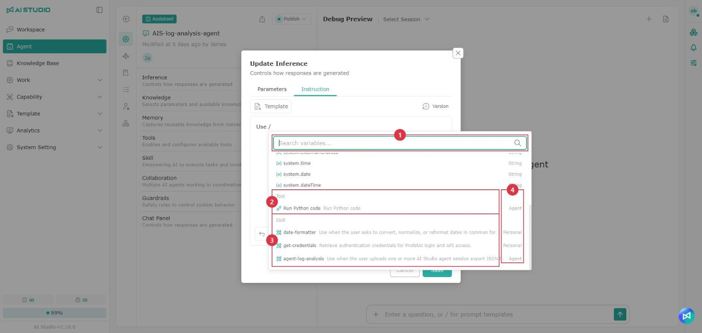
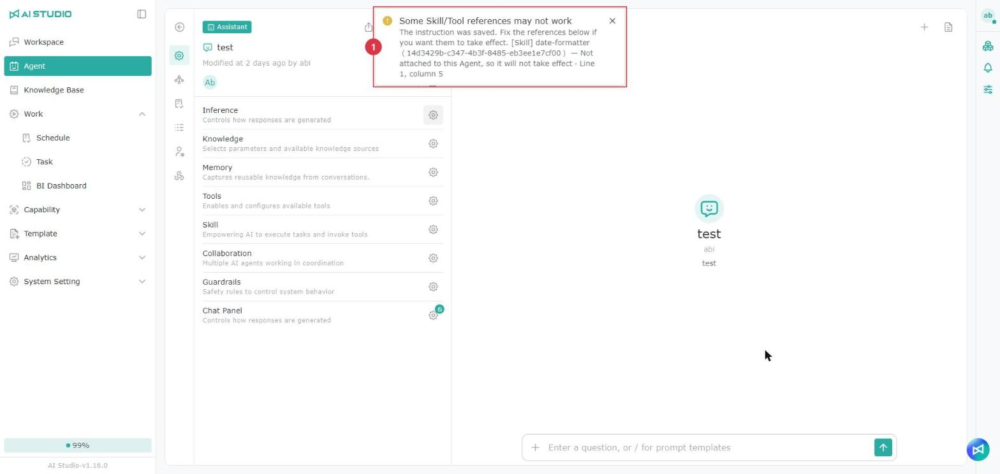
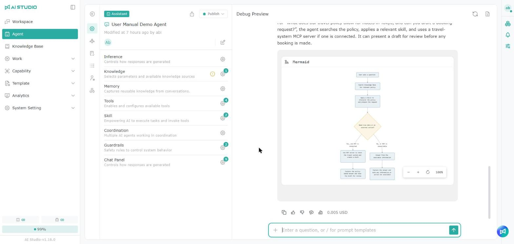

# チャット Agent

## **基本設定**

<figure><figcaption></figcaption></figure>

チャット Agent のホームは、主に次の部分で構成されています。

1. **Agent の機能メニュー**：以下のリンクがあり、それぞれ対応する設定ページが開きます。
2. **基本情報**：Agent 名、作成・編集の日時と担当者、有効状態を確認できます。
3. **アプリケーション設定：** Agent の種類に応じて、Agent の動作に関する設定を行います。
4. **デバッグプレビュー：** 回答が期待どおりかをテストできます。

### 設定数の表示

<figure><figcaption></figcaption></figure>

アプリケーション設定では、「ナレッジ」「ツール」「スキル」「メモリー」などの設定行の歯車アイコンの右上に、設定済みの数が表示されます。設定ウィンドウを開かなくても確認できます。

* **メモリー**：「メモリーの引用」をオンにすると 1 が表示され、オフの場合は数字は表示されません。「メモリーの自動最適化」と抽出の指示事項は数に含まれません。メモリーの自動最適化をオンにしていても、メモリーの引用がオフであれば数字は表示されません。
* 数字は保存済みの設定に基づいて表示されます。設定ウィンドウで切り替えた後に「キャンセル」をクリックしても数字は変わりません。「保存」をクリックするとすぐに更新されます。

## **推論パラメーター**

設定には **パラメーター** と **指示事項** の 2 つのタブがあります。

### **パラメーター**

**パラメーター** タブの項目を調整して、Agent の回答の動作を制御します。

<figure><figcaption></figcaption></figure>

<figure><figcaption></figcaption></figure>

推論パラメーターでは、Agent が使用するモデルと、モデルが回答を生成する際の生成方法、回答の長さ、コンテキストの範囲を設定します。

**推論設定を更新** をオンにすると、**パラメーター** タブで関連する設定を調整できます。選択したモデルが思考パラメーターに対応しているかどうかによって、表示される欄が自動的に切り替わります。

#### モデルの選択

**モデル** 欄で Agent が使用するモデルを選択します。モデル名の横のラベルには、「会話」「音声」「リアルタイム」など、そのモデルが対応している機能が表示されます。

モデルを選択すると、下に次の情報が表示されます。

| 情報      | 説明                      |
| ------- | ----------------------- |
| 入力      | 入力 Token 100 万個あたりの参考料金 |
| 出力      | 出力 Token 100 万個あたりの参考料金 |
| 最大トークン数 | そのモデルが対応する Token の上限    |

利用できるモデル、機能ラベル、料金情報は、システム管理者の設定によって異なります。各モデルに適した利用シーンについては、[モデル - 機能別のモデルの推奨](../xi-tong-she-ding-zhi-nan/mo-xing.md) を参照してください。

#### 欄の表示方法

モデルが思考パラメーターに対応しているかどうかによって、次の欄が表示されます。

| モデルの種類      | 表示される欄                                |
| ----------- | ------------------------------------- |
| 思考パラメーター非対応 | 温度、Top P、最大トークン数、コンテキストウィンドウ、ウィンドウサイズ |
| 思考パラメーター対応  | 思考レベル、最大トークン数、コンテキストウィンドウ、ウィンドウサイズ    |

モデルを切り替えると設定できる欄が自動的に更新されるため、設定モードを手動で切り替える必要はありません。

#### 一般的なモデルのパラメーター

モデルが思考パラメーターに対応していない場合、次の生成パラメーターを設定できます。

#### 温度

回答の安定性と多様性を制御します。

* 設定範囲：`0–1`
* `0` に近いほど：回答が安定して一貫し、一貫性や正確さが求められるタスクに適しています。
* `1` に近いほど：回答が多様になり、アイデア出しや自由度の高い内容に適しています。

スライダーをドラッグするか、右側に数値を直接入力します。

#### Top P

モデルが回答を生成する際に選択できる内容の範囲を制御します。

* 設定範囲：`0–1`
* 値が低い：回答が集中し、保守的になります。
* 値が高い：言葉遣いや内容のバリエーションが増えます。

特にモデルを調整する必要がなければ、システムの既定値のままにすることをおすすめします。

#### 思考パラメーターに対応したモデル

モデルが思考パラメーターに対応している場合、**思考レベル** が表示され、**温度** と **Top P** は非表示になります。

#### 思考レベル（Reasoning Effort）

モデルが問題を処理する際の思考の深さを設定します。思考レベルが高いほど複雑な分析や複数ステップのタスクに適していますが、通常は回答に時間がかかり、Token の消費も増えます。

<table data-header-hidden data-search="false"><thead><tr><th></th><th></th></tr></thead><tbody><tr><td>設定値</td><td>適した場面</td></tr><tr><td>なし</td><td>思考レベルを特に指定しません。簡単でストレートな Q&#x26;A に適しています</td></tr><tr><td>低</td><td>簡単な判断、要約、形式の変換などのタスク</td></tr><tr><td>中</td><td>一般的な分析、内容の整理、日常的なタスクの大半</td></tr><tr><td>高</td><td>複雑な指示、詳細な分析、複数ステップのタスク</td></tr><tr><td>非常に高い</td><td>より綿密な推論と深い判断が必要なタスク</td></tr><tr><td>最高</td><td>モデルが提供する最も高い思考レベルを使用します。非常に複雑なタスクに適しています</td></tr></tbody></table>

実際に選択できる思考レベルは、モデルとシステムの設定によって異なります。システム管理者がモデルに対してあるレベルを有効にしていない場合、その選択肢はメニューに表示されません。

#### 共通のパラメーター

以下の欄はどちらの種類のモデルでも表示されます。

#### 最大トークン数

モデルが 1 回の回答で生成できる最大 Token 数を設定します。

* スライダーをドラッグするか、数値を直接入力します。
* 設定できる上限は、選択したモデルによって異なります。
* モデルが対応する上限は **モデル** 欄の下に表示されます。
* 値が大きいほど長い回答を生成できますが、処理時間と Token の消費が増える場合があります。

この設定は使用できる上限を示すもので、毎回の回答で上限まで使うわけではありません。

#### コンテキストウィンドウ

モデルが回答を生成する際に、最近の会話履歴を参照するかどうかを制御します。

| 設定値 | 説明                  |
| --- | ------------------- |
| オン  | 指定した範囲内の最近の会話を参照します |
| オフ  | この設定では会話履歴を読み込みません  |

オンにすると、**ウィンドウサイズ** 欄が表示されます。

#### ウィンドウサイズ

モデルが参照できる最近の会話の範囲を設定します。

* 設定範囲：`1–50`
* 値が大きいほど、参照できる最近の会話が増えます。
* ウィンドウを大きくすると長い会話でも文脈を保ちやすくなりますが、Token の消費が増える場合があります。
* この欄は **コンテキストウィンドウ** がオンの場合にのみ有効です。

設定が終わったら、**保存** をクリックして変更を適用します。モデルを切り替えた場合は、モデルによって対応する欄や上限値が異なることがあるため、各パラメーターを再度確認することをおすすめします。

> 注意：思考型のモデルを選択した場合、モデルが推論用の Token を追加で生成するため、実際の料金が一般的なモデルより高くなることがあります。思考レベル（Reasoning Effort）が高いほど、通常 Token の消費も増えます。

### 指示事項

**指示事項** タブではプロンプトを定義し、Agent の言語、役割、口調などを制御できます。

<figure><figcaption></figcaption></figure>

#### **テンプレートからプロンプトを追加する**

テンプレートから必要なアプリケーションテンプレートをすばやく追加できます。

<figure><figcaption></figcaption></figure>

<figure><figcaption></figcaption></figure>

1. 空欄から追加します。すでにプロンプトがある場合は、マウスで追加したい位置を選択します。
2. **テンプレート** ボタンをクリックしてテンプレート一覧を開き、追加したいテンプレートの種類を選択します。
3. 対応するテンプレートが生成されます。追加されたテンプレートは選択状態で挿入されるので、必要に応じて編集します。
4. **保存** ボタンをクリックして編集を完了します。

#### **要件を入力してプロンプトを生成する**

プロンプト生成機能は「既存の内容の書き直し」と「白紙からの生成」に対応しています。上部の赤枠は書き直しのベースとして任意で入力し、下部の緑の入力欄に生成の指示を入力すると結果が出力されます。

<figure><figcaption></figcaption></figure>

<figure><figcaption></figcaption></figure>

1. 下部の入力欄を選択し、プロンプトに対する要件を入力します。
2. キーボードの Enter キーを押すか、右側の生成ボタンをクリックし、AI がテンプレートを自動生成するのを待ちます。
3. 自動生成が完了したら、必要に応じて編集します。
4. **保存** ボタンをクリックして編集を完了します。

> 注意：指示事項を生成または書き直す際、システムはこの Agent の現在の設定（追加済みのツール、スキル、協働する Agent など）を参照し、生成される指示事項が Agent の実際の能力と一致するようにします。このとき、画面右下にこれらの設定を参照する旨の通知が表示されます。書き直した指示事項ではスキルとツールの参照が保持されないため、「/」で選択し直してください。詳しくは [指示事項でスキルとツールを参照する](#zai-zhi-ling-zhong-yin-yong-ji-neng-yu-gong-ju) を参照してください。

#### **指示事項でシステム変数を使う**

指示事項にシステム変数を追加すると、Agent は会話中に現在のユーザーや会話の情報を取得できます。たとえば、ユーザーのアカウントや名前に応じて回答を調整できます。指示事項の入力欄で「/」を入力するとメニューが開き、「システム」グループから変数を選択できます。追加した変数はグレーのタグで表示されます。同じメニューからスキルとツールも参照できます。詳しくは下記を参照してください。

| 変数 | 説明 |
| --- | --- |
| `system.sessionId` | 現在の会話の ID |
| `system.userId` | ログイン中のユーザーの AI Studio でのユーザー ID |
| `system.account` | ログイン中のユーザーのアカウント |
| `system.userName` | ログイン中のユーザーの名前 |
| `system.userEmail` | ログイン中のユーザーのメールアドレス |
| `system.loginProvider` | ユーザーのログイン方法（AI Studio アカウント、Google、Azure Entra ID、AD など） |
| `system.externalUserId` | 外部ログインサービスでのユーザー ID |
| `system.externalTenantId` | 外部ログインサービスのテナント ID |
| `system.time` | 現在のシステム時刻 |
| `system.date` | 現在のシステム日付 |
| `system.dateTime` | 現在のシステム日時 |

> 変数の値はユーザーのログイン方法によって異なります。たとえば AI Studio アカウントでログインした場合、外部ログインサービスに関する変数は空になることがあります。

#### **指示事項でスキルとツールを参照する** 

指示事項の中でスキルやツールに触れる場合は、「/」で直接選択できます。選択すると、単なるテキストではなく、参照先の実際の項目が記録されます。項目の名前が変わっても参照は有効なままで、保存時には参照が使えるかどうかもチェックされます。

<figure><figcaption></figcaption></figure>

1. 指示事項の入力欄で「/」を入力します。
2. メニューの「ツール」または「スキル」グループから参照したい項目を探します。検索欄に名前を入力して探すこともできます。
3. 項目をクリックすると、指示事項にその項目の参照タグが挿入されます。
4. 「保存」をクリックします。

<table data-search="false"><thead><tr><th width="90">項目</th><th width="157">名前</th><th>説明</th></tr></thead><tbody><tr><td>1</td><td>検索</td><td>変数、ツール、スキルを名前で検索します</td></tr><tr><td>2</td><td>ツール</td><td>参照できるツールです</td></tr><tr><td>3</td><td>スキル</td><td>参照できるスキルです</td></tr><tr><td>4</td><td>ソースタグ</td><td>「Agent」はこの Agent に追加済みの項目で、実行時に使用できます。「個人」は利用権限はあるものの、まだこの Agent に追加されていない項目です</td></tr></tbody></table>

> 注意：参照しても、その項目が Agent に自動的に追加されるわけではありません。「個人」と表示された項目を参照する場合は、先に「ツール」または「スキル」でこの Agent に追加してください。追加しないと実行時に有効になりません。

**保存時の参照チェック**

<figure><figcaption></figcaption></figure>

指示事項を保存すると、システムが各参照をチェックします。使用できない可能性がある参照がある場合は、画面上部に「一部の Skill／Tool の参照が使用できない可能性があります」という通知が表示され（上図の 1）、各参照の種類と名前、理由、記載されている行と列が一覧表示されます。通知は数秒後に自動的に閉じます。指示事項自体は保存されるため、下表に従って修正し、もう一度保存すると参照が有効になります。

| 理由                                 | 対処方法                                                   |
| ---------------------------------- | ------------------------------------------------------ |
| 見つからない（削除済み、または id の誤り）             | 項目が削除されています。この参照を削除するか、別の項目を選択してください                   |
| 無効化されている                           | 項目が無効化されています。項目の管理者に再度有効にしてもらうか、別の項目を選択してください          |
| 読み取り権限がない                          | この項目の利用権限がありません。項目の管理者に権限を付与してもらってください                 |
| この Agent に追加されていないため、実行時に有効にならない   | 「ツール」または「スキル」でこの項目を Agent に追加してください                     |

#### **以前の指示事項に戻す**

<figure><figcaption></figcaption></figure>

<figure><figcaption></figcaption></figure>

<figure><figcaption></figcaption></figure>

1. 指示事項の **バージョン** をクリックします。
2. 戻したい指示事項を選択します。
3. **復元** をクリックします。
4. **保存** をクリックして設定を完了します。

> **バージョンの保持**\
> 指示事項のバージョン履歴に保存数の上限は現在ありません。

## ナレッジベース

### ナレッジベースのソース

<figure><figcaption></figcaption></figure>

### ナレッジベースのパラメーター 

詳しくは [ナレッジベースのパラメーター](liao-tian-agent.md#zhi-shi-ku-can-shu) を参照してください。

<figure><figcaption></figcaption></figure>

## **ツール**

設定で、Agent がアクセスできるツールを有効化／無効化できます。

<figure><figcaption></figcaption></figure>

> 注意：ツールの作成者が既定のパラメーターを設定している場合、ツールを追加すると既定値が自動的に入力されます。ここで変更した値は既定値より優先されます。最新の既定値を適用するには **Reset** をクリックします。詳しくは MCP - ツールの既定パラメーターを参照してください。

#### **Session Memory**

<table data-search="false"><thead><tr><th width="250">ツール</th><th>説明</th></tr></thead><tbody><tr><td>KV セッション短期メモリー</td><td>セッション中に、キーに基づいて一時データを正確に保存・取得します。<code>ユーザー名</code>、<code>選択したプラン</code> などの動的な変数の追跡に便利です。</td></tr><tr><td>graphiti - メモリーデータの追加</td><td>エピソード情報（やり取りやイベントなど）をナレッジグラフに保存します。</td></tr><tr><td>graphiti - メモリーノードの検索</td><td>エンティティの要約やノード単位のメモリー表現を取得します。</td></tr><tr><td>graphiti - メモリーファクトの検索</td><td>メモリーグラフから関連する事実と構造化された関係を検索します。</td></tr><tr><td>graphiti - エンティティ関係の削除</td><td>グラフからエンティティ間に定義された関係を削除します。</td></tr><tr><td>graphiti - エピソードの削除</td><td>メモリーグラフ内の特定のエピソードを削除します。</td></tr><tr><td>graphiti - エンティティ関係の取得</td><td>特定のエンティティに関連する構造化された関係を取得します。</td></tr><tr><td>graphiti - エピソードの取得</td><td>最近のメモリーエピソードを返し、会話や判断の背景を提供します。</td></tr><tr><td>graphiti - メモリーグラフのクリア</td><td>グラフベースのメモリーシステム全体をリセットします。</td></tr></tbody></table>

> 補足：Graphiti について詳しくは、公式サイトを参照してください。

#### **Academic Articles**

<table><thead><tr><th width="250">ツール</th><th>使い方</th></tr></thead><tbody><tr><td>arXiv 論文検索</td><td>arXiv データベースから学術論文を検索できます。</td></tr><tr><td>Google Scholar 検索</td><td>Google Scholar を使って学術記事と引用を検索します。</td></tr></tbody></table>

#### **Web Search**

<table data-search="false"><thead><tr><th width="250">ツール</th><th>使い方</th></tr></thead><tbody><tr><td>Serper - Web コンテンツの抽出</td><td>Web ページの URL から読み取れる内容を抽出します。</td></tr><tr><td>Serper - Google 検索</td><td>Google 検索を実行し、要約した結果を返します。</td></tr><tr><td>Serper - 特許検索</td><td>公開済みの特許と関連文書を検索します。</td></tr><tr><td>Serper - 画像検索</td><td>テキストのクエリに基づいて画像を検索します。</td></tr><tr><td>Serper - 論文検索</td><td>Google Scholar 形式のソースを使って学術論文を検索します。</td></tr><tr><td>Serper - ニュース検索</td><td>テキストのクエリに基づいてニュースを検索します。</td></tr><tr><td>Serper - 地図情報の検索</td><td>テキストのクエリに基づいて地図を検索します。</td></tr></tbody></table>

> 注：Serper について詳しくは、公式サイトを参照してください。

#### **Code**

<table><thead><tr><th width="250">ツール</th><th>使い方</th></tr></thead><tbody><tr><td>Python コードの実行</td><td>Python のスクリプトやロジックを実行し、計算、データ解析、自動化などのタスクを支援します。</td></tr></tbody></table>

#### **Document Handling**

<table><thead><tr><th width="250">ツール</th><th>使い方</th></tr></thead><tbody><tr><td>ドキュメントのプレビュー</td><td>アップロードしたドキュメントをプラットフォーム内で読みやすい形式で表示します。</td></tr><tr><td>ドキュメントを Markdown に変換</td><td>ドキュメントを Markdown 形式に変換します。</td></tr></tbody></table>

#### **Other**

<table><thead><tr><th width="250">ツール</th><th>使い方</th></tr></thead><tbody><tr><td>現在時刻の取得</td><td>リクエスト時点のシステムの現在時刻を返します。</td></tr><tr><td>簡単な数式の計算</td><td>プロンプト内で簡単な算術計算を行います。</td></tr><tr><td>Sequential Thinking</td><td>複雑な問題を段階的な思考に分解し、必要に応じて修正や分岐も行えます。計画、トラブルシューティング、構造化された推論に適しています。</td></tr></tbody></table>

## スキル

<figure><figcaption></figcaption></figure>

スキルを設定すると、データへのアクセス、ツールの操作、プロセスの実行、特定タスクの拡張など、Agent が対応できる機能とタスクのシナリオが広がります。必要に応じてスキルを設定し、Agent の柔軟性とタスク処理能力を高めてください。

## Coordination 

この機能を使うと、複数の Agent の間に協働関係を作り、役割ごとにタスクを分担できます。プロセスの柔軟性と全体的なタスク処理の効率が向上します。

<figure><figcaption></figcaption></figure>

<figure><figcaption></figcaption></figure>

AI Studio 内のほかの Agent に加えて、**Capability → A2A** に登録された外部 Agent も追加でき、Agent がほかのプラットフォームの Agent に質問を委任できるようになります。追加できるのは利用権限がある外部 Agent のみで、Agent はここで追加した外部 Agent にだけ委任します。登録と権限の設定方法は [A2A](../neng-li-zhi-nan/a2a.md) を参照してください。

### 追加済みの項目の管理

ナレッジベース、ツール、スキル、Coordination、プロンプトテンプレートのメニューでは、次の操作を共通で利用できます。

* **検索**：ツールとスキルは、名前またはグループ名で検索できます。検索結果には項目が属するグループが表示されるため、同名の項目を区別しやすくなります。検索結果には、利用権限のある項目のみが表示されます。
* **複数選択して削除**：追加済みの項目を複数選択し、まとめて Agent から削除できます。
* **お気に入り**：よく使うスキル、ナレッジベース、ツール、プロンプトテンプレートをお気に入りに追加し、**お気に入り** で絞り込んで追加したい項目をすばやく見つけられます。
* **項目の情報**：メニューに各項目の作成者、名前、説明が表示されるため、同名の項目を区別しやすくなります。
* **利用できない項目**：追加済みの項目が無効化された場合や、その項目の利用権限がない場合、その行全体が無効として表示されます。行にマウスカーソルを合わせると理由を確認できます。Agent の設定ページの該当するブロックにも注意アイコンが表示されます。

> 注意：Agent 管理者と Agent 編集者は、ナレッジベース、ツール、スキル、SubAgent、プロンプトテンプレートの利用権限を持っていなくても、その項目を Agent から削除できます。

## ガードレール

ガードレールは内容をチェックして制限し、個人データの漏えい、情報セキュリティ、コンテンツのコンプライアンスに関するリスクを低減します。適用される位置によって、「入力ガードレール」（内容がモデルに送られる前にチェック・ブロックする）と「出力ガードレール」（回答が送信される前にチェック・マスクする）に分かれます。

<figure><figcaption></figcaption></figure>

<figure><figcaption></figcaption></figure>

#### 動作モード（ブロック／マスク）

| モード         | 動作                                                               |
| ----------- | ---------------------------------------------------------------- |
| ブロック（Block） | ルールに一致すると、内容全体をブロックして出力しません。完全に禁止すべき場合に適しています。                   |
| マスク（Mask）   | 一致した部分だけを伏せ字にしたり置き換えたりします（例：個人データを記号に置き換える）。それ以外の内容は通常どおり出力されます。 |

#### 設定できるルールの種類：

<table data-search="false"><thead><tr><th>ルール</th><th>説明</th></tr></thead><tbody><tr><td>Keyword（キーワード）</td><td>指定したキーワードと照合し、一致するとトリガーされます。</td></tr><tr><td>Jailbreak（ジェイルブレイク）</td><td>既存のルールを無視させる指示など、システムの安全上の制限を回避しようとする質問を検出します。</td></tr><tr><td>NSFW（不適切なコンテンツ）</td><td>性的、暴力的、差別的など、不適切な内容を検出します。</td></tr><tr><td>PII（個人識別情報）</td><td>氏名、電話番号、アカウント、身分証番号などの個人を識別できる情報を検出します。</td></tr><tr><td>Topical Alignment（トピックの整合性）</td><td>内容が指定したトピックの範囲内にあることを求め、トピックから外れるとトリガーされます。</td></tr><tr><td>URLs（URL）</td><td>内容に含まれる URL リンクを検出または制限します。</td></tr><tr><td>Prompt Custom（カスタムプロンプトルール）</td><td>検出したい内容の種類を文章で説明し、その説明に基づいてシステムが判定します。</td></tr><tr><td>Regex Custom（カスタムパターン照合）</td><td>独自の形式のルールに基づいて、特定のパターンの内容（特定の番号形式など）を識別します。</td></tr></tbody></table>

#### チェックの範囲

ブロックタブのガードレールは **入力**（ユーザーが送信した内容）に、マスクタブのガードレールは **出力**（モデルの回答内容）に適用されます。個人データとコンテンツの審査は通常、両方でチェックします。入力側では個人データが記録されないように、出力側では回答に含まれないようにするためです。

> 注意：一方のガードレールがもう一方の設定を引き継ぐように設定されている場合、引き継がれている側のガードレールはオフにできません。有効化スイッチは操作できなくなり、スイッチにマウスカーソルを合わせると説明が表示されます。オフにしたい場合は、先にもう一方の引き継ぎ設定を解除してください。

## **会話パネル**

会話パネルには、プロンプトテンプレート、Agent のウェルカムページ、操作メニュー、チャット表示の設定があります。

### **プロンプトテンプレート**

既存の、またはお気に入りに追加したアプリケーションテンプレート（プロンプトテンプレート）を Agent に紐づけると、必須項目を入力するだけで Q\&A をすばやく行えます。

<figure><figcaption></figcaption></figure>

### **Agent のウェルカムページ**

#### **クイック質問**

あらかじめ会話の内容を設定しておくと、会話を始める前に Agent がクリックできる質問の候補を表示し、ユーザーがすばやくやり取りを始められるようにします。

<figure><figcaption></figcaption></figure>

#### **グリーティング**

Agent の最初のあいさつメッセージを設定します。ユーザーがこの Agent を選んで会話を始めると、Agent がまずこのメッセージを自動的に送信して会話を始めます。

<figure><figcaption></figcaption></figure>

### **操作メニュー**

<figure><figcaption></figcaption></figure>

#### **ファイル処理**

オンにすると、ユーザーは会話の入力欄でファイルをアップロードできます。ファイルがアップロードされると、**Agent がファイルの種類とユーザーの質問に応じて処理方法を自動的に判断します**。たとえば、ファイルの内容を直接読み取ったり、適切なツールを呼び出したりします。

#### **Canvas**

有効にすると、会話の入力メニューに Canvas の選択肢が表示されます。

Agent の作成時、Canvas のスイッチは既定でオンになっています。

### **チャット表示**

<figure><figcaption></figcaption></figure>

#### **ヒューマンアクション**

<figure><figcaption></figcaption></figure>

オンにすると、Agent がユーザーに判断への参加、操作の確認、追加情報の提供を求める際に、回答の下に Action Card が表示されます。ユーザーは必要に応じて操作を完了するか、カードをスキップして会話を続けられます。

#### **実行プロセス** 

<figure><figcaption></figcaption></figure>

オンにすると、Agent が回答するたびに、ツールの実行、重要なステップ、実行状態などの実行プロセスが表示され、Agent がどのようにタスクを完了したかを把握できます。実行プロセスは回答内容と同期して更新され、「実行プロセス」で現在の進捗が示されます。

#### **ナレッジベースのソース**

<figure><figcaption></figcaption></figure>

オンにすると、Agent の回答に引用したナレッジベースのソースが表示され、関連ファイルも **参照ファイル** に一覧表示されます。

オフにすると、回答にナレッジベースの引用は表示されず、**参照ファイル** にもナレッジベースのファイルは表示されません。この場合、どのナレッジベースが引用されたかは、Agent 管理者と Agent 編集者だけが会話ログで確認できます。

#### **ビジュアル回答** 

<figure><figcaption></figcaption></figure>

オンにすると、Agent の回答が内容に応じてカード、表、グラフ、フローチャートで表示され、テーマの配色が適用されるため、情報がより見やすくなります。

* オンにすると出力コストがわずかに上がります。
* 外部システムが Agent API 経由で回答を取得する場合は、Agent API の設定でも「ビジュアル回答」をオンにする必要があり、呼び出し側で HTML をレンダリングできる必要があります。詳しくは [インテグレーション - Agent API](zheng-he.md#agent-api) を参照してください。

## **デバッグプレビュー**

<figure><figcaption></figcaption></figure>

このエリアで Agent の回答をテストし、その結果に応じて設定を調整します。デバッグプレビューの Canvas、インターネット検索、マインドマップ、ナレッジベースの引用などの右側パネルは、ワークスペースと同じように操作できます。

### テスト会話の切り替えと削除

<figure><figcaption></figcaption></figure>

デバッグプレビューでは、テスト会話がすべて保持されます。Agent のほかの設定ページに切り替えてから戻っても会話は残っているため、そのままテストを続けられます。以前のテスト会話に切り替えて、続けて質問することもできます。

<table data-search="false"><thead><tr><th width="90">項目</th><th width="157">操作名</th><th>説明</th></tr></thead><tbody><tr><td>1</td><td>テスト会話</td><td>タイトル横のドロップダウンメニューをクリックすると、この Agent のほかのテスト会話に切り替えられます。会話名は最初の質問から自動的に生成され、メニューには自分のテスト会話のみが表示されます</td></tr><tr><td>2</td><td>削除</td><td>メニュー内の会話にマウスカーソルを合わせ、ゴミ箱アイコンをクリックすると削除できます</td></tr><tr><td>3</td><td>新しい会話</td><td>新しいテスト会話を始めます</td></tr><tr><td>4</td><td>会話ファイル</td><td>このテスト会話でアップロードまたは生成されたファイルを確認します</td></tr></tbody></table>

> 注意：デバッグプレビューでテスト会話を削除しても、メニューから消えるだけです。会話ログにはその会話の内容がすべて保存され、ソースは「デバッグプレビュー」と表示されます。詳しくは [会話ログ](dui-hua-ri-zhi.md) を参照してください。

テスト中にエラーメッセージが表示された場合は、エラーメッセージにマウスカーソルを合わせ、電球ボタンをクリックして Copilot に質問できます。詳しくは [エラー発生時に Copilot に質問する](../ping-tai-zhi-nan/ai-studio-copilot.md#yu-dao-cuo-wu-shi-xun-wen-copilot) を参照してください。

### **デバッグプレビュー**でのファイルのアップロード方法

* 入力欄のプラス（+）をクリックしてファイルをアップロードできます。

<figure><figcaption></figcaption></figure>

* ドラッグ＆ドロップでのアップロードにも対応しています。

<figure><figcaption></figcaption></figure>

> 注意：デバッグプレビューでアップロードまたは生成されたファイルは 30 分間のみ保持されます。
