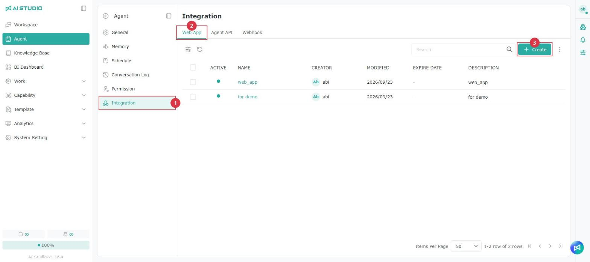
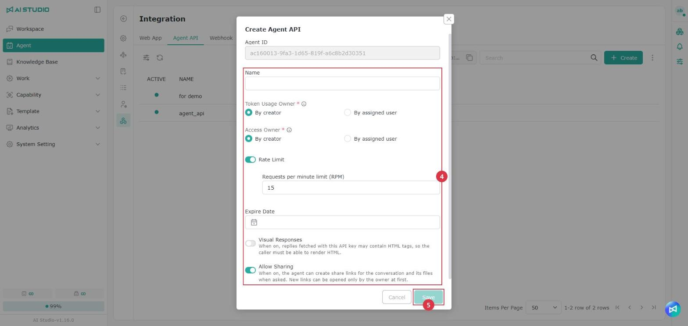
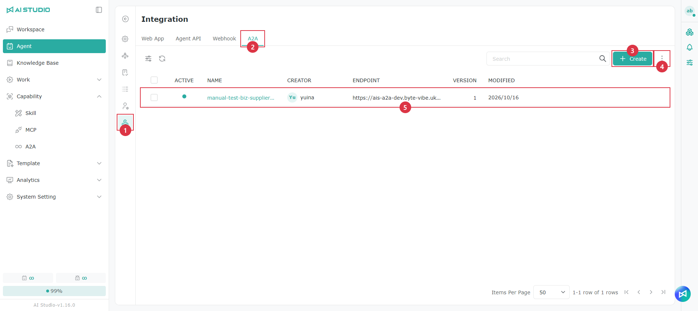
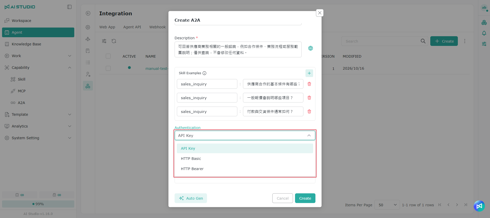
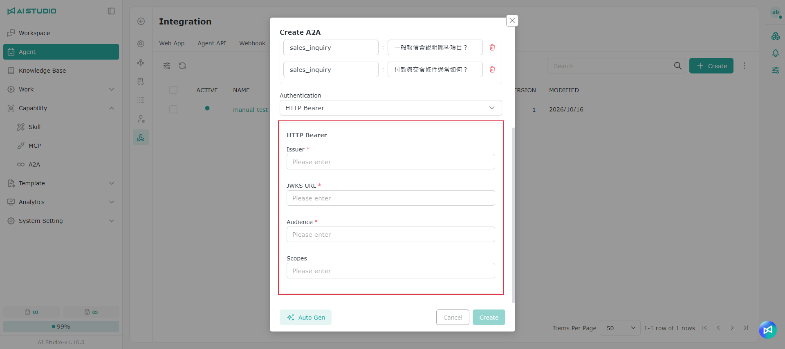

# インテグレーション

## **Web App**

Agent は Web ページに埋め込んで Q&A サービスとして提供できます。以下はその例です。

<figure><figcaption></figcaption></figure>

Agent を Web サイトに埋め込むには、この機能でフロントエンド用の埋め込みコードを生成します。

### Web App の作成

<figure><figcaption></figcaption></figure>

<figure><figcaption></figcaption></figure>

1. Agent の機能メニューで **インテグレーション** をクリックします。
2. **Web App** タブを選択します。
3. 右上の **作成** をクリックします。
4. 次の設定を行います。

| 設定                 | 説明 |
| ------------------ | -- |
| **名前**             | 一覧で用途を識別しやすいよう、Web App の名前を入力します。欄の右側のボタンをクリックすると、多言語の名前を設定できます。[多言語設定](guan-li-agent.md#duo-guo-yu-yan-she-ding) を参照してください。 |
| **説明**             | Web App の用途を入力します。欄の右側のボタンをクリックすると、多言語の説明を設定できます。[多言語設定](guan-li-agent.md#duo-guo-yu-yan-she-ding) を参照してください。 |
| **Token 使用量の帰属先** | 「作成者」に固定されており、変更できません。この Web App を通じて発生した Token 使用量は、すべて作成者に計上されます。 |
| **権限の帰属先**         | 「作成者」に固定されており、変更できません。Web App の実行時には作成者のユーザー権限が適用されます。 |
| **共有を許可**         | オンにすると、Agent はユーザーの要求に応じて、会話とその中のファイルの共有リンクを作成できます。作成された時点では、リンクを開けるのは所有者のみです。 |

5. **保存** をクリックして作成を完了します。

> Web App は現在「指定ユーザー」に対応していません。Token 使用量と権限は、どちらも Web App を作成した開発者に帰属します。詳しくは [Token 使用量の帰属](zheng-he.md#token-ji-liang-gui-shu) を参照してください。

### Web App の管理

<figure><figcaption></figcaption></figure>

<figure><figcaption></figcaption></figure>

作成した Web App は一覧に表示され、有効状態、名前、作成者、最終更新日時、有効期限、説明を確認できます。

* 緑色のステータスは、Web App が有効であることを示します。
* Web App の行にマウスを合わせると、**呼び出し履歴**、**編集**、**有効期限の設定**、**削除** を使用できます。
* Web App 名をクリックすると、詳細ページが開きます。
  * **Embed：** 埋め込みコードを確認してコピーします。
  * **Settings：** 言語、1 分あたりのリクエスト上限（RPM）、1 分あたりの Token 上限（TPM）、有効期限を設定します。

> 各 Agent には複数の Web App を作成でき、それぞれに独立した API Key と埋め込みコードがあります。Web サイトごとに有効期限と使用制限を個別に管理できます。

## Agent API <a href="#agent-api" id="agent-api"></a>

Agent API は本人確認に使うアクセスキーです。システムは Agent API の呼び出し時にリクエストの送信元を識別し、対応する権限と使用クォータを適用します。Agent API は外部に漏れないよう大切に保管してください。キーが漏えいした疑いがある場合は、すぐに差し替えて、そのキーを使っているすべての連携設定を更新することをおすすめします。

### Agent API の作成

<figure><figcaption></figcaption></figure>

<figure><figcaption></figcaption></figure>

1. Agent の機能メニューで **インテグレーション** をクリックします。
2. **Agent API** タブを選択します。
3. 右上の **作成** をクリックします。
4. 次の設定を行います。

| 設定                 | 説明 |
| ------------------ | -- |
| **Agent ID**       | 現在の Agent の ID が自動で入力されます。変更はできません。 |
| **名前**             | 一覧で用途を識別しやすいよう、Agent API の名前を入力します。 |
| **Token 使用量の帰属先** | この Agent API を通じた呼び出しで発生した Token 使用量の帰属先を指定します。 |
| **権限の帰属先**         | この Agent API を通じて Agent を呼び出すときに適用するユーザー権限を指定します。 |
| **Rate Limit**     | オンにすると、「1 分あたりのリクエスト上限（RPM）」で 1 分間に許可するリクエスト数を設定できます。 |
| **有効期限**           | 必要に応じて、Agent API の有効期限を設定します。 |
| **ビジュアル回答**       | 既定ではオフで、必要に応じてオンにできます。オンにすると、この Agent API で取得した回答に HTML タグが含まれることがあるため、呼び出し側で HTML をレンダリングできる必要があります。詳しくは [チャット Agent - ビジュアル回答](liao-tian-agent.md#shi-jue-hua-hui-fu) を参照してください。 |
| **共有を許可**         | オンにすると、Agent はユーザーの要求に応じて、会話とその中のファイルの共有リンクを作成できます。作成された時点では、リンクを開けるのは所有者のみです。 |

Token 使用量の帰属先と権限の帰属先には、どちらも次の選択肢があります。

* **作成者：** Agent API の作成者を帰属先にします。
* **指定ユーザー：** 呼び出し時に指定したユーザーを帰属先にします。

Token 使用量の帰属先と権限の帰属先は別々の設定です。帰属先の選び方によっては、Token 使用量とデータのアクセス権限が別のユーザーに適用されることがあります。

5. **保存** をクリックして作成を完了します。

### Agent ID と API Key の保存

<figure><figcaption></figcaption></figure>

Agent API を作成すると、システムはすぐに次の情報を表示します。

* **Agent ID**
* **API Key**

この画面で情報をコピーするか、**Download JSON** をクリックしてダウンロードし、大切に保管してください。

> API Key の全体が表示されるのは作成完了時の 1 回だけです。画面を閉じると、キーの全体を再び確認することはできません。コピーまたはダウンロードが完了したことを確認してから **確認** をクリックしてください。

API Key を使うと対応する Agent を呼び出せるため、機密情報として大切に保管し、公開されたコード、ドキュメント、フロントエンドのページには含めないでください。

### Agent API の管理

作成した Agent API は一覧に表示され、有効状態、名前、API Key（一部の文字のみ表示）を確認できます。

* 緑色のステータスは、Agent API が有効であることを示します。

### Endpoint のコピー

Endpoint は Agent API のサービスの入口となる URL です。システムはこの場所に API リクエストを送り、対応する機能を実行します。リクエストを誤った環境に送ったり接続に失敗したりしないよう、用途に応じて正しい Endpoint（テスト環境や本番環境など）を選んでください。

Endpoint のコピーボタンは検索ボックスの横にあります。コピーボタンをクリックすると URL をコピーできます。URL をコピーする際は、現在の環境に注意してください。

<figure><figcaption></figcaption></figure>

### 注意事項

* API Key の全体が表示されるのは 1 回だけです。作成後すぐにコピーまたはダウンロードしてください。
* API Key を公開された環境で明かさないでください。
* リクエスト、エラーログ、スクリーンショットを共有する前に、API Key を伏せてください。
* Rate Limit がオフの場合でも、システムレベルのリクエスト制限を受けることがあります。

## Webhook

Webhook を使うと、注文ステータス、システム通知、そのほかのサービスのイベントなどを、外部システムから Agent に能動的に送信でき、Agent がそれを処理して応答します。

Webhook は作成した Agent に自動的に紐づくため、外部システムで Agent を別途指定する必要はありません。システムが生成した Webhook エンドポイントにイベントを送信するだけで利用できます。

### Webhook の作成

<figure><figcaption></figcaption></figure>

<figure><figcaption></figcaption></figure>

1. **インテグレーション > Webhook** を選択します。
2. 右上の **作成** をクリックします。
3. 次の設定を行います。

| 設定                 | 説明                                  |
| ------------------ | ----------------------------------- |
| **名前**             | 一覧で用途を識別しやすいよう、Webhook の名前を入力します。    |
| **Token 使用量の帰属先** | この Webhook の実行で発生した Token 使用量の帰属先を指定します。 |
| **権限の帰属先**         | Webhook の実行時に適用するユーザー権限を指定します。       |

Token 使用量の帰属先と権限の帰属先には、どちらも次の選択肢があります。

* **作成者：** Webhook の作成者を帰属先にします。
* **指定ユーザー：** 呼び出し時に指定したユーザーを帰属先にします。

Token 使用量の帰属先と権限の帰属先は別々の設定です。帰属先の選び方によっては、Token 使用量とデータのアクセス権限が別のユーザーに適用されることがあります。

4. **作成** をクリックして完了します。

> 作成時にキーを入力する必要はありません。Webhook キーはシステムが生成し、作成完了後に表示されます。

### Webhook エンドポイントとキーの保存 <a href="#chu-cun-webhook-url-yu-keyendpoint" id="chu-cun-webhook-url-yu-keyendpoint"></a>

<figure><figcaption></figcaption></figure>

Webhook を作成すると、システムはすぐに次の情報を表示します。

* **Webhook エンドポイント**
* **Webhook キー**

この画面で情報をコピーするか、**Download JSON** をクリックしてダウンロードし、大切に保管してください。

> Webhook キーの全体が表示されるのは作成完了時の 1 回だけです。画面を閉じると、キーの全体を再び確認することはできません。コピーまたはダウンロードが完了したことを確認してから **確認** をクリックしてください。

Webhook キーを使うと対応する Agent を呼び出せるため、機密情報として大切に保管し、公開されたコード、ドキュメント、フロントエンドのページには含めないでください。

### Webhook の管理

作成した Webhook は一覧に表示され、有効状態、名前、作成者、最終更新日時を確認できます。

* 緑色のステータスは Webhook が有効であることを示します。
* Webhook の行にマウスを合わせると「呼び出し履歴」を開き、外部システムからの呼び出し状況を確認できます。
* Webhook 名をクリックすると詳細が開き、**リクエスト** と **レスポンス** の仕様を確認できます。

### Agent にイベントを送信する

Webhook の詳細を開いて **リクエスト** を選択すると、外部システムがイベントを送信する際に必要な情報を確認できます。

### リクエストの設定

* **メソッド：** `POST`
* **Endpoint：** Webhook の詳細に表示される Webhook エンドポイントの完全な URL
* **ヘッダー：** `Bearer <Webhook Key>`
* **Content-Type：** `application/json`

リクエストヘッダーの例：

```http
Authorization: Bearer <Webhook Key>
Content-Type: application/json
```

リクエスト本文の例（詳細ページの例では、各フィールドにコメントで説明が付いています）：

```json
{
  // Unique identifier for the external event. Use a different UUID for each webhook event.
  "event_id": "evt_550e8400-e29b-41d4-a716-446655440000",

  // ID of the Agent session that should receive this event.
  "session_id": "session_12345678-abcd-4321-abcd-1234567890ab",

  // Event type. "incoming" indicates an event sent from an external system to the Agent.
  "type": "incoming",

  // Event content passed to the Agent, such as an order update, notification, or alert.
  "content": "注文 O-123 の支払いが完了しました",

  // Additional information related to the event.
  "metadata": {
    // ID of the user associated with this event.
    "user_id": "user_12345678-abcd-4321-abcd-1234567890ab"
  }
}
```

> コメントは説明用です。実際に送信するリクエスト本文は標準の JSON である必要があるため、先にコメントを削除してください。

### リクエスト本文のフィールド

| フィールド              | 説明                                      |
| ------------------ | --------------------------------------- |
| `event_id`         | 外部イベントの一意の識別子です。イベントごとに異なる値を使用してください。後でイベントの処理結果を照会する際にも使えます。 |
| `session_id`       | このイベントを受け取る Agent の Session の識別子です。             |
| `type`             | メッセージの種類です。Agent に送るイベントは `incoming` を使います。 |
| `content`          | Agent に送る主なイベントの内容です（注文の更新、通知、アラートなど）。                  |
| `metadata`         | イベントに関連する追加情報です。                        |
| `metadata.user_id` | このイベントに関連するユーザーの識別子です。                  |

### Webhook の処理結果の確認

Webhook の処理は「イベントの受け付け」と「結果の照会」の 2 段階に分かれています。

#### 1. イベントの受け付け

外部システムが `POST` リクエストを送信し、システムがイベントを受け付けると、`202 Accepted` が返されます。

```json
{
  "event_id": "external-event-uuid",
  "invocation_id": "whi_01HYX...",
  "session_id": "session-uuid",
  "status": "accepted"
}
```

`accepted` はシステムがイベントを受信して受け付けたことを示すもので、Agent の処理が完了したことを意味するものではありません。

#### 2. 処理状況の照会

外部システムは次の Endpoint でイベントの処理状況を照会できます。

```http
GET /v1/agent-webhooks/{webhookId}/events/{eventId}
```

処理中のレスポンスの例：

```json
{
  "event_id": "external-event-uuid",
  "invocation_id": "whi_01HYX...",
  "status": "processing"
}
```

`processing` は Agent がイベントを処理中であることを示します。

処理完了時のレスポンスの例：

```json
{
  "event_id": "external-event-uuid",
  "invocation_id": "whi_01HYX...",
  "status": "completed",
  "message": {
    "id": "msg_01HYX...",
    "session_id": "session-uuid",
    "type": "outgoing",
    "content": "Agent の回答内容",
    "created_at": 1757400000
  }
}
```

`completed` は Agent の処理が完了したことを示し、結果は `message` に含まれます。

### レスポンスのフィールド

<table data-search="false"><thead><tr><th>フィールド</th><th>説明</th></tr></thead><tbody><tr><td><code>event_id</code></td><td>元のリクエストに対応するイベントの識別子です。</td></tr><tr><td><code>invocation_id</code></td><td>今回の Agent の実行に対してシステムが生成した識別子です。</td></tr><tr><td><code>session_id</code></td><td>このイベントが属する Session の識別子です。</td></tr><tr><td><code>status</code></td><td>現在の処理状況です。例：<code>accepted</code>、<code>processing</code>、<code>completed</code>。</td></tr><tr><td><code>message</code></td><td>Agent の処理完了後に生成された回答の情報です。</td></tr><tr><td><code>message.id</code></td><td>Agent の回答メッセージの識別子です。</td></tr><tr><td><code>message.type</code></td><td>回答メッセージの種類です。Agent が送信したメッセージは <code>outgoing</code> です。</td></tr><tr><td><code>message.content</code></td><td>Agent が生成した回答の内容です。</td></tr><tr><td><code>message.created_at</code></td><td>回答メッセージの作成日時です。</td></tr></tbody></table>

### 注意事項

* Webhook キーの全体が表示されるのは 1 回だけです。作成後すぐにコピーまたはダウンロードしてください。
* Webhook エンドポイントと Webhook キーを公開された環境で明かさないでください。
* リクエスト、エラーログ、スクリーンショットを共有する前に、キーと認証情報を伏せてください。
* Rate Limit がオフの場合でも、システムレベルのリクエスト制限を受けることがあります。
* `accepted` を受け取った後は、照会用の Endpoint で後続の処理状況を確認してください。Agent の回答が完了したものとして扱わないでください。

## A2A <a href="#a2a" id="a2a"></a>

Agent を外部システムに公開し、A2A（Agent-to-Agent）プロトコルで質問を受け付けます。公開用のエントリーを作成したら、**エンドポイント** とキーを相手に渡します。相手のシステムは、その Agent を直接呼び出せるようになります。自分の Agent から外部 Agent を呼び出す場合は、[A2A](../neng-li-zhi-nan/a2a.md) を参照してください。

> 注意：外部に公開する Agent は、システムによって読み取り専用の照会操作に制限されます。公開する前に、システム管理者が **システム設定 → 構成** で **A2A の公開 URL** を設定する必要があります。[構成 - A2A の公開 URL と接続を許可するホスト](../xi-tong-she-ding-zhi-nan/pei-zhi.md#a2a-dui-wai-wang-zhi-yu-yun-xu-lian-xian-de-zhu-ji) を参照してください。

### A2A タブを開く

<figure><figcaption></figcaption></figure>

<table data-search="false"><thead><tr><th width="90">項目</th><th width="157">操作名</th><th>説明</th></tr></thead><tbody><tr><td>1</td><td>インテグレーション</td><td>Agent の設定ページの左側にある最後のアイコンです。</td></tr><tr><td>2</td><td>A2A タブ</td><td>Web App、Agent API、Webhook と並んで表示されます。</td></tr><tr><td>3</td><td>作成</td><td>この Agent の外部公開用 A2A エントリーを作成します。同じ Agent に複数のエントリーを作成し、協力会社ごとに異なる認証を割り当てることもできます。</td></tr><tr><td>4</td><td>その他（⋮）</td><td>この Agent のすべての A2A エントリーの呼び出し履歴をまとめて表示します。</td></tr><tr><td>5</td><td>公開済みエントリー</td><td>エンドポイントは相手に渡す URL です。バージョンは現在公開されているリリースを示します。</td></tr></tbody></table>

### A2A の公開用エントリーを作成する

1. **作成** をクリックします。
2. 左下の **自動生成** をクリックして、AI に名前、説明、スキルの質問例の下書きを作らせ、必要に応じて編集します。すべて手入力することもできます。
3. 認証方法を選択します。
4. **作成** をクリックすると、作成と同時に公開されます。API Key を選んだ場合は、キーが一度だけ表示されるウィンドウが開きます。
5. 一覧の **エンドポイント** とキーを相手に渡します。

<figure><figcaption></figcaption></figure>

<table data-search="false"><thead><tr><th width="90">項目</th><th width="157">欄</th><th>説明</th></tr></thead><tbody><tr><td>1</td><td>名前と説明</td><td>相手に表示される名前と紹介文で、Agent Card に記載されます。Agent ができることとできないことを明確に説明してください。相手の Agent はこの説明を基に、呼び出すかどうかを判断します。右側の地球ボタンで多言語を設定できます。</td></tr><tr><td>2</td><td>スキルの質問例</td><td>左がスキルの識別子、右が質問例です。最大 5 件まで追加できます。</td></tr><tr><td>3</td><td>認証方法</td><td>相手が呼び出す際に必要な認証情報です。後述の「認証方法」を参照してください。</td></tr><tr><td>4</td><td>自動生成</td><td>この Agent のツール、ナレッジベース、スキルを基に、AI が項目 1 と 2 を入力します。約 20〜30 秒かかります。生成後も手動で編集できます。</td></tr><tr><td>5</td><td>作成</td><td>作成と同時に公開され、外部に対してすぐに有効になります。</td></tr></tbody></table>

**自動生成** を使うには、システム管理者が **システム設定 → 構成** で **A2A Agent Card の提案** を有効にしておく必要があります。無効な場合は、ウィンドウ上部に、管理者にシステム設定で有効化してもらうよう求めるメッセージが表示されます。有効化後、もう一度 自動生成 をクリックしてください。

### 認証方法

<figure><figcaption></figcaption></figure>

| 認証方法 | 呼び出し元が送信する内容 | 認証情報を決める側 |
| --- | --- | --- |
| API Key | <code>x-api-key: &lt;キー&gt;</code> ヘッダー | AI Studio が自動生成します。作成時に一度だけ表示されるため、すぐにコピーしてください。 |
| HTTP Basic | <code>Authorization: Basic …</code> | フォームでユーザー名とパスワードを指定します。 |
| HTTP Bearer | 相手の認証サービスが発行する JWT | 相手の認証サービスです。AI Studio が検証できるように、Issuer などを入力します。 |

HTTP Bearer を選ぶ場合は、**Issuer**、**JWKS URL**、**Audience**（必須）と、**Scopes**（任意）を入力します。相手のセキュリティ担当者またはシステム管理者から入手してください。

<figure><figcaption></figcaption></figure>

API Key を選んで作成すると、**API Key** ウィンドウが開きます。

<table data-search="false"><thead><tr><th width="90">項目</th><th width="157">操作名</th><th>説明</th></tr></thead><tbody><tr><td>1</td><td>キーとコピー</td><td>右側のボタンをクリックしてキーをコピーします。元の値を確認できるのは、この一度だけです。</td></tr><tr><td>2</td><td>注意事項</td><td>相手は呼び出し時に <code>x-api-key</code> ヘッダーへキーを入れる必要があります。</td></tr><tr><td>3</td><td>確認</td><td>クリックするとウィンドウが閉じ、以降は設定済みとだけ表示されます。</td></tr></tbody></table>

### 編集とキーの更新

<figure><figcaption></figcaption></figure>

<table data-search="false"><thead><tr><th width="90">項目</th><th width="157">操作名</th><th>説明</th></tr></thead><tbody><tr><td>1</td><td>設定済み</td><td>キーの元の値は生成時に一度だけ表示され、以降は 設定済み とだけ表示されます。</td></tr><tr><td>2</td><td>キーの更新</td><td>新しいキーを生成し、古いキーを直ちに無効にします。新しいキーも一度しか表示されないため、すぐに相手へ渡してください。</td></tr><tr><td>3</td><td>有効</td><td>オフにすると外部から呼び出せなくなります。設定とログは保持されます。</td></tr></tbody></table>

> キーをコピーし忘れても、元の値を再表示することはできません。**キーの更新** で新しいキーを生成してください。古いキーはすぐに無効になるため、古いキーを使うすべてのシステムも更新する必要があります。

### バージョン履歴

保存するたびに新しいバージョンが公開されます。変更内容に誤りがあった場合は、バージョン履歴から復元できます。

<figure><figcaption></figcaption></figure>

<table data-search="false"><thead><tr><th width="90">項目</th><th width="157">操作名</th><th>説明</th></tr></thead><tbody><tr><td>1</td><td>バージョン履歴</td><td>各バージョンの内容を確認し、復元できます。</td></tr><tr><td>2</td><td>呼び出し履歴</td><td>このエントリーへの呼び出しだけを表示します。</td></tr><tr><td>3</td><td>編集</td><td>設定を変更したり、キーを更新したり、有効 をオフにしたりします。</td></tr><tr><td>4</td><td>削除</td><td>削除後は、相手からの呼び出しが失敗します。</td></tr></tbody></table>

<table data-search="false"><thead><tr><th width="90">項目</th><th width="157">操作名</th><th>説明</th></tr></thead><tbody><tr><td>1</td><td>バージョンの内容</td><td>そのバージョンで外部公開されている Agent Card の内容です。</td></tr><tr><td>2</td><td>選択したバージョン</td><td>クリックすると、左側で内容を確認できます。</td></tr><tr><td>3</td><td>現在</td><td>現在有効なバージョンです。</td></tr><tr><td>4</td><td>復元</td><td>選択したバージョンを下書きに戻して再公開します。外部に対してすぐに有効になります。</td></tr></tbody></table>

バージョンを削除するには、そのバージョンの右上の **⋮ → 削除** をクリックします。削除は元に戻せません。**現在** のバージョンは削除できません。

### 呼び出し履歴

外部で利用されているか、呼び出しが成功しているかを確認するには、呼び出し履歴を開きます。入口は 2 つあります。

* 一覧右上の **⋮ → 呼び出し履歴**：この Agent のすべての A2A エントリーのログを表示します。
* 各行の **呼び出し履歴**：そのエントリーのログだけを表示します。

<table data-search="false"><thead><tr><th width="90">項目</th><th width="157">欄</th><th>説明</th></tr></thead><tbody><tr><td>1</td><td>ツールバー</td><td>表示列の調整、更新、状態や時間による絞り込みを行います。</td></tr><tr><td>2</td><td>状態</td><td>処理中、完了、失敗、拒否です。拒否は通常、認証に失敗したことを示します。</td></tr><tr><td>3</td><td>呼び出し元</td><td>相手が使った認証方法です。</td></tr><tr><td>4</td><td>実行時間</td><td>リクエストの受信から回答の完了までの時間です。</td></tr></tbody></table>

行にマウスカーソルを合わせ、右側の **会話を表示** をクリックすると、その呼び出しの質問と回答の全体を開けます。

<table data-search="false"><thead><tr><th width="90">項目</th><th width="157">操作名</th><th>説明</th></tr></thead><tbody><tr><td>1</td><td>Session／要約</td><td>会話全体と要約を切り替えます。</td></tr><tr><td>2</td><td>相手からの質問</td><td>外部システムが送信した質問の内容です。</td></tr><tr><td>3</td><td>Agent の回答</td><td>Agent が返した内容です。下部で使用量とコストを確認できます。</td></tr><tr><td>4</td><td>ダウンロード</td><td>この会話をダウンロードします。</td></tr></tbody></table>

### A2A の FAQ

<details>

<summary>公開時に、システムの公開 URL が未設定と表示される</summary>

管理者に **システム設定 → 構成 → A2A の公開 URL** で、外部から到達できる URL を設定してもらってください。

</details>

<details>

<summary>相手から、呼び出しが拒否されると言われた</summary>

呼び出し履歴を確認します。拒否は通常、認証が通らなかったことを示します。キーを入れるヘッダーが誤っている（API Key は <code>x-api-key</code> が必要）、更新前の古いキーを使っている、エントリーが無効になっている、といった原因が考えられます。

</details>

## Token 使用量の帰属 <a href="#token-ji-liang-gui-shu" id="token-ji-liang-gui-shu"></a>

Web App、Agent API、Webhook を通じて Agent を呼び出すとき、発生した Token 使用量を誰のクォータに計上するかを決められます。連携方式ごとに対応している帰属方式は次のとおりです。

| 連携方式      | 開発者が負担 | 呼び出したユーザーが負担 |
| --------- | ------ | ------------ |
| Web App   | ✓      | —            |
| Agent API | ✓      | ✓            |
| Webhook   | ✓      | ✓            |

| 方式           | 対応する選択肢    | 説明 |
| ------------ | ---------- | -- |
| 開発者が負担       | **作成者**    | この連携を通じたすべての呼び出しの Token 使用量が、Web App、Agent API、Webhook を作成した開発者に計上されます。 |
| 呼び出したユーザーが負担 | **指定ユーザー** | 呼び出し時にリクエストでユーザー ID（`metadata.user_id`）を渡すと、Token 使用量はそのユーザーのクォータに計上されます。渡し方は Agent API の連携 - 指定したユーザーとして実行するを参照してください。 |

> Web App は現在、開発者が負担する方式のみに対応しています。Web App を通じて発生した Token 使用量は、すべて Web App を作成した開発者に計上されます。
