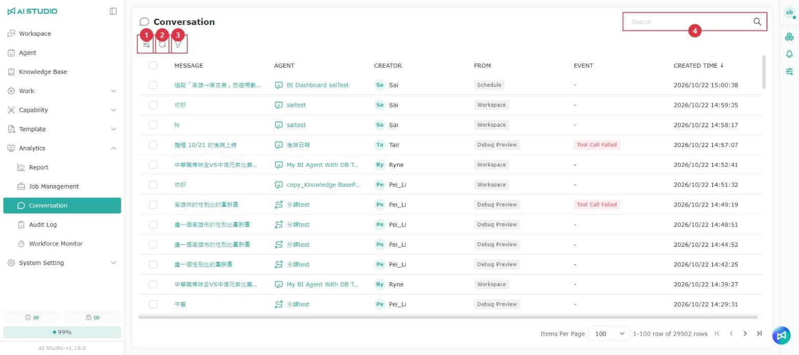
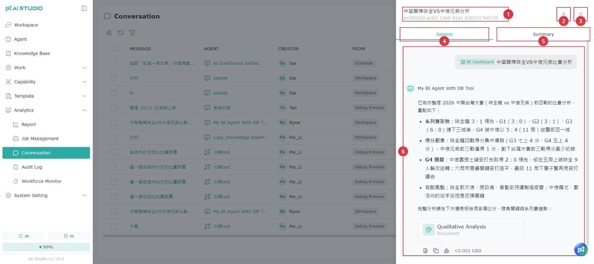

# 会話モニタリング

会話モニタリングでは、すべての Agent が受け取ったメッセージを「1 件のメッセージ」単位で一覧表示します。管理者はソース、Agent、イベントで絞り込み、実行に失敗した会話や制限を受けた会話をすばやく見つけ、会話全体を開いて前後の内容を確認できます。

> 注意：会話モニタリングを利用できるのは **AI Studio 管理者** のみです。詳しくは [AI Studio のロールと権限](../ru-men-zhi-nan/ai-studio-jue-se-yu-quan-xian-shuo-ming.md) を参照してください。

## 会話モニタリングを開く

左側メニューの「分析」グループで「会話モニタリング」をクリックします。

## ページの概要

<figure><figcaption></figcaption></figure>

<table data-search="false"><thead><tr><th width="90">項目</th><th width="157">操作名</th><th>説明</th></tr></thead><tbody><tr><td>1</td><td>列設定</td><td>列の表示／非表示を切り替えます。列を固定することもできます</td></tr><tr><td>2</td><td>更新</td><td>一覧を再読み込みします</td></tr><tr><td>3</td><td>フィルター</td><td>メッセージ、Agent、作成者、ソース、イベント、作成日時で絞り込めます。複数の条件を追加できます</td></tr><tr><td>4</td><td>検索</td><td>キーワードを入力して検索します</td></tr></tbody></table>

一覧は既定で作成日時の新しい順に並びます。各列の説明は次のとおりです。

| 列 | 説明 |
| --- | --- |
| メッセージ | ユーザーが送信したメッセージの内容です。クリックすると、このメッセージが属する会話全体が開きます。詳しくは下記の「会話全体を確認する」を参照してください |
| Agent | このメッセージに回答した Agent です |
| 作成者 | このメッセージを送信したユーザーです |
| ソース | このメッセージがどの画面またはチャネルから送信されたかを示します。詳しくは下記の「会話のソース」を参照してください |
| イベント | 実行中に発生した異常イベントがタグで表示され、色はイベントのグループによって異なります。イベントがない場合は「-」と表示されます。詳しくは下記の「異常イベント」を参照してください |
| 作成日時 | メッセージが送信された日時です |

## 会話のソース

「ソース」列には、各メッセージがどの画面またはチャネルから送信されたかが表示されます。

| ソース | 説明 |
| --- | --- |
| ワークスペース | ユーザーがワークスペースで Agent と会話しました |
| デバッグプレビュー | Agent 設定ページのデバッグプレビュー、またはワークフローエディターのテストプレビューでの会話です |
| スケジュール | スケジュールによって実行されました |
| ダッシュボード | ダッシュボードで質問しました |
| ダッシュボード変換 | ダッシュボードに関連する会話です |
| Agent API | 外部システムが Agent API を通じて Agent を呼び出しました |
| Web App | Web サイトに埋め込まれた Web App を通じた会話です |
| Webhook | 外部システムが Webhook を通じて Agent にイベントを送信しました |

> 以前の会話データにはソースが記録されていないため、「ソース」列には「-」と表示されます。

## 異常イベント

会話の実行中に異常が発生すると、「イベント」列に対応するイベントタグが表示され、問題のある会話をすばやく絞り込めます。1 件のメッセージに複数のイベントがある場合は、タグの横に「+数字」が表示され、マウスを合わせるとほかのイベントを確認できます。

フィルターでイベントを絞り込む場合、イベントは性質によって次の 4 つのグループに分かれます。

### 失敗・ブロック

| イベント | 説明 |
| --- | --- |
| ガードレールブロック | 内容がガードレールのルールに該当し、ブロックされました |
| モデルプロバイダーのコンテンツ制限 | モデルプロバイダーが安全性やコンテンツポリシーを理由に回答を拒否しました |
| ツール呼び出し失敗 | パラメーターの誤り、ツールの利用不可、タイムアウトなどにより、ツールの呼び出しに失敗しました |
| Skill の読み込み失敗 | スキルが見つからないか、内容の読み込みに失敗しました |
| Skill の実行失敗 | スキルの実行に失敗したか、タイムアウトしました |
| Skill のビルド失敗 | Skill Builder でスキルを作成する際に、ビルド、検証、保存のいずれかに失敗しました |
| モデル呼び出し失敗 | モデルサービスが利用できない、接続がタイムアウトした、応答が異常であるなどの状態です |
| ナレッジベース処理失敗 | ナレッジベースの検索、埋め込み、再ランキングに失敗しました（検索結果が 0 件の場合は含みません） |
| 添付ファイル処理失敗 | 添付ファイルの読み込み、変換、解析に失敗しました |
| 成果物の提供失敗 | 生成されたファイルのアップロードまたはダウンロードの提供に失敗しました |
| ワークフロー失敗 | ワークフローのノード、変数、分岐の実行に失敗しました |
| 未分類の実行失敗 | 実行に失敗したことは確かですが、上記のいずれにも分類できません |

### 制限・未完了

| イベント | 説明 |
| --- | --- |
| ガードレールマスク | 内容がガードレールのルールに該当し、一部がマスクされました |
| 予算・クォータ不足 | 予算またはクォータが不足しています |
| モデルのレート制限 | モデルまたはプロバイダーがリクエストの頻度を制限しました |
| 回答未完了 | 出力 Token を使い切った、モデルが内容を返さなかったなどの理由で、回答が完了しませんでした |
| ツール呼び出し上限到達 | ツールの呼び出し回数が上限に達しました |

### 実行の調整

| イベント | 説明 |
| --- | --- |
| 代替モデルを使用 | メインのモデルが利用できないため、代替モデルで回答を完了しました。通知のためのイベントで、回答自体は成功している場合があります |

### 権限拒否

| イベント | 説明 |
| --- | --- |
| 権限拒否 | ユーザーにモデル、ツール、スキル、ファイルなどのリソースの利用権限がありません |

## 会話全体を確認する

一覧の各行には 1 件のメッセージのみが表示されます。メッセージをクリックすると、右側にそのメッセージが属する会話全体が開きます。

<figure><figcaption></figcaption></figure>

<table data-search="false"><thead><tr><th width="90">項目</th><th width="157">操作名</th><th>説明</th></tr></thead><tbody><tr><td>1</td><td>会話名</td><td>会話名と Session ID を表示します</td></tr><tr><td>2</td><td>セッションをダウンロード</td><td>会話全体の記録をダウンロードします</td></tr><tr><td>3</td><td>閉じる</td><td>ドロワーを閉じて一覧に戻ります</td></tr><tr><td>4</td><td>Session</td><td>会話全体を表示します</td></tr><tr><td>5</td><td>概要</td><td>AI が自動生成した会話の要約を表示します。会話が短い場合は要約が生成されないことがあり、その場合は「この会話の要約はまだ生成されていません。」と表示されます</td></tr><tr><td>6</td><td>選択したメッセージ</td><td>一覧でクリックしたメッセージはグレーの背景で示され、画面はそのメッセージの先頭が表示された状態になります</td></tr></tbody></table>
