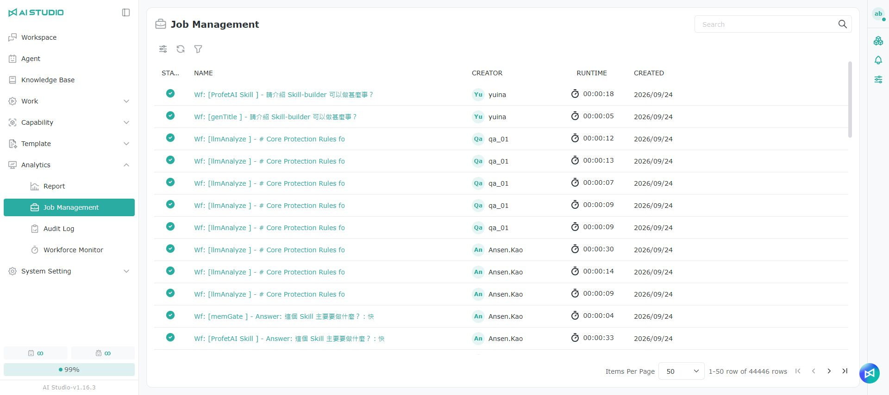

# ジョブ管理

## 概要

ユーザーが要件を伝えると、システムはそれを実行可能な作業項目に分解し、Job Manager に対応するタスクを作成します。各タスクには、明確な Job、説明、現在のステータス（未処理、処理中、完了、失敗／対応が必要など）、作成・更新日時、関連する入力と出力、必要な実行記録が含まれ、ユーザーが後からさかのぼって確認・照合できます。

### 確認できる記録の範囲

ジョブ管理に表示される記録は、アカウントのロールによって異なります。

* **AI Studio 管理者**：すべてのユーザーのジョブの記録を確認できます。
* **AI Studio ドメインユーザー**：自分のジョブの記録のみ確認できます。

## タスクのステータス

ステータス（Status）は全部で 8 種類あります。

<table><thead><tr><th width="224">ステータス名</th><th>説明</th></tr></thead><tbody><tr><td>PENDING</td><td>作成済みで、待機列への投入待ち／まだ配信されていません</td></tr><tr><td>QUEUED</td><td>待機列で実行を待っています</td></tr><tr><td>RUNNING</td><td>実行中</td></tr><tr><td>SUCCEEDED</td><td>正常に完了しました</td></tr><tr><td>FAILED</td><td>実行に失敗しました</td></tr><tr><td>STOPPED</td><td>停止（中止）されました</td></tr><tr><td>CANCELED</td><td>キャンセルされました</td></tr><tr><td>PAUSED</td><td>一時停止中</td></tr></tbody></table>

## Job ページの説明

確認したいタスクの名前をクリックすると、ポップアップウィンドウが開き、その下の Job を確認できます。

<table><thead><tr><th width="101">項目</th><th width="177">名前</th><th>説明</th></tr></thead><tbody><tr><td>1</td><td>再実行</td><td>Job をもう一度実行します</td></tr><tr><td>2</td><td>続行</td><td>Job の作業を続行します</td></tr><tr><td>3</td><td>詳細情報</td><td>詳細情報を確認します</td></tr><tr><td>4</td><td>一時停止</td><td>Job の作業を一時停止します</td></tr><tr><td>5</td><td>キャンセル</td><td>この Job のタスクをキャンセルします</td></tr></tbody></table>

> 注意：一覧の作成者欄には、完全なユーザー名が表示されます。
