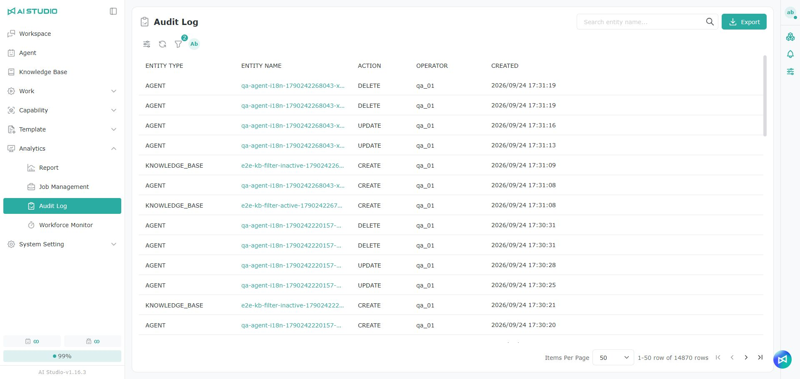
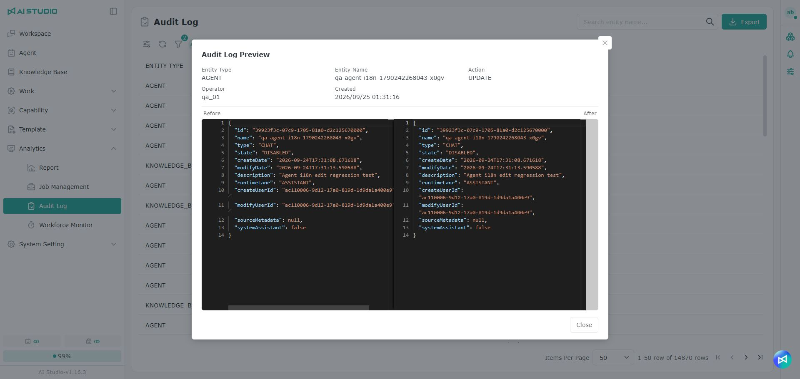

# 監査ログ

## 概要

監査ログは、システム内の重要なオブジェクトに対する操作の記録です。プラットフォームでのユーザーによる追加、編集、削除などの操作を管理者が追跡できるようにします。監査ログでは、操作日時、操作者、オブジェクトの種類、オブジェクト名、変更内容を確認でき、システム管理、問題の追跡、データの監査に役立ちます。

## 欄の説明

| 欄       | 説明                                                    |
| ------- | ----------------------------------------------------- |
| 操作の種類   | 操作されたオブジェクトの種類を表示します。例：Agent、データセット、スキル、ワークフローテンプレート、プロンプトテンプレートなど。 |
| 操作名     | 操作されたオブジェクトの名前を表示します。名前をクリックすると、その操作の詳しい変更内容を確認できます。          |
| 動作      | 操作の種類を表示します。例：CREATE、UPDATE、DELETE。                  |
| 操作者     | その操作を行ったユーザーを表示します。                                   |
| 作成日     | その操作記録が作成された日時を表示します。                                 |

## 監査ログの内容を確認する

一覧の操作名をクリックすると監査ログのプレビューウィンドウが開き、その操作の詳しい内容を確認できます。

**変更前** と **変更後** のブロックには、その操作によるデータの差分が表示されます。この内容で、操作の前後でオブジェクトがどう変わったかを確認できます。

操作の種類によって、表示される変更内容は異なります。たとえば、**作成** の操作では通常作成後のデータが表示され、**更新** の操作では変更前後の差分が表示されます。**削除** の操作では、削除されたオブジェクトに関する情報を追跡できます。

## 検索とフィルター

ページ上部の検索欄に名前を入力すると、特定のオブジェクトの操作記録をすばやく見つけられます。

フィルター機能を使って、オブジェクトの種類、操作の種類、操作者、期間などで絞り込むこともできます。フィルターの条件を使うと、特定の期間や特定のユーザーの操作記録をすばやく見つけられます。

## 監査ログのエクスポート

監査記録を保存したり、さらに分析したりする必要がある場合は、右上の **エクスポート** ボタンをクリックして、監査ログのエクスポートウィンドウを開きます。

エクスポートの前に、次の条件を設定できます。

| 欄             | 説明                   |
| ------------- | -------------------- |
| 操作の種類         | エクスポートするオブジェクトの種類を選びます |
| 動作            | エクスポートする操作の種類を選びます     |
| 操作名           | 特定のオブジェクト名を入力します        |
| 操作者           | 操作を行ったユーザーを選びます         |
| 開始日時 \~ 終了日時 | エクスポートする期間を設定します         |

条件を設定したら、次の形式でエクスポートできます。

* **CSV をエクスポート**：CSV ファイルとしてエクスポートします。表計算ツールでの確認や整理に適しています。
* **JSON をエクスポート**：JSON ファイルとしてエクスポートします。システム連携、データ交換、技術的な分析に適しています。

## 注意事項

監査ログは主にシステムの操作記録の追跡に使います。確認できる記録の範囲は、ユーザーの権限によって異なります。

特定の記録が見つからない場合は、検索条件、フィルターの条件、期間が正しいかを確認してください。条件を調整したら、もう一度検索するか、条件に合う監査記録をエクスポートできます。
