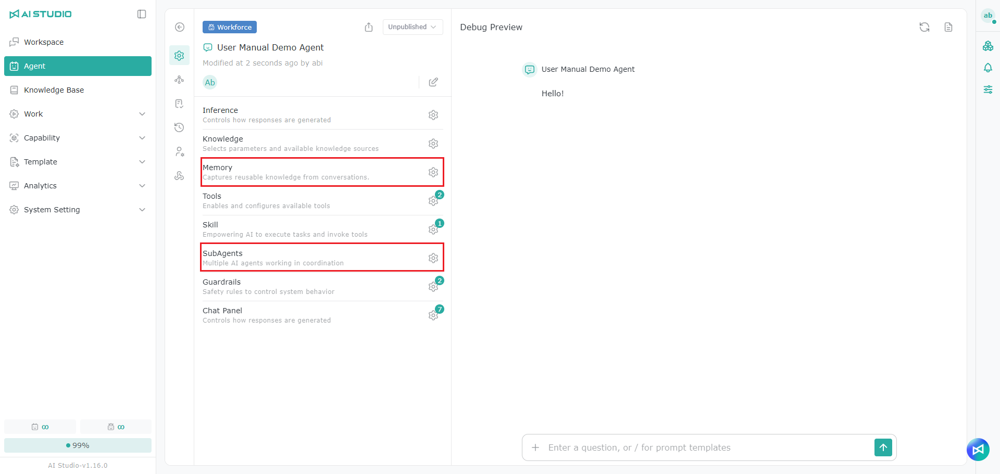

# Workforce モニター

Workforce モニターでは、Assistant と Workforce の容量の使用状況とジョブの状態をまとめて確認できます。管理者は現在利用できる枠、実行中と待機中のジョブを把握し、推移のデータから高負荷の時間帯を特定できます。

> この機能に表示されるのは現時点の実行容量とジョブの状態で、一定期間に累積した Token 使用量ではありません。

## Assistant と Workforce の違い 

<figure><figcaption></figcaption></figure>

<figure><figcaption></figcaption></figure>

システムは Agent の設定に応じて、実行時に Assistant と Workforce のどちらの枠を使うかを自動的に判断します。判断の対象は Agent 自体の設定のみで、ユーザーが誰か、どの画面から使うか、API 経由で呼び出すかには関係ありません。Agent が下表の Workforce の条件のいずれかに当てはまると Workforce の枠を使い、どれにも当てはまらない場合は Assistant の枠を使います。2 つの種類にはそれぞれ独立した枠の上限があり、共有されません。


Agent の設定を変更すると、システムはすぐにその種類を判断し直します。


> 注：AI Studio Copilot は SubAgent を使うため、Workforce に含まれます。

### Agent の設定項目

Agent の設定ページで、下表の Workforce 欄にチェックがある機能のいずれかをオンにするか紐づけると、その Agent は Workforce の枠を使います。

<figure><figcaption></figcaption></figure>

<table data-search="false"><thead><tr><th>設定項目</th><th align="center">Assistant</th><th align="center">Workforce</th><th>説明</th></tr></thead><tbody><tr><td>ナレッジ</td><td align="center">✔</td><td align="center"></td><td>いくつ紐づけても影響しません。</td></tr><tr><td>メモリー</td><td align="center"></td><td align="center">✔</td><td><strong>メモリーの引用</strong> または <strong>メモリーの自動最適化</strong> のいずれかがオンの場合に該当します。詳しくは<a href="../agent-zhi-nan/ji-yi.md">メモリー</a>を参照してください。</td></tr><tr><td>ツール</td><td align="center">✔</td><td align="center"></td><td>組み込みツール、MCPツール、AutoML を含みます。いくつ紐づけても影響しません。</td></tr><tr><td>スキル</td><td align="center">✔</td><td align="center"></td><td>いくつ紐づけても影響しません。</td></tr><tr><td>Coordination</td><td align="center"></td><td align="center">✔</td><td>Agent を 1 つ以上紐づけている必要があります。</td></tr></tbody></table>

ユーザーが[パーソナライズ](../ge-ren-she-ding/agent-memory.md)で行うメモリーの設定は個人の設定であり、Agent の枠の種類には影響しません。

### スケジュール

スケジュールを作成しても、Agent の枠の種類は変わりません。スケジュールの実行時に Assistant と Workforce のどちらの枠を使うかは、スケジュールに紐づく Agent の設定によって決まります。スケジュールの作成方法は [スケジュール](../gong-zuo-zhi-nan/pai-cheng.md) を参照してください。

## 現在の容量を確認する

ページ上部には Assistant と Workforce の容量カードがそれぞれ表示され、管理者は 2 つの種類の現在の負荷を比較できます。

| 欄        | 説明                                     |
| -------- | -------------------------------------- |
| **使用率**  | 実行中の枠が `Limit` に占める割合です。全体の負荷をすばやく判断できます。 |
| **実行中**  | 現在実行中で、枠を占有しているジョブの数です。                 |
| **待機中**  | 利用できる枠がないため、実行を待っているジョブの数です。             |
| **枠の上限** | お客様のライセンスによって決まる、同時に実行できる最大の枠です。        |
| **残りの枠** | 現在の使用状況に基づく、まだジョブを開始できる実行枠です。            |

残りの枠が 0 の場合は、現在すべての枠が使用中であることを示します。待機に対応したジョブはまず `Queued` に入り、前のジョブが終了して枠が空くと自動的に実行を開始します。待機は正常な待ち状態であり、実行の失敗を意味するものではありません。

## 使用状況の推移を確認する

使用率と実行数の推移では、指定した期間の容量の変化を確認できます。

* **実行数の推移（棒グラフ）**：各時点で実行中のジョブの数を示します。
* **使用率（折れ線グラフ）**：枠の使用率の変化を示します。

期間を調整して使用のピークを確認し、Assistant や Workforce が容量の上限に近づくことが多いかを判断して、今後の枠の配分や使い方の調整の参考にできます。

## 実行中のアクティビティを追跡する

アクティビティのエリアで Assistant と Workforce を切り替え、現在実行中および待機中のジョブを確認します。

| ステータス     | 説明                                                        |
| --------- | --------------------------------------------------------- |
| **実行中**   | ジョブが枠を確保して実行中です。Agent、ユーザー、ジョブのソース、開始日時、経過時間などの情報を追跡できます。 |
| **待機中**   | ジョブが利用できる枠を待っています。待機列に入った日時、待機時間、現在の待機順位などの情報を確認できます。      |

ジョブのソースには、チャット、WebApp、Agent API、スケジュール、ワークフロー、Agent Task、マルチ Agent の会話などがあり、管理者は負荷がどの利用シナリオから来ているかを確認できます。

> システムが複数ノードでデプロイされている場合、待機順位はそのジョブが属するノード内での順位で、システム全体での唯一の順位ではありません。そのため、一覧に同じ待機順位が表示されることがあります。

## 注意事項

* Assistant と Workforce の枠は互いに独立しています。一方の種類が満杯でも、もう一方の種類にも利用できる枠がないとは限りません。
* 待機中のジョブは枠を確保すると自動的に実行を開始するため、通常は手動で再送信する必要はありません。
* リアルタイムの音声会話は Assistant と Workforce のどちらの枠も占有しないため、このページの使用データには含まれません。
* このページは全体の容量を把握するためのものです。個々の会話での待機の表示は、その会話画面に表示されるリアルタイムの状態に従ってください。

## よくある質問

Agent のメモリーをオンにした後、待機が発生するようになったのはなぜですか？

**メモリーの引用** または **メモリーの自動最適化** をオンにすると、Agent はすぐに Workforce の枠を使うようになります。Workforce と Assistant の枠はそれぞれ独立しており、Workforce の枠の上限は通常少ないため、利用が多いときは待機が発生しやすくなります。Coordination で Agent を追加した場合も同様です。詳しくは [Assistant と Workforce の違い](workforce-jian-kong.md#assistant-yu-workforce-de-cha-yi) を参照してください。

MCPツールを紐づけたり、スケジュールを作成したりすると、Agent は Workforce の枠を使うようになりますか？

いいえ。ツール（MCPツールと AutoML を含む）、ナレッジ、スキル、スケジュールは枠の種類に影響しません。Agent が Workforce の枠を使うようになるのは、メモリーをオンにした場合か Coordination で Agent を追加した場合のみです。

AI Studio Copilot に「待機中」と表示されます。機能の不具合ですか？

いいえ。AI Studio Copilot は SubAgent を使うため Workforce に含まれます。「待機中」の表示は、現在 Workforce の枠がすべて使用中であることを示しており、Copilot の故障ではありません。ほかのジョブが終了して枠が空くと Copilot は自動的に実行を開始するため、再送信する必要はありません。

