# BI ダッシュボード

## BI ダッシュボードとは 

BI ダッシュボードは、データを数値カード、グラフ、明細表にまとめ、AI が分析のインサイトを書き添えます。ダッシュボードに置ける内容は次の 2 種類で、同じダッシュボードに共存できます。

| 種類          | 説明                                                                                       | 適した場面                                                  |
| ----------- | ---------------------------------------------------------------------------------------- | ------------------------------------------------------ |
| Artifact ページ | Agent が一度に作成するページ全体の分析で、数値カード、グラフ、表、インサイトを含みます。ダッシュボードに追加すると、ページ全体で 1 つのタイルになります | 既定の出力です。データソースの数値が必要な分析や、Web ページ・アップロードしたファイルを材料にした分析に使われます |
| 標準ダッシュボード   | テンプレートに基づいて生成され、数値カード、グラフ、明細表、インサイト、セクション見出しの各タイルで構成されます。タイルごとに個別に調整できます              | 標準ダッシュボードやテンプレートを明示的に指定した場合                            |

会話の中で Agent にデータの分析を依頼すると、Agent は既定で Artifact ページを生成します。標準ダッシュボードやテンプレートを明示的に指定した場合にのみ、標準ダッシュボードを生成します。Artifact ページの生成が続けて失敗した場合も、Agent は標準ダッシュボードの生成に切り替えます。どちらの内容も、まず会話の右側のキャンバスでプレビューされ、固定または確認した後にダッシュボードに追加されます。

> 注意：上記の生成方法は既定値で、管理者が [構成 - 対話型 BI](../xi-tong-she-ding-zhi-nan/pei-zhi.md#dui-hua-shi-bi) で変更できます。たとえば「データソースの質問で自由ページを既定にする」をオフにすると、データソースが必要な質問では標準ダッシュボードが生成され、ユーザーが明示的に求めた場合のみ Artifact ページが生成されます。「Agent にページを自由に作成させる」をオフにすると、Web ページやアップロードしたファイルを材料にした質問も固定のレイアウトになります。

* Artifact ページの操作は [Artifact ページ](bi-yi-biao-ban.md#artifact-ye-mian) を参照してください。
* AI が SQL を生成する際に使うビジネス上の定義は [指標](bi-yi-biao-ban.md#zhi-biao) を参照してください。

## 使用前の準備 

会話の中で BI ダッシュボードや Artifact ページを生成するには、次の条件を満たす必要があります。

| 条件               | 説明                                                                                                                                                       |
| ---------------- | -------------------------------------------------------------------------------------------------------------------------------------------------------- |
| 対話型 BI の有効化      | 管理者が「システム設定 → 構成 → グローバル」の「対話型 BI」で「会話での BI ダッシュボードの生成を許可」をオンにする必要があります。詳しくは [構成 - 対話型 BI](../xi-tong-she-ding-zhi-nan/pei-zhi.md#dui-hua-shi-bi) を参照してください。新規インストールの環境では既定でオフです |
| BI 権限            | ユーザーのロールに BI ダッシュボードの権限が必要です                                                                                                                             |
| Agent の種類と設定     | チャット Agent またはワークフロー Agent を使い、Agent の BI 機能がオンになっている必要があります。チャット Agent では既定でオン、ワークフロー Agent では既定でオフのため、フローのノードでオンにします                                     |
| データ              | データのデータモデルの設定が完了しているか、ナレッジベースのスプレッドシートのデータである必要があります                                                                                                     |

条件を満たしたら、会話の入力欄で「BI ダッシュボード」を選択し、分析したい内容を入力します。

> 注意：
>
> * 「会話での BI ダッシュボードの生成を許可」をオフにすると、会話の入力欄に BI の入口が表示されず、会話の中で新しいダッシュボードや Artifact ページを生成できなくなります。既存のダッシュボードは、質問パネルから引き続き変更できます。
> * ダッシュボードの内容を変更する操作（更新、レイアウトの編集、質問、アラート、スケジュール、バージョン履歴、固定、共有など）には、ダッシュボードの管理権限が必要です。管理権限がないユーザーは、閲覧と PNG／PDF のエクスポートのみ行えます。

## BI ダッシュボードのページを開く 

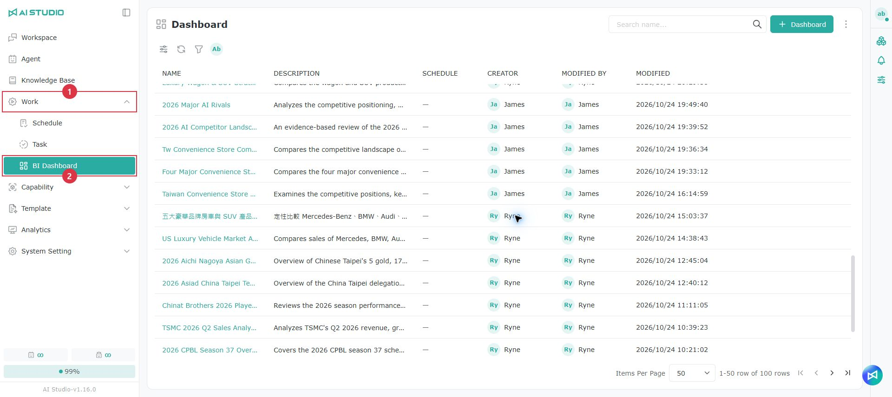

左側のメニューで「Work」をクリックし、「BI ダッシュボード」をクリックします。

## ページの説明 

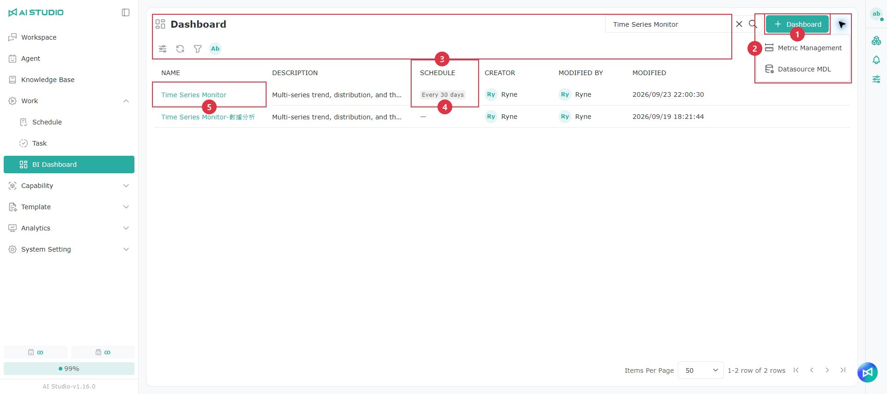

<table data-search="false"><thead><tr><th width="90">項目</th><th width="157">操作名</th><th>説明</th></tr></thead><tbody><tr><td>1</td><td>＋ Dashboard</td><td>「GenBI でダッシュボードを生成」ウィンドウが開きます。詳しくは<a href="bi-yi-biao-ban.md#jian-li-yi-biao-ban">ダッシュボードの作成</a>を参照してください</td></tr><tr><td>2</td><td>その他</td><td>展開すると「指標の管理」（指標のページに移動します。詳しくは<a href="bi-yi-biao-ban.md#zhi-biao">指標</a>を参照してください）または「データソース MDL」（データソースのセマンティックレイヤーの設定に移動します）を選択できます</td></tr><tr><td>3</td><td>ツールバー</td><td>左から順に、検索、表示列の調整、更新、絞り込み、「マイリスト」です。名前の検索では大文字と小文字は区別されません</td></tr><tr><td>4</td><td>スケジュール</td><td>ダッシュボードのスケジュール更新の頻度を表示します。絞り込みで「スケジュールあり」または「対応が必要」のダッシュボードを探せます</td></tr><tr><td>5</td><td>名前</td><td>名前をクリックするとダッシュボードが開きます</td></tr><tr><td>6</td><td>編集／削除</td><td>「編集」ではダッシュボードの名前と説明を変更できます。「削除」ではダッシュボード全体が削除されます</td></tr></tbody></table>

一覧には、各ダッシュボードの名前、説明、スケジュール、作成者、更新者、更新日時が表示されます。

> 注意：「アクセス権限がありません」と表示される場合は、お使いのロールでは BI ダッシュボードを利用できません。管理者にお問い合わせください。「現在 BI ダッシュボードの権限を確認できません。しばらくしてからもう一度お試しください。」と表示される場合は、「再試行」をクリックしてください。

## ダッシュボードの作成 

ダッシュボードの作成方法は 2 つあります。一覧ページには、空のダッシュボードを作成する入口はありません。

### 会話から固定する（推奨） 

会話の入力欄で「BI ダッシュボード」を選択して Agent にデータの分析を依頼すると、Agent が右側のキャンバスに Artifact ページのプレビューを生成します。内容を確認したら、キャンバスの固定ボタンをクリックし、既存のダッシュボードに追加するか、新しいダッシュボードを作成するかを選択します。詳しくは [ダッシュボードに固定する](bi-yi-biao-ban.md#ding-xuan-dao-yi-biao-ban) を参照してください。

### GenBI でダッシュボードを生成する 

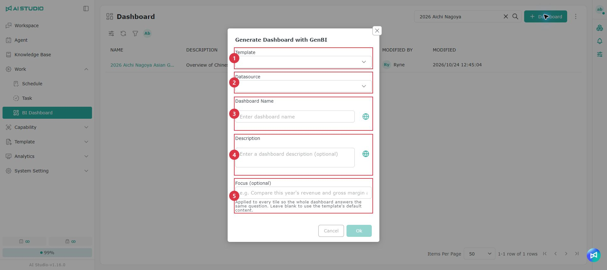

1. 一覧の右上にある「＋ Dashboard」をクリックします。
2. 下表に従って入力して送信すると、テンプレートに基づいて標準ダッシュボード全体が生成されます。生成中は「生成中…」と表示されます。

<table data-search="false"><thead><tr><th width="90">項目</th><th width="157">欄</th><th>説明</th></tr></thead><tbody><tr><td>1</td><td>テンプレート</td><td>ダッシュボードの構成を選択します。選択したデータソースのデータモデルではサポートできないテンプレートは、選択できない状態で説明付きで表示されます</td></tr><tr><td>2</td><td>データソース</td><td>ダッシュボードがデータを取得する元です。「定性分析」テンプレートではデータソースは不要で、「定性分析ではデータソースを選択する必要はありません。下の Web とファイルのソースを使ってください」と表示されます</td></tr><tr><td>3</td><td>Dashboard 名</td><td>ダッシュボードの名前（必須）</td></tr><tr><td>4</td><td>説明</td><td>ダッシュボードの説明（任意）</td></tr><tr><td>5</td><td>分析の重点（任意）</td><td>ダッシュボードで重点的に扱いたい分析の問いです。例：「今年と昨年の売上と粗利を比較する」。空欄の場合はテンプレートの既定の内容を使います</td></tr></tbody></table>

**Web とファイルの材料**（定性分析テンプレートでは必須、データソースも必要な混合型テンプレートでは任意）

* Web ページの URL を入力して「追加」をクリックする（または Enter キーを押す）か、ファイルをアップロードします（複数可）。定性分析テンプレートでは材料が 1 つ以上必要です。
* 各材料には文字数が表示され、内容が長すぎる場合は「内容が切り詰められました」と表示されます。
* 追加から 25 分を超えた Web ページには「まもなく期限切れ」と表示され、「再追加」をクリックできます。30 分を超えると「期限切れ」と表示されます。

> 注意：ダッシュボードに内容がない場合、開くと「表示できるデータがありません」と表示されます。管理権限のあるユーザーは「自動生成」をクリックして内容を生成できます。

## ダッシュボードの内部ページ 

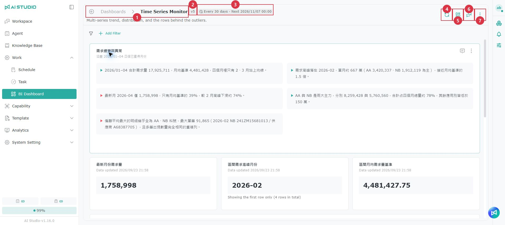

<table data-search="false"><thead><tr><th width="90">項目</th><th width="157">操作名</th><th>説明</th></tr></thead><tbody><tr><td>1</td><td>戻るボタンと名前</td><td>「Dashboard」をクリックすると一覧に戻ります</td></tr><tr><td>2</td><td>バージョン</td><td>現在のバージョンです（例：v2）。レイアウトを保存したり変更を適用したりするたびに、新しいバージョンが作成されます</td></tr><tr><td>3</td><td>スケジュール</td><td>スケジュールの概要を表示します。クリックするとスケジュールの設定が開きます。詳しくは<a href="bi-yi-biao-ban.md#pai-cheng-shua-xin">スケジュール更新</a>を参照してください</td></tr><tr><td>4</td><td>更新</td><td>最新のデータでダッシュボードを更新します。詳しくは<a href="bi-yi-biao-ban.md#geng-xin-yi-biao-ban">ダッシュボードの更新</a>を参照してください。一部のタイルを選択している場合は、「選択したタイルを更新（n）」も表示されます</td></tr><tr><td>5</td><td>レイアウトの編集</td><td>ドラッグしてタイルの位置とサイズを調整します。詳しくは<a href="bi-yi-biao-ban.md#bian-ji-pai-ban">レイアウトの編集</a>を参照してください</td></tr><tr><td>6</td><td>このダッシュボードに質問</td><td>右側に質問パネルが開き、Agent に内容の変更や解説を依頼できます。詳しくは<a href="bi-yi-biao-ban.md#xun-wen-ci-yi-biao-ban">このダッシュボードに質問する</a>を参照してください</td></tr><tr><td>7</td><td>⋮ その他</td><td>下表を参照してください</td></tr></tbody></table>

**「⋮」メニュー**

| 項目                   | 説明                                                                                     |
| -------------------- | -------------------------------------------------------------------------------------- |
| データソース               | ダッシュボードが使用しているデータソースを確認します。データソースが古くなっている場合は、「⋮」ボタンに警告の点が表示されます                         |
| データソース MDL           | データソースのセマンティックレイヤーの設定に移動します（管理権限が必要）                                                   |
| バージョン履歴              | 過去のバージョンを確認・復元します。詳しくは [バージョン履歴](bi-yi-biao-ban.md#ban-ben-li-shi) を参照してください              |
| スケジュール更新             | 定期的な自動更新を設定します（管理権限が必要）。詳しくは [スケジュール更新](bi-yi-biao-ban.md#pai-cheng-shua-xin) を参照してください   |
| PNG をエクスポート／PDF をエクスポート | 現在の画面を画像または PDF としてエクスポートします。詳しくは [PNG／PDF のエクスポート](bi-yi-biao-ban.md#hui-chu-pngpdf) を参照してください |
| テーマの切り替え             | ライトテーマとダークテーマを切り替えます。現在の画面にのみ適用され、保存されません                                              |

ダッシュボードに Artifact ページのタイルが 1 つだけの場合は、ヘッダーのボタンと「⋮」メニューに Artifact の操作も加わります。詳しくは [ヘッダーの操作](bi-yi-biao-ban.md#ye-shou-cao-zuo) を参照してください。

> 注意：管理権限がないユーザーの「⋮」メニューには、データソース、エクスポート、テーマの切り替えのみが表示され、変更、更新、質問はできません。

## 標準ダッシュボードのタイル 

標準ダッシュボードは、数値カード、グラフ、明細表、インサイト、セクション見出しの各タイルで構成されています。

* **タイトルバー**：タイトルとステータスアイコンが表示されます。サブタイトルには、データソース、期間、データの基準時刻、更新時刻が表示されます。指標を使っているタイルには指標タグが表示されます。詳しくは [ダッシュボードに表示される指標の情報](bi-yi-biao-ban.md#zai-yi-biao-ban-shang-kan-dao-de-zhi-biao-zi-xun) を参照してください。
* **再質問／更新**：このタイルについて Agent に追加で質問するか、最新のデータでこのタイルを更新します。インサイトと定性的な内容のタイルには「更新」はありません。
* **AI 分析**：一部のタイルの下には 1 文の結論が表示されます。分析中は「AI が原因を分析しています…」と表示され、完了すると「AI 分析」と結論が表示されます。「追加質問」をクリックすることもできます。

**タイルの「⋮」メニュー**（タイルの種類に応じて表示され、多くは管理権限が必要）

| 項目                  | 説明                                                                                                            |
| ------------------- | ------------------------------------------------------------------------------------------------------------- |
| 参照元                 | インサイトや定性的な内容が引用している出典を確認します。出典をクリックすると、対応するタイルに移動するか Web ページが開きます                                             |
| SQL を表示             | このタイルが使っているクエリを確認します                                                                                          |
| 検証済みにする             | このタイルの質問と SQL を検証済みの Q&A として登録します。詳しくは [検証済みの Q&A](bi-yi-biao-ban.md#yi-yan-zheng-wen-da) を参照してください               |
| ほかの Dashboard に固定   | ほかのダッシュボードにコピーします                                                                                             |
| ピボット                | 明細表の行、列、値を設定して集計表を作成します。詳しくは [ピボット分析](bi-yi-biao-ban.md#shu-niu-fen-xi) を参照してください                              |
| アラート設定              | 数値が条件を満たしたときにメールで通知します。詳しくは [アラート設定](bi-yi-biao-ban.md#gao-jing-she-ding) を参照してください                              |
| CSV をエクスポート／XLSX をエクスポート | 明細表のデータをエクスポートします                                                                                             |
| グラフの種類を変更           | 棒グラフ、推移、円グラフ、ドーナツ、散布図、レーダー、2 軸グラフに変更します                                                                    |
| 更新可能なコンポーネントに変換     | 会話から固定した静的な内容を、データソースに基づいて更新できるタイルに変換します。詳しくは [更新可能なコンポーネントに変換する](bi-yi-biao-ban.md#zhuan-huan-cheng-ke-geng-xin-de-yuan-jian) を参照してください |
| 再取得                 | 材料に基づいてこのタイルを再生成します。1 回に 1 タイルで、最長で約 5 分かかります                                                                  |
| 削除                  | このタイルを削除します                                                                                                   |

**ステータスアイコン**：タイルのタイトルの後ろに警告アイコンが表示されている場合は、次のいずれかの状況です。複数該当する場合は数字が表示されます。アイコンをクリックすると、理由を確認して対応できます。

| ステータス       | 対処方法                                |
| ----------- | ----------------------------------- |
| スケジュール失敗    | 「スケジュール更新」をクリックして原因を確認し、設定し直してください   |
| アラート中       | 数値がアラートの条件を満たしています。「アラート設定」をクリックして確認してください |
| フィルター未適用    | このタイルには現在のフィルター条件を適用できません           |
| 古くなっています    | 内容が古くなっている可能性があります。更新するか、「このままにする」をクリックしてください |

## このダッシュボードに質問する 

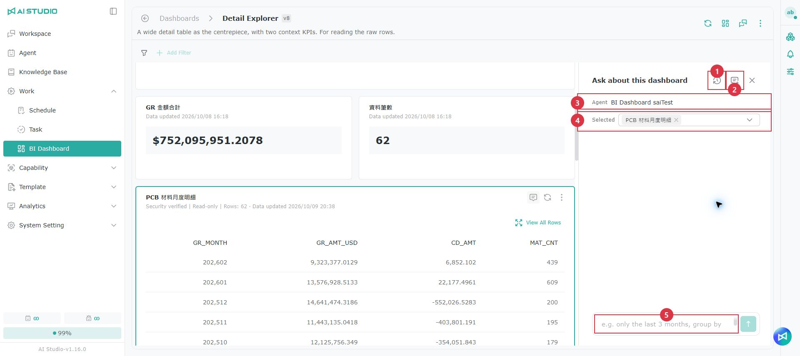

1. ヘッダーの「このダッシュボードに質問」をクリックすると、右側に質問パネルが開きます。
2. 使用する Agent を選択します。このダッシュボードにすでに会話履歴がある場合、Agent は元の Agent に固定されます。
3. 必要に応じて、「選択済み」で変更したいタイルを指定します。ダッシュボードに Artifact ページのタイルが 1 つだけの場合は「選択済み」は表示されず、そのページが自動的に指定されます。
4. 質問や変更の要望を入力して送信します。

パネル上部の「履歴」をクリックすると過去の会話を確認でき、「新しい会話」をクリックすると最初からやり直せます。パネルの左端をドラッグすると幅を調整できます。

### 提案を確認して適用する 

Agent による変更はすぐには反映されず、「提案」として作成されます。

1. タイルの「変更前／変更後」をクリックして内容を比較するか、プレビューを開いて現在の SQL と「推奨 SQL」を確認します。
2. 確認したら「適用」をクリックします。適用して初めて変更がダッシュボードに書き込まれ、新しいバージョンが作成されます。
3. 提案が複数ある場合は、チェックを入れて「すべて適用（n）」をクリックし、「n 件の提案の適用を確認」ウィンドウで確定します。一度に最大 20 件まで適用でき、まとめて適用してもバージョンは 1 つだけ増えます。

> 注意：
>
> * 一括適用には最長で約 2.5 分かかります。適用中はページを離れないでください。
> * 質問パネルとデータソースパネルは同時に 1 つしか開けません。
> * ほかの人が開いた会話は閲覧のみ可能で、続けて入力することはできません。

## ダッシュボードの更新 

| 方法       | 説明                                                                         |
| -------- | -------------------------------------------------------------------------- |
| 更新       | ヘッダーの「更新」をクリックしてダッシュボード全体を更新します。一部のタイルを選択している場合は、「選択したタイルを更新（n）」をクリックすると、それらのタイルだけを更新できます |
| 再取得      | タイルの「⋮」メニューから 1 つのタイルを更新します                                                  |
| スケジュール更新 | 設定した頻度で自動的に更新します。詳しくは [スケジュール更新](bi-yi-biao-ban.md#pai-cheng-shua-xin) を参照してください |

更新はバックグラウンドで実行されるため、先にページを離れてもかまいません。完了すると通知されます。更新中は、画面上部に「材料に基づいてタイルを更新しています（完了数／合計）…」と表示されます。

* データに変化がない場合は、すぐに「変化なし」と表示されます。
* データに変化がある場合や、内容に Web ページ・アップロードしたファイルを使っている場合は、Agent がインサイトと数値の文章を書き直し、提案として表示します。適用すると更新されます。詳しくは [提案を確認して適用する](bi-yi-biao-ban.md#cha-kan-yu-tao-yong-ti-yi) を参照してください。

> 注意：
>
> * 画面上の「更新」と「再読み込み」は同じ機能で、どちらも最新のデータで内容を更新します。
> * タイルごとの更新はそれぞれ 1 回の Agent の処理となり、Token を消費します。

### スケジュール更新 

1. ヘッダーのスケジュールタグをクリックするか、「⋮」から「スケジュール更新」を選択します。
2. 下表に従って設定し、保存します。

| 欄             | 説明                                                   |
| ------------- | ---------------------------------------------------- |
| 有効            | スケジュールのオン／オフを切り替えます。既定でオン                              |
| 間隔            | 数値（1～9999）を入力し、時間、日、週、月から選択します。既定は 1 日ごと               |
| 開始時刻（任意）      | 最初に実行する時刻です。タイムゾーンはブラウザーの設定に従い、変更できません                  |
| 通知メールの受信者     | 必須で、1～50 人を指定します。既定は自分です                              |
| 定性タイルも更新      | Web ページやファイルを材料にしたタイルも一緒に更新するかどうかです。既定でオン。Token を追加で消費します |

* Web ページや日付検索を材料にしている場合は、ウィンドウの下部で材料ごとに一緒に更新するかどうか（「単一の記事」「更新されるページ」など）を設定できます。
* ウィンドウには、次回と前回の実行時刻、更新・失敗・スキップしたタイルの数、「前回更新できなかったタイル」が表示されます。クリックするとそのタイルに移動します。
* すでにスケジュールがある場合は、「スケジュールを削除」をクリックできます。

> 注意：スケジュールは 3 回続けて失敗すると自動的に無効になります。BI 権限を失った場合も無効になります。再度保存すると元に戻ります。失敗するとウィンドウに「あと n 回失敗すると自動的に無効になります」と表示されます。

### アラート設定 

標準ダッシュボードの数値カードが対象です。Artifact ページのアラートはルールが異なります。詳しくは [KPI アラート](bi-yi-biao-ban.md#kpi-gao-jing) を参照してください。

1. 数値カードの「⋮」から「アラート設定」を選択するか、タイルの「アラート中」アイコンをクリックします。
2. 「アラートを有効にする」をオンにします。
3. 条件（より大きい、より小さい、変動率が % を超える）を選択し、しきい値を入力します。変動率が % を超えるを選択した場合、しきい値は 0 より大きくする必要があります。
4. 「受信者」（必須、1～50 人、既定は自分）を設定して保存します。

数値が条件を満たすとメールで通知され、タイルのタイトルにも「アラート中」アイコンが表示されます。ウィンドウには前回のチェック結果が表示されます。アラートを設定済みの場合は、「アラートを削除」をクリックできます。

> 注意：アラートはスケジュールと組み合わせて使います。ダッシュボードでスケジュールが有効になっていない場合は、ウィンドウにメッセージが表示されます。

## フィルター 

<figure>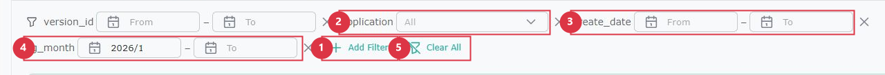<figcaption></figcaption></figure>

フィルターバーはダッシュボードの上部にあり、フィールドごとにダッシュボード全体を絞り込めます。Artifact ページ内のデータソースに紐づいた数値カード、グラフ、表も一緒に更新されます。フィルターは最大 10 個まで追加できます。

**フィルターの追加**（管理権限が必要）

1. 「フィルターを追加」をクリックし、「データソース」「テーブル」「フィールド」を順に選択します。追加済みのフィールドは表示されません。計算フィールドには「計算フィールド」と表示されます。
2. 必要に応じて「フィルター名」（最大 64 文字）を入力します。入力しない場合はフィールド名が使われます。
3. 「保存」をクリックします。

**フィルターの使い方**

| フィルターの種類 | 操作                                                         |
| -------- | ---------------------------------------------------------- |
| テキスト     | ドロップダウンリストから複数選択します。既定は「すべて」です。選択肢は最大 200 件まで表示されます            |
| 日付       | 「開始」と「終了」を選択します                                            |
| 数値       | 「最小値」と「最大値」を入力します。入力形式が正しくない場合や、最小値が最大値より大きい場合は、フィルターは適用されません |

「すべてクリア」をクリックするとすべての条件をクリアできます。フィルターの × をクリックするとフィルターを削除できます（管理権限が必要）。

> 注意：
>
> * フィルターの結果は現在の画面にのみ表示され、保存されず、新しいバージョンも作成されません。
> * フィルターを適用できないタイルやクエリには「未適用」と表示され、ほかの内容は通常どおり更新されます。
> * レイアウトの編集中、バージョン履歴の表示中、すべての更新中、質問パネルを開いている間は、フィルターバーが一時的に使えなくなります。
> * データ量が多い場合は「フィルター処理中」と表示されることがあります。しばらくお待ちください。

## レイアウトの編集 

1. ヘッダーの「レイアウトの編集」をクリックします。質問パネルが閉じ、現在のフィルターもクリアされます。
2. タイルをドラッグして位置を調整し、角をドラッグしてサイズを調整します。タイルの「全幅に展開」「上へ移動」「下へ移動」をクリックすることもできます。
3. 「保存」をクリックすると、新しいバージョンが作成されます。

保存していない変更がある状態で「キャンセル」をクリックしたりページを離れたりすると、「編集を続ける」「保存」「破棄」のどれにするかを確認されます。

> 注意：
>
> * 適用待ちの提案がある場合や再取得中の場合は、レイアウトを編集できません。ボタンのツールチップに理由が表示されます。
> * ダッシュボードに Artifact ページのタイルが 1 つだけの場合は「レイアウトの編集」はなく、「ページレイアウトの編集」を使います。詳しくは [ページレイアウトの編集とグラフの変更](bi-yi-biao-ban.md#bian-ji-ye-mian-pai-ban-yu-huan-tu) を参照してください。

## ピボット分析 

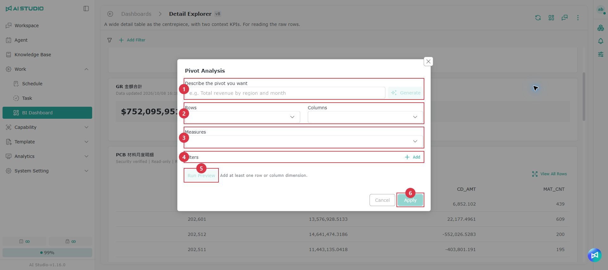

明細表の「⋮」から「ピボット」を選択するか、タイルのピボットタグをクリックします。

1. 要望を文章で入力して「AI で生成」をクリックするか、手動で設定します。
   * 「行のディメンション」と「列のディメンション」：合計で最大 4 個。
   * 「値」：最大 4 個。合計、平均、件数、ユニーク件数、最小、最大から選べます。合計と平均は数値フィールドにのみ使えます。
   * 「フィルター条件」：テキストフィールドでは「含む」／「含まない」、数値フィールドでは「等しい」「範囲内」などを選べます。
2. 「試算」をクリックして結果を確認します。
3. 「適用」をクリックします。適用済みのピボットは「ピボットをクリア」で削除できます。

> 注意：適用するには、行または列のディメンションが 1 つ以上と、値が 1 つ以上必要です。

## 更新可能なコンポーネントに変換する 

会話から固定した静的な内容（コード、ドキュメントなど）を、データソースに基づいて更新できるタイルに変換できます。

1. タイルの「⋮」から「更新可能なコンポーネントに変換」を選択します。
2. 材料を 1 つ以上選択します：「データソース」「Web データ」「チャット内のファイル」「チャット内のナレッジベース検索」。
3. 確認すると変換が始まります。進捗ウィンドウに「現在 n 個のコンポーネントを作成しました…」と表示されます。「バックグラウンドで続行」をクリックして先に離れることもできます。
4. 完了したら、「ダッシュボードへ移動」をクリックして結果を確認します。

変換中は、ダッシュボードの上部に「このダッシュボードは変換中です…」と進捗が表示されます。

## バージョン履歴 

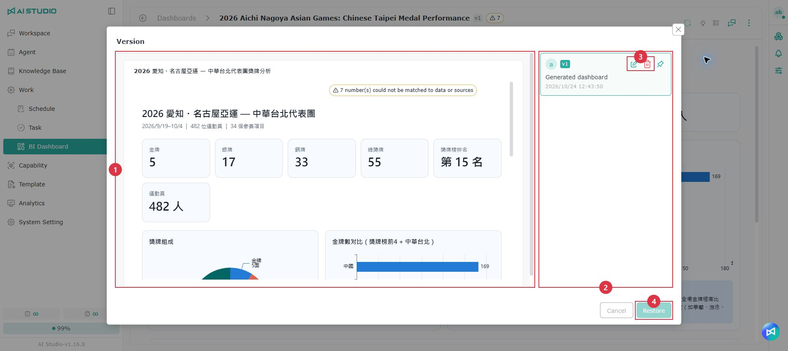

「⋮」から「バージョン履歴」を選択します。左側がプレビュー、右側がバージョンの一覧です。

* バージョンを選択すると内容をプレビューでき、「復元」をクリックするとそのバージョンに戻ります。Artifact ページを復元すると、「すべてのデータを表示」で使うデータも一緒に復元されます。
* バージョンにマウスカーソルを合わせると、「バージョン名」（最大 200 文字）と「概要」（最大 500 文字）を編集したり、バージョンを削除したりできます。
* 重要なバージョンを固定すると、自動的に削除されるのを防げます。

> 注意：保持されるバージョンは最大 20 個です。18 個に達すると「固定していない最も古いバージョンが削除される可能性があります」と表示され、上限を超えると、固定していない最も古いバージョンが自動的に削除されます。

## PNG／PDF のエクスポート 

「⋮」から「PNG をエクスポート」または「PDF をエクスポート」を選択すると、現在の画面を画像または PDF としてエクスポートします。管理権限のないユーザーもエクスポートできます。

* エクスポート時には、タイルの操作ボタン、ドラッグハンドル、ステータスアイコンが自動的に非表示になります。
* PDF は A4 横向きで、内容は画像のため文字を選択できません。改ページでは、同じカードができるだけ同じページに収まるようにします。
* ダッシュボードの内容が長い場合は、解像度が自動的に下げられ、「ダッシュボードの内容が長いため、エクスポートした画像の解像度を下げました。」と表示されます。

> 注意：ページの読み込みが完了していない場合、読み込みに失敗したタイルがある場合、Artifact ページのレイアウトを編集中の場合は、エクスポートできません。

## Artifact ページ 

Artifact ページは、Agent が質問に応じて一度に作成するページ全体の分析です。ページ上の数値カード、グラフ、表はデータソースに紐づけることができ、更新すると数値とグラフが一緒に更新されます。ダッシュボードに固定すると、ページ全体がダッシュボード上の 1 つのタイルになります。

同じ Artifact ページは 3 か所に表示され、それぞれ利用できる機能が異なります。

| 機能                | ダッシュボードの内部ページ | 会話の右側のキャンバス | 共有ページ |
| ----------------- | ------------- | ----------- | ----- |
| ブロックを選択して質問、インサイトへの追加質問 | あり            | あり          | なし    |
| 通常の表のエクスポート       | あり            | あり          | なし    |
| データソースに紐づいた表のエクスポート | あり            | なし          | なし    |
| すべてのデータを表示        | あり（管理権限が必要）   | なし          | なし    |
| ページレイアウトの編集、グラフの変更 | あり（管理権限が必要）   | なし          | なし    |
| グラフをクリックして絞り込み・ドリルダウン | あり（管理権限が必要）   | なし          | なし    |

### ページの内容 

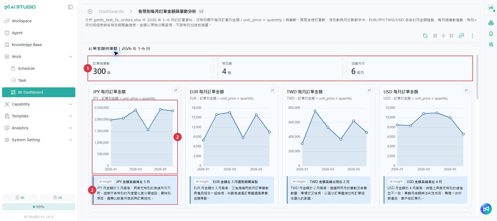

<table data-search="false"><thead><tr><th width="90">項目</th><th width="157">名前</th><th>説明</th></tr></thead><tbody><tr><td>1</td><td>数値カード</td><td>重要な数値を表示します。数値型の数値カードにはアラートを設定できます。詳しくは<a href="bi-yi-biao-ban.md#kpi-gao-jing">KPI アラート</a>を参照してください</td></tr><tr><td>2</td><td>グラフ</td><td>ランキング、推移、積み上げ、ドーナツ、ファネル、散布図、ウォーターフォール、サンキーなど、さまざまな種類があります。一部のグラフは互換性のある種類に変更できます。詳しくは<a href="bi-yi-biao-ban.md#bian-ji-ye-mian-pai-ban-yu-huan-tu">ページレイアウトの編集とグラフの変更</a>を参照してください</td></tr><tr><td>3</td><td>AI インサイト</td><td>ブロックの下に表示され、そのブロックに対する AI の解釈を説明します。インサイトについて追加で質問できます</td></tr><tr><td>4</td><td>明細表</td><td>表は先頭の 200 行のみプレビューされ、下に「プレビューには先頭の n 行のみ表示しています。」と表示されます。データソースに紐づいた表では「すべてのデータを表示」をクリックできます。詳しくは<a href="bi-yi-biao-ban.md#cha-kan-quan-bu-zi-liao">すべてのデータを表示</a>を参照してください</td></tr><tr><td>5</td><td>CSV／Excel</td><td>表のデータをエクスポートします。詳しくは<a href="bi-yi-biao-ban.md#hui-chu-biao-ge">表のエクスポート</a>を参照してください</td></tr><tr><td>6</td><td>フッターの注記</td><td>ページ上の数値の出典を説明します。ページの最下部に表示され、タイトルをクリックすると折りたためます。下記の説明を参照してください</td></tr></tbody></table>

**データの紐づけ**：1 ページに紐づけられるクエリは最大 8 個で、使えるデータソースは 1 つだけです。データソースには、データベース、インポートしたファイル、MCP によるデータ取得、ナレッジベースのスプレッドシートを使えます。

**フッターの注記**：ページで実際に使われた出典に基づいてシステムが自動的に生成し、ダッシュボードの内部ページと共有ページの両方に表示されます。

* Web ページ、ナレッジベース、アップロードしたファイル、ユーザーが提供したデータを使っている場合は、これらの数値が「ドキュメントで開示された値」であることを説明します。
* 推計で求めた数値がある場合は、これらの数値が「推計値」であることを説明します。
* データソースに紐づいたクエリもある場合は、クエリの結果が「実績値」であることを別途説明します。
* データソースのクエリだけを使っているページには、フッターの注記は生成されません。

> 注意：
>
> * ページ上部に「データは … に更新されました。インサイトと主要な数値は前のバージョンの内容です」と表示された場合は、数値は更新されていますが、AI が書いた文章は古いままです。再取得するか、Agent にインサイトの書き直しを依頼してください。
> * あるブロックに「データを表示できません。」と表示される場合は、そのブロックに対応するクエリが見つかりません。ほかのブロックには影響しません。

### ヘッダーの操作 

ダッシュボードに Artifact ページのタイルが 1 つだけの場合、Artifact の操作はダッシュボードのヘッダーにまとめられ、別のツールバーは表示されません。

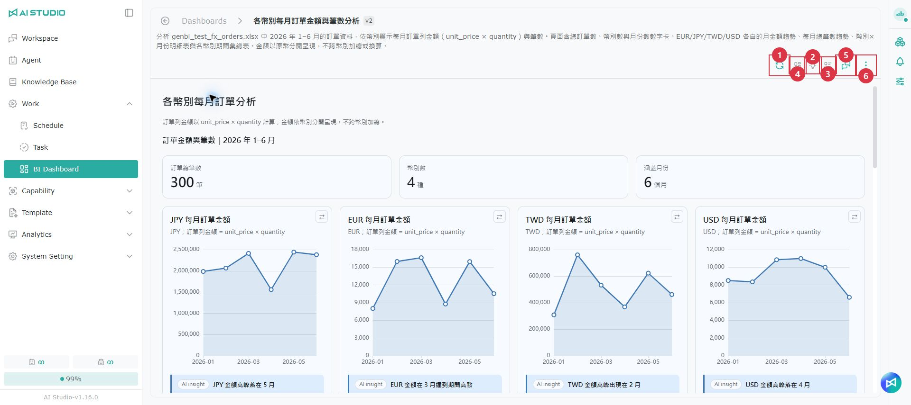

<table data-search="false"><thead><tr><th width="90">項目</th><th width="157">操作名</th><th>説明</th></tr></thead><tbody><tr><td>1</td><td>更新</td><td>最新のデータでページを再読み込みします。結果は提案として表示されます。詳しくは<a href="bi-yi-biao-ban.md#geng-xin-yu-ti-yi">更新と提案</a>を参照してください</td></tr><tr><td>2</td><td>インサイト</td><td>AI インサイトの表示／非表示を切り替えます</td></tr><tr><td>3</td><td>作成記録</td><td>このページの作成過程と使用したデータを確認します</td></tr><tr><td>4</td><td>ページレイアウトの編集</td><td>ドラッグしてページ内のブロックの位置と幅を調整します。詳しくは<a href="bi-yi-biao-ban.md#bian-ji-ye-mian-pai-ban-yu-huan-tu">ページレイアウトの編集とグラフの変更</a>を参照してください</td></tr><tr><td>5</td><td>このダッシュボードに質問</td><td>右側に質問パネルが開き、Agent にページの変更や解説を依頼できます</td></tr><tr><td>6</td><td>⋮ その他</td><td>ダッシュボードのメニュー項目に加えて、「ほかの Dashboard に固定」「アラート設定」「ページを共有」があります</td></tr></tbody></table>

* ページのステータスアイコン（スケジュール失敗、アラート中、フィルター未適用、古くなっていますなど）と「数値が一致しません」の警告は、ダッシュボードのタイトルの横に表示されます。
* ダッシュボードに複数のタイルがある場合は、Artifact のタイルの右上に専用の操作ボタンと「⋮」メニューがあります。

> 注意：Artifact ページには「削除」はありません。ページ内のブロックを削除したい場合は、そのブロックを選択して Agent に削除を依頼してください。

**会話の右側のキャンバス**：操作ボタンは普段は非表示で、ページにマウスカーソルを合わせると表示され、キャンバスの上部に固定されます。タッチデバイスでは常に表示されます。キャンバス上の Artifact ページには「⋮」メニューはありません。ページ全体を固定するには、操作ボタンの列にある固定ボタンを使います。

### ブロックを選択して質問する 

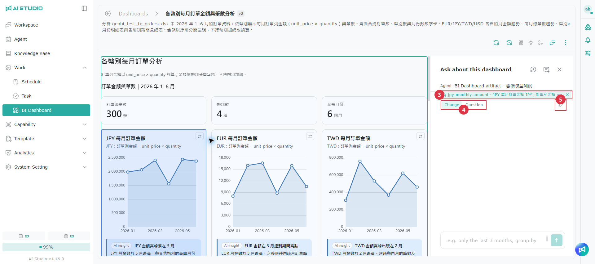

1. ページ内のブロックにマウスカーソルを合わせると、ブロックの右上に「選択に追加」と「このブロックに質問」の 2 つのアイコンが表示されます。
2. 複数のブロックについてまとめて質問したい場合は、「選択に追加」をクリックして 1 つずつ追加します。選択したブロックは枠線で示され、最大 10 個まで選択できます。
3. 「このブロックに質問」をクリックすると、選択したブロックが質問パネルに読み込まれます。選択に追加していない場合は、現在マウスカーソルがあるブロックが読み込まれます。
4. 「変更」または「質問」を選択し、要望を入力して送信します。

* ダッシュボードの内部ページでは、選択した各ブロックが質問パネルにタグとして表示され、個別に削除できます。すべて削除すると選択が解除されます。
* 会話の右側のキャンバスでは、フローティングの質問ウィンドウのタグに、1 つ目のブロックと残りの数（例：「＋2」）が表示されます。
* ダッシュボードの内部ページで 1 つのブロックだけを選択している場合は、同じ行の「このブロックを固定」をクリックすると、そのブロックだけをほかのダッシュボードに固定できます。
* Agent による変更は提案として表示され、適用すると書き込まれます。

> 注意：共有ページ、ページの読み込みが完了していない場合、ページレイアウトの編集中は、ブロックのアイコンは表示されません。

### すべてのデータを表示 

データソースに紐づいた表の下には「すべてのデータを表示」があり、クリックするとダッシュボードの右側に「データソース」パネルが開きます。

<figure><figcaption></figcaption></figure>

* パネルには、上から順にクエリのタイトル、データソース名、クエリの SQL、すべてのデータが表示されます。
* 1 ページあたり既定で 200 件表示され、50、100、200、500、1000 件に切り替えられます。データの並べ替えと検索には対応していません。
* 指標を使っているクエリでは、パネルに指標タグが表示され、ここから「検証済みにする」こともできます。
* パネルの左端をドラッグすると幅を調整できます。データソースパネルと質問パネルは同時に 1 つしか開けません。

> 注意：
>
> * Agent の回答中はパネルを開けず、「AI が回答中です。しばらくしてから開いてください」と表示されます。
> * 提案の「変更後」のプレビューには、「すべてのデータを表示」とエクスポートはありません。
> * 「このクエリが見つかりません。置き換えられたか削除された可能性があります。」と表示される場合はページが更新されているため、ページを再読み込みしてください。「すべての明細を読み込めませんでした。もう一度お試しください。」と表示される場合は、しばらくしてからもう一度お試しください。

### 表のエクスポート 

表の右上とデータソースパネルに「CSV」と「Excel」ボタンがあります。

| 表の種類            | エクスポートされる内容             | 上限                     |
| --------------- | ----------------------- | ---------------------- |
| データソースに紐づいた表    | そのクエリのすべてのデータ           | 10 万行。超えた分は切り捨てられ、メッセージが表示されます |
| 通常の表            | 現在表示されているデータ（検索・並べ替えの適用後） | —                      |

* ファイル名は、クエリのタイトル（通常の表は artifact-table）にエクスポート時刻を加えたものです。
* フィルターを適用している場合、エクスポートしたデータには現在のフィルター条件が反映されます。
* 共有ページではエクスポートできません。

### グラフをクリックして絞り込み・ドリルダウンする 

ダッシュボードの内部ページでグラフのデータポイントをクリックすると、次の操作を選べます。

* **これでページ全体を絞り込む**：このデータポイントでダッシュボード全体を絞り込みます。絞り込みに使えるフィールドの場合にのみ表示されます。
* **ドリルダウン**：データポイントを追加質問の文章に変換し、質問パネルにあらかじめ入力します。確認してから送信します。

フィルターの結果は現在の画面にのみ表示され、保存されず、新しいバージョンも作成されません。フィルターを適用できないブロックには「未適用」と表示され、ほかのブロックは通常どおり更新されます。詳しくは [フィルター](bi-yi-biao-ban.md#shai-xuan-qi) を参照してください。

### ページレイアウトの編集とグラフの変更 

ページレイアウトの編集とグラフの変更には Agent は必要ありません。変更は直接保存され、新しいバージョンが作成されます。

#### ページレイアウトの編集 

1. ヘッダーの「ページレイアウトの編集」をクリックします。
2. ブロックをドラッグして位置と幅を調整します。
3. 数値カードのグループやカード内の項目は、マウスカーソルを合わせるとハンドルが表示され、同じコンテナ内で並べ替えたり、同じ種類のコンテナに移動したりできます。ドラッグ中は挿入線で位置がプレビューされ、`Esc` キーを押すとキャンセルできます。
4. 完了したら保存します。

> 注意：
>
> * レイアウトを編集するには、ページに 2 つ以上のブロックが必要です。Agent が自由にレイアウトしたページはドラッグできず、ボタンは無効になり理由が表示されます。
> * 適用待ちの提案がある場合、更新中の場合、Agent の回答中は、「ページレイアウトの編集」は無効になります。
> * 編集中は、質問パネル、更新、エクスポートは使えません。保存していない変更がある状態でページを離れようとすると、確認が表示されます。
> * ほかの人が同時にこのダッシュボードを変更していた場合は、保存時にメッセージが表示されて再読み込みされ、保存していないレイアウトは破棄されます。

#### グラフの変更 

グラフカードのグラフ変更ボタンをクリックすると、ランキング、棒グラフ、推移、積み上げ、ドーナツ、ファネル、レーダー、2 軸など、互換性のある種類に変更できます。現在のデータに適した種類のみが表示されます（例：数値の差が大きい場合は 2 軸、カテゴリが 3～8 個の場合はレーダー）。

グラフの変更は表示方法を変えるだけで、数値は変わりません。切り替えるたびに新しいバージョンが作成されます。

### 更新と提案 

Artifact ページは 3 か所から更新でき、結果は必ずまず提案として表示され、ページが直接上書きされることはありません。

| 入口                 | 説明                  |
| ------------------ | ------------------- |
| 更新                 | ダッシュボード全体を更新します     |
| 選択したタイルを更新（n）      | 選択したタイルだけを更新します     |
| タイルの「その他」の「再取得」    | このタイルだけを更新します       |

* 更新はバックグラウンドで実行されるため、先にページを離れてもかまいません。完了すると通知されます。一度に最大 10 タイルまでです。
* データに変化がない場合は、すぐに「変化なし」と表示されます。データに変化がある場合や、ページで Web ページ・アップロードしたファイルを使っている場合は、Agent がインサイトと数値の文章を書き直します。

**提案を確認して適用する**

1. 「変更前／変更後」を切り替えて内容を比較します。変更のあったブロックは点線の枠で示されます。
2. 確認したら「適用」をクリックします。提案が複数ある場合は、「すべて承認（削除を除く）」をクリックすると、削除以外の提案をまとめて選択できます。一度に最大 20 件までです。
3. 適用を確定すると、まとめて適用してもダッシュボードのバージョンは 1 つだけ増えます。期限切れ、処理済み、権限のない提案はスキップされ、理由が表示されます。

> 注意：タイルごとの更新はそれぞれ 1 回の Agent の処理となり、Token を消費します。

### KPI アラート 

Artifact ページに数値型の数値カードがある場合は、数値カードごとにアラートのルールを 1 つずつ設定できます（管理権限が必要）。

1. 「アラート設定」を開きます。ダッシュボードに Artifact ページのタイルが 1 つだけの場合はヘッダーの「⋮」から、複数のタイルがある場合は Artifact のタイルの「⋮」から選択します。
2. ウィンドウ上部の KPI メニューで、設定する数値カードを選択します。既定は 1 つ目のカードです。
3. 「アラートを有効にする」をオンにし、条件（より大きい、より小さい、変動率が % を超える）、しきい値、「受信者」を設定して保存します。
4. ほかの数値カードにも設定する場合は、KPI メニューを切り替えて手順 3 を繰り返します。

いずれかの数値カードが条件を満たすと、タイトルの横に「アラート中」アイコンが表示され、受信者にメールで通知されます。「アラートを削除」をクリックすると、現在選択している数値カードのルールだけが削除されます。

> 注意：
>
> * Artifact ページのアラートは、標準ダッシュボードとはチェックのタイミングが異なります。再取得や変更の提案を適用した後にのみチェックされ、ダッシュボードでスケジュールが有効になっている必要があります。スケジュールの実行直後にはチェックされず、メールも送信されません。
> * ページの更新後に存在しなくなった数値カードがある場合、KPI メニューとアラートの一覧もそれに合わせて更新されます。

### ダッシュボードに固定する 

<figure><figcaption></figcaption></figure>

1. 会話の右側のキャンバスで固定ボタンをクリックすると、ページ全体を固定します。数値カード、グラフ、表を 1 つだけ固定したい場合は、ダッシュボードの内部ページの質問パネルでそのブロックを選択し、「このブロックを固定」をクリックします。
2. 「Dashboard に固定」ウィンドウで、既存のダッシュボードを選択するか、新しいダッシュボードを作成します。
3. 確定すると、内容が新しいタイルとしてダッシュボードの一番下に追加されます。

固定したコピーと元のページは別々に更新され、それぞれのバージョンが保持されます。同じダッシュボードに、複数の Artifact ページと標準のタイルを同時に置くことができます。

### ページを共有する 

1. 「⋮」から「ページを共有」を選択するか（ダッシュボードに Artifact ページのタイルが 1 つだけの場合はヘッダーの「⋮」）、会話の右側のキャンバスの共有ボタンをクリックします。
2. 共有の設定を確認してリンクを作成します。

共有リンクを開いた人は閲覧のみ可能で、表にはプレビューのデータだけが表示されます。すべてのデータの表示、表のエクスポート、作成記録の確認、ブロックの選択、インサイトへの追加質問はできません。共有ページの右上にはダウンロードボタンがあります。

> 注意：
>
> * 現在、ページを共有できるのはダッシュボードの所有者のみです。ほかの人には「このページを共有できるのはダッシュボードの所有者のみです」と表示されます。
> * ページにクエリのデータのプレビューが含まれている場合、リンクを開ける人なら誰でも閲覧できます。共有ウィンドウには「このページにはクエリのデータのプレビューが含まれており、共有リンクを開ける人なら誰でも閲覧できます。」と表示されます。
> * データがナレッジベースのスプレッドシートのものである場合、共有ページの表には「内容は権限のあるユーザーがログインした場合のみ表示されます」と表示されますが、ページ上の文章、KPI の数値、インサイトは公開されます。共有する前に内容を確認してください。

## 指標 

指標とは、売上や粗利率など、確認済みのビジネス上の定義です。名前、定義、単位、良し悪しの方向、担当者を含み、「バインド」で、あるデータソースにおけるその指標の計算式を記録します。

AI がダッシュボードの SQL を生成する際には確認済みの指標が使われるため、ダッシュボードが違っても数値の算出方法が一致します。また、使った指標とそのバージョンも記録されます。指標の定義が改訂されると、古い定義を使っているタイルには「定義が更新されました」と表示されます。

### 指標のページを開く 

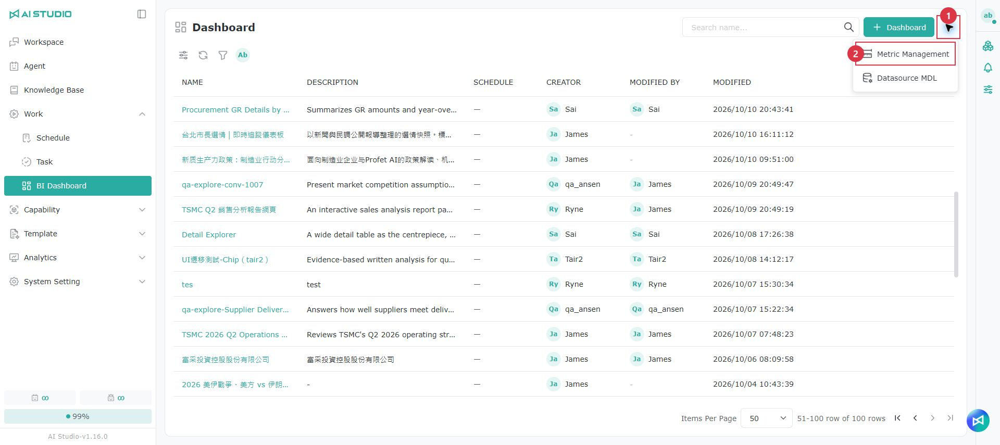

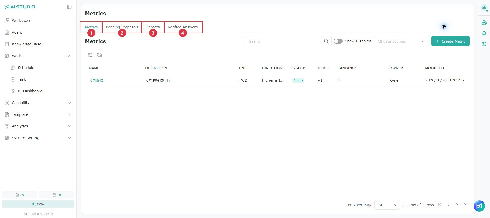

BI ダッシュボードの一覧ページで右上の「その他」をクリックし、「指標の管理」を選択します。ダッシュボードのタイルにある指標タグをクリックして、その指標を新しいタブで開くこともできます。

指標のページには 4 つのタブがあります。

| タブ       | 説明                                               |
| -------- | ------------------------------------------------ |
| 指標の一覧    | 指標の作成、編集、無効化と、バインドとバージョンの管理を行います                |
| 確認待ちの提案  | AI がデータモデルから提案した新しい指標や新しいバインドです。修正して適用するか、破棄します    |
| 目標値      | 各指標の期間ごとの目標値です。手動で追加するか、ドキュメントから抽出できます            |
| 検証済みの Q&A | 人が確認した「質問＋SQL」の例です。AI は似た質問を受けたときにこれを参照します        |

> 注意：データソースやユーザー一覧の読み込みに失敗した旨が表示された場合は、「再試行」をクリックしてください。

### 指標の一覧 

一覧には、各指標の名前、定義、単位、方向、ステータス（有効／無効）、バージョン、バインド数、担当者、更新日時が表示されます。

* 検索では名前と定義の両方が照合されます。データソースで絞り込むこともできます。
* 無効化した指標は既定では表示されません。「無効なものを表示」をオンにすると確認できます。
* バインド数の横に「確認が必要」と表示されている場合は、確認が必要なバインドがあります。指標を開くと理由を確認できます。
* バインド数の横に「+N」と表示されている場合は、権限のないナレッジベースのデータソースからのバインドがほかに N 件あります。

#### 指標の作成 

1. 「指標を作成」をクリックします。
2. 名前（必須）、定義、単位、方向（指定なし／高いほど良い／低いほど良い）、担当者を入力します。
3. 保存したら、指標の名前をクリックして詳細を開き、バインドを追加します。

> 注意：指標の名前は重複できません。

#### 指標の詳細とバインド 

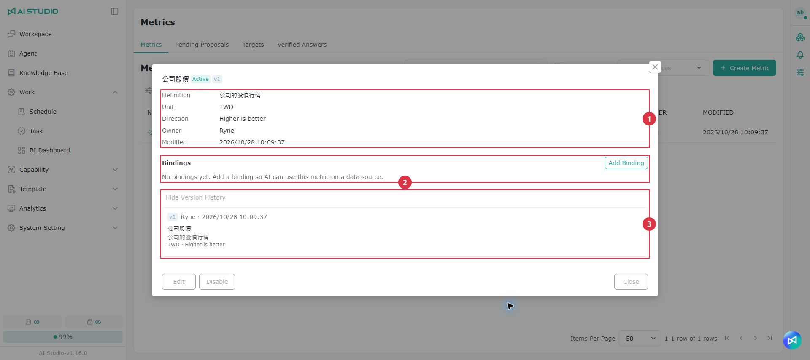

指標の名前をクリックすると詳細が開き、基本情報、バインドの一覧、バージョン履歴を確認できます。

バインドとは、あるデータソースにおける指標の計算式です。バインドを追加または変更する際は、データソース、データモデル、計算式、時間フィールド、既定のフィルターを入力します。**保存する前に「テスト実行」に成功する必要があります。**テスト実行には数秒かかる場合があり、いずれかの欄を変更した場合はもう一度テスト実行する必要があります。

> 注意：バインドのデータソースは作成後に変更できません。ソースを変更したい場合は、バインドを削除してから追加し直してください。

#### 指標の無効化と有効化 

行の右側の「無効化」をクリックして確認すると、指標が無効になります。無効にすると AI はその指標を使わなくなり、その指標を使っているタイルには「無効」と表示されます。「有効化」をクリックすると、いつでも再び有効にできます。

> 注意：無効化した指標で変更できるのは担当者のみです。

### 確認待ちの提案 

<figure><figcaption></figcaption></figure>

データソースの Schema ページで「AI による指標の提案」をクリックすると、AI がデータモデルに基づいて新しい指標や新しいバインドを提案し、完了するとこのタブに移動します。

* 一覧には、種類（新しい指標／バインドの追加）、名前、定義、データソース、データモデル、計算式、作成者、提案日時が表示されます。
* ステータス（確認待ち／適用済み／破棄済み）とデータソースで絞り込めます。
* **適用**：ウィンドウが開き、先に内容を修正できます。テスト実行に成功したら送信します。
* **破棄**：確認すると破棄されます。元に戻すことはできません。

> 注意：
>
> * AI による指標の提案には 1 分以上かかる場合があります。処理中と表示されている間は、もう一度クリックする必要はありません。完了すると提案が一覧に表示されます。
> * 「権限のため表示されていないものがほかに N 件あります」と表示される場合は、権限のないナレッジベースのデータソースからの提案があります。

### 目標値 

<figure><figcaption></figcaption></figure>

一覧には、指標、期間（例：「2025 Q1」）、値と単位、ソース（手動／ドキュメントから抽出）、ステータス（確認待ち／確認済み）、作成日時が表示されます。ソースにマウスカーソルを合わせると出典を確認できます。単位が指標と異なる場合は「単位が一致しません」と表示されます。

* **手動で追加**：指標、期間、値を選択します。追加するとすぐに「確認済み」になり、同じ指標・同じ期間の古い確認済みの値を置き換えます。
* **ドキュメントから抽出**：PDF、Word（.docx、.doc）、PowerPoint（.pptx、.ppt）、TXT、Markdown のファイル（1 ファイル 20 MB 以内）をアップロードします。抽出はバックグラウンドで実行され、最長で約 15 分かかります。タブを切り替えてから戻っても続きから処理されます。完了すると件数が表示され、「確認待ち」に切り替わります。
* **確認と削除**：確認待ちの値は、値と単位を修正してから「確認」するか、削除できます。確認済みの値は削除のみ可能です。

### 検証済みの Q&A 

<figure><figcaption></figcaption></figure>

検証済みの Q&A は、人が確認した質問と SQL で、AI は似た質問を受けたときにこれを参照します。一覧には、質問、SQL、使用した指標、データソース、種類（タイルから／手動）、ステータス、検証者、検証日時が表示されます。

* **ダッシュボードから追加**：標準のタイルでは「⋮」から「検証済みにする」を選択します。Artifact ページでは「データソース」パネルでクエリごとに登録します。
* **手動で追加**：データソースを選択し、質問（最大 500 文字）と SQL を入力します。システムがそのソースでテスト実行し、成功した場合のみ保存されます（データが見つからない場合も成功とみなされます）。
* **再検証**：質問とデータソースは変更できず、SQL のみ修正できます。修正しなくても送信できます。

> 注意：
>
> * 指標が改訂されると、関連する Q&A は「再検証が必要」になり、再検証するまで AI は参照しません。
> * データソースが削除された Q&A には「ソースが存在しません」と表示され、削除のみ可能です。

### ダッシュボードに表示される指標の情報 

<figure><figcaption></figcaption></figure>

| 項目              | 説明                                                                                                                         |
| --------------- | -------------------------------------------------------------------------------------------------------------------------- |
| 指標タグ            | 「売上 v3」のように、タイルを生成した時点で使った指標とバージョンを表示します。クリックすると、その指標が新しいタブで開きます。Artifact ページの指標タグは「データソース」パネルに表示されます                                |
| 定義の更新のお知らせバー    | 指標の定義が更新された場合、指標が無効化された場合、目標値が変更された場合に表示されます。システムがタイルを自動的に変更することはありません。「AI に再生成を依頼」をクリックすると質問パネルにあらかじめ入力されるので、確認してから送信します（目標値の変更の場合はこのボタンはありません） |
| 検証済みにする         | タイルの質問と SQL を検証済みの Q&A として登録します。詳しくは [検証済みの Q&A](bi-yi-biao-ban.md#yi-yan-zheng-wen-da) を参照してください                             |

> 注意：Artifact ページで使っている指標の定義が更新された場合、更新しても記録されたバージョンは変わりません。AI にそのページの再生成を依頼する必要があります。

## よくある質問 

会話に BI ダッシュボードの入口が表示されない

[使用前の準備](bi-yi-biao-ban.md#shi-yong-qian-zhun-bei) の条件を満たしているか確認してください。管理者が構成で「会話での BI ダッシュボードの生成を許可」をオンにしていること、お使いのロールに BI 権限があること、使用している Agent の BI 機能がオンになっていることが必要です。

一覧ページに空のダッシュボードを作成するボタンが見つからない

一覧ページでは、「＋ Dashboard」から GenBI でダッシュボードを生成するか、会話から Artifact ページを固定してダッシュボードを作成する方法しかありません。空のダッシュボードを作成する入口はありません。

「読み込めませんでした。もう一度お試しください。」と表示される

「再読み込み」をクリックしてください。繰り返し発生する場合は、管理者にデータソースの状態を確認してもらってください。

会話に「接続が切断されました。回答が不完全な可能性があります。ページを再読み込みして結果を確認してください。」と表示される

Agent の回答中に接続が切断されました。ページを再読み込みし、回答と生成された内容が揃っているかを確認してください。

更新したら数値は変わったが、インサイトが変わらない

ページ上部に「データは … に更新されました。インサイトと主要な数値は前のバージョンの内容です」と表示されます。再取得するか、Agent にインサイトの書き直しを依頼してください。

「すべてのデータを表示」が表示されないのはなぜですか？

「すべてのデータを表示」は、ダッシュボードの内部ページにあるデータソースに紐づいた表にのみ表示され、ダッシュボードの管理権限が必要です。会話の右側のキャンバス、共有ページ、提案の「変更後」のプレビューでは利用できません。

「アラート設定」が表示されないのはなぜですか？

標準ダッシュボードでは数値カードである必要があり、Artifact ページでは数値型の数値カードが 1 つ以上必要です。どちらもダッシュボードの管理権限が必要です。

エクスポートしたデータが不完全

データソースに紐づいた表は最大 10 万行までエクスポートでき、超えた分は切り捨てられてメッセージが表示されます。通常の表は、現在表示されているデータのみがエクスポートされます。

エクスポートした PDF の文字を選択できない

PDF は画面をキャプチャして作成されるため、内容は画像です。ダッシュボードの内容が長い場合は、エクスポートの解像度が自動的に下げられます。

