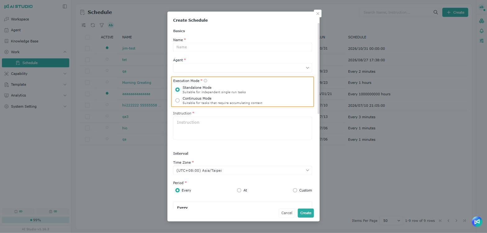
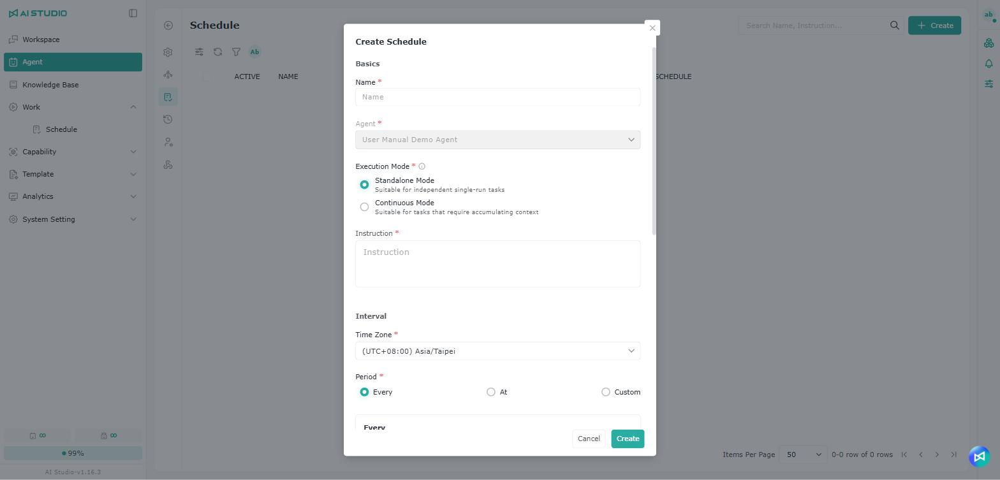

# スケジュール

## 概要

<figure><figcaption></figcaption></figure>

Schedule を使うと、スケジュールタスクを作成し、指定した Agent に設定した日時や周期で指示を自動実行させられます。毎日の要約、定期的な通知、データの照会、レポートの作成、自動化されたプロセスなど、定型的なタスクを定期的に実行できます。

スケジュールを設定すれば、Agent との会話を手動で開かなくても、Agent が指定した日時にタスクを自動実行し、実行ごとの結果と記録が残ります。

スケジュール管理ページで作成するほか、Agent との会話で要件を伝えて Agent にスケジュールを作成させることもできます。また、指示の中で判断の条件を書き、担当者を @ で指定しておくと、条件が成立したときだけ Agent が通知を送るようにもできます。詳しくは条件付き通知を参照してください。

## スケジュールの作成

### スケジュール管理ページから作成する 

<figure><figcaption></figcaption></figure>

<figure><figcaption></figcaption></figure>

<figure><figcaption></figcaption></figure>

<figure><figcaption></figcaption></figure>

1. スケジュールタブに切り替えます。
2. 右上の **追加** をクリックすると **スケジュールの追加** ウィンドウが開き、新しいスケジュールタスクを作成できます。
3. スケジュール名を入力します。
4. スケジュールをトリガーする Agent を選択します。一度選択すると変更できません。
   * Agent 一覧では、ユーザー自身が作成した Agent が先頭に表示されます。
5. スケジュールの実行モードを選択します。
   * スタンドアロンモード：各回の実行を独立したタスクとして扱います。コンテキストを蓄積する必要のない単発の実行に適しています。
   * 継続モード：実行の文脈を引き継いで蓄積します。継続的な追跡、情報の蓄積、タスクの状態の引き継ぎが必要な場合に適しています。
   * 実行モードは作成後に変更できません。
6.  Agent が毎回の実行で完了すべきタスクの内容を入力します。スケジュールの実行結果を安定させるため、指示ではタスクの目的、出力形式、注意すべき条件をできるだけ明確に記述してください。

    * 指示の中で @ を入力して担当者を選択できます。@ で指定された担当者はこのスケジュールの通知対象となり、Agent が指示内の条件に基づいて通知するかどうかを判断します。詳しくは条件付き通知を参照してください。

    <figure><figcaption></figcaption></figure>
7. タイムゾーンを入力します。システムは選択したタイムゾーンでスケジュールの実行日時を計算します。
8.  スケジュールの周期を選択します。スケジュールは次の 3 つの周期モードに対応しています。

    * 定期実行：一定の間隔で繰り返し実行するスケジュールに使います。たとえば **30 分ごと** に設定すると、**開始日時** から 30 分ごとに自動実行されます。
      * 実行単位は分、時間、日、週、月から選べます。
    * 日時指定：スケジュールを実行する日付と時刻を指定する場合に使います。実行する日付と時刻を選択します。特定の日時に 1 回だけ実行するタスクや、システム設定に基づいて指定した日時にトリガーするタスクに適しています。
    * カスタム：より複雑なスケジュールのルールを設定する場合に使います。自然な文章で説明を入力してシステムに Cron を生成させるか、Cron 式を直接入力できます。
      * **AI 補助による生成** 欄に実行ルール（例：「毎月第 3 月曜日」）を入力し、Enter キーを押すか、欄の右側のボタンをクリックするか、欄から離れると、システムが Cron 式を自動生成して **Cron** 欄に入力します。

    周期を設定すると、下の **プレビュー** ブロックにスケジュールのルールの説明と **今後の実行日時**（最大 3 件）が表示されます。Date または Count の実行上限を有効にしている場合、プレビューには実際に実行される日時だけが表示されます。設定に誤りがある場合は、プレビューブロックにその理由が表示されます。

    <figure><figcaption></figcaption></figure>
9.  実行上限を選択します。少なくとも 1 つの使用制限を有効にする必要があります。有効にした使用制限のいずれかが設定したしきい値に達すると、スケジュールは自動的に無効になります。スケジュールは次の停止条件に対応しています。

    * Date：終了日を設定します。指定した日付になると、スケジュールの実行を停止します。
    * Count：最大実行回数を設定します。指定した回数に達すると、スケジュールの実行を停止します。
    * Token：最大 Token 使用量を設定します。指定した Token 数に達すると、スケジュールの実行を停止します。

    最大実行回数の上限は 10,000 回、最大 Token 数の上限は 10,000,000 です。
10. 通知先を設定します。スケジュールの完了後に指定したユーザーに通知するかどうかを設定できます。現在、システム通知、メール通知、Webhook の 3 つの方法に対応しています。

    * システム通知：プラットフォーム内の通知（右上の通知ベル）で指定したユーザーに通知します。
    * メール通知：メールで指定した受信者に通知します。
      * 受信者はユーザー一覧から選ぶことも、メールアドレスを直接入力して Enter キーで追加することもできます。
    * Webhook：外部の URL を設定できます。スケジュールの実行完了後、結果を POST で指定した外部サービスに送信できます。

    ここで設定した通知は毎回の実行終了後に送信され、実行の完了時と失敗時の両方で通知されます。スケジュールを追加する際、システム通知とメール通知の受信者には、現在ログインしているユーザーが既定で設定されます。特定の条件でのみ通知したい場合は、条件付き通知を参照してください。

    <figure><figcaption></figcaption></figure>
11. 設定が終わったら **追加** をクリックして完了します。

### スケジュールの実行モード

<figure><figcaption></figcaption></figure>

スケジュールの各回の実行で以前の内容を引き継ぐかどうかは、**実行モード** によって決まります。

| モード                                       | 動作                                         | 適した場面                                       |
| ----------------------------------------- | ------------------------------------------ | ------------------------------------------- |
| 
スタンドアロンモード

（Standalone）
 | 各回の実行は独立した作業で、前回の内容は引き継がず、毎回最初から始めます。        | 各回の実行が互いに関係しない場合。例：毎日決まった要約の作成、定期的な通知。          |
| 
継続モード

（Continuous）
          | 各回の実行で以前の内容と状態を引き継いで蓄積します。                   | 実行をまたいだ追跡、情報の蓄積、進捗の引き継ぎが必要な場合。例：同じテーマを継続的に追跡する。 |

### Agent 設定ページから作成する

<figure><figcaption></figcaption></figure>

入口は Agent 設定ページのスケジュール管理です。追加の手順は [スケジュール管理ページから作成する](pai-cheng.md#cong-pai-cheng-guan-li-ye-mian-jian-li) を参照してください。唯一の違いは、Agent 設定ページではほかの Agent を選べないことです。

### 会話の中で Agent にスケジュールを作成させる

会話の中で Agent にスケジュールの作成を依頼する際、依頼内容でほかのユーザーをメンション（mention）すると、メンションされたユーザー向けの通知が作成されます。通知の内容はシステム通知で確認できます。

<figure><figcaption></figcaption></figure>

1. 会話の中でスケジュールの要件を説明します。実行の日時または頻度と、実行上限を含めてください。例：「平日の毎朝 8 時に業界ニュースをまとめて。30 回実行したら停止して」
2. 情報が十分であれば、Agent がそのままスケジュールを作成します。情報が不足している場合は、Agent がまず質問するか、推奨する実行上限を提案して確認を求めます。
3. 作成が完了すると、会話にスケジュールカードが表示され、スケジュール名と実行周期が示されます。
4. スケジュールカードをクリックするとスケジュールの編集画面が開き、設定の調整、無効化、削除を行えます。

<figure><figcaption></figcaption></figure>

利用上の注意事項は次のとおりです。

* 会話から作成したスケジュールは常に継続モードになり、現在の会話に紐づきます。以降の各回の実行結果はこの会話に返されます。
* 作成後に変更したい場合は、会話の中で Agent に直接伝えます。たとえば「毎週月曜の朝 9 時に実行するように変更して」と伝えると、Agent がスケジュールを更新し、新しいスケジュールカードを表示します。
* スケジュールが実行されるたびに、その回の実行の会話にもスケジュールカードが表示されます。実行に成功すると緑のチェックマーク、失敗すると赤いバツ印が表示されます。
* スケジュールを削除すると、スケジュールカードに「このスケジュールは削除されました」と表示され、クリックできなくなります。
* スケジュールカードをクリックして編集画面を開けるのは、スケジュールの作成者だけです。
* ほかの人に通知したい場合は、メッセージの中で @ で担当者を選びます。自分に通知したい場合は、「完了したら通知して」と伝えるだけで構いません。通知方法は既定でシステム通知ですが、メールを送るよう伝えるとメール通知になります。
* 「歩留まりに異常があったときだけ @王小明 に通知して」のように通知に条件がある場合、Agent は条件付き通知として設定します。
* Webhook は会話の中では設定できません。利用する場合は、スケジュールの編集画面で設定してください。

### 条件付き通知

数値の異常や状態の変化など、毎回ではなく特定の状況のときだけ Agent に通知させたい場合は、指示の中で判断の条件を書き、@ で通知対象の担当者を指定します。

指示の例：

> 毎回の実行で、生産ライン A の過去 1 時間の歩留まりを照会してください。歩留まりが 95% を下回った場合は @王小明 に通知し、異常のあったロット番号と歩留まりの値を含めてください。歩留まりが正常な場合は誰にも通知する必要はありません。

<figure><figcaption></figcaption></figure>

条件付き通知の仕組みは次のとおりです。

* 指示の中で @ で指定された担当者は、このスケジュールの通知対象になります。通知を送るかどうかは、各回の実行時に Agent が指示の条件に基づいて判断します。
* 通知は実行中に条件が成立した時点ですぐに送られ、内容は Agent が作成します。
* 通知方法はシステム通知またはメールで、Agent が指示に基づいて判断します。方法を指定したい場合は、「@王小明 にメールを送って」のように指示の中に明記してください。
* Agent が通知できるのは、指示の中で @ で指定された担当者だけです。ほかのユーザーや、直接入力したメールアドレスには通知できません。
* 指示から @王小明 を削除して保存すると、その担当者は通知対象ではなくなります。

<figure><figcaption></figcaption></figure>

条件付き通知は、スケジュール作成時の通知設定と同時に利用できます。両者の違いは次のとおりです。

<figure><figcaption></figcaption></figure>

| 項目         | 通知設定（システム通知／メール通知／Webhook）              | 指示の中で @ した担当者（条件付き通知） |
| ---------- | ----------------------------------------- | -------------------- |
| 送信のタイミング   | 毎回の実行終了後に送信されます                          | 指示の条件が成立したときだけ送信されます  |
| 判断するのは     | システム                                     | 指示に基づいて Agent が判断します   |
| 通知の内容      | スケジュール名、実行ステータス、実行日時、Agent の回答内容       | Agent が作成したメッセージ       |
| Webhook の対応 | あり                                       | なし                   |

たとえば、通知設定で自分自身を指定して毎回実行結果を受け取り、同時に指示の中で上司を @ して、異常時だけ通知することができます。同じ人が両方に含まれている場合、条件が成立した回には 2 件の通知を受け取ります。条件が成立したかどうかは Agent が判断するため、「成績が悪い」ではなく「95% を下回る」のように、明確で数値化できる形で条件を記述することをおすすめします。送信された通知は取り消せません。

### スケジュールの管理 

スケジュール一覧には、各スケジュールの有効状態、名前、Agent、作成者、最終実行ステータス、実行時間、次回の実行日時、スケジュールのルールが表示されます。実行ステータスはリアルタイムで更新されるため、ページを再読み込みする必要はありません。スケジュールにマウスカーソルを合わせると、次の操作を行えます。

* 実行：スケジュールをすぐに 1 回実行します。本来の次回の実行日時には影響しません。
* 停止：現在実行中の回を停止します。詳しくは実行の停止を参照してください。
* 編集：スケジュールの設定を変更します。
* 削除：スケジュールを削除します。

<figure><figcaption></figcaption></figure>

スケジュール名をクリックするとスケジュールの詳細ページが開き、**一般設定** と **ログ** の 2 つのタブがあります。**一般設定** タブではスケジュールの内容を直接変更でき、**有効** スイッチでスケジュールを一時停止または再開できます。変更後に **保存** をクリックすると反映されます。

<figure><figcaption></figcaption></figure>

#### 実行の停止

スケジュールの実行中は、スケジュール一覧またはログ一覧で **停止** をクリックすると、現在の回の実行を中断できます。

* 停止で中断されるのはその回の実行だけです。スケジュール自体には影響せず、次回の実行日時も変わらないため、その後も通常どおりトリガーされます。
* 停止した回の実行も、実行回数と Token の上限に計上されます。
* 停止後のステータスは **停止済み** と表示され、実行の失敗とは区別されます。
* 停止した実行では、システム通知、メール通知、Webhook のいずれの通知も送信されません。
* 停止できるのは、自分がトリガーした実行だけです。ステータスが **待機中** の実行はまだ停止できません。

## ログの確認

スケジュールの詳細ページで **ログ** をクリックすると、そのスケジュールの実行記録を確認できます。

<figure><figcaption></figcaption></figure>

ログ一覧には、各回の実行のタイトルとステータスが表示されます。記録をクリックすると、その回の実行の詳細を確認できます。

ログ一覧の実行ステータスはリアルタイムで更新され、次の種類があります。

| ステータス | 説明                                    |
| ----- | ------------------------------------- |
| 待機中   | トリガーされ、利用できる実行枠を待っている状態です。このとき表示される時刻は待機列に入った時刻で、実行が始まると実際の開始時刻に更新されます。実行時間に待機時間は含まれません。詳しくは下の「待機中の実行」を参照してください |
| 実行中   | Agent がタスクを実行中です。停止をクリックすると今回の実行を中断できます       |
| 完了    | 実行に成功しました                             |
| エラー   | 実行に失敗しました。記録をクリックするとエラーの原因を確認できます              |
| 停止済み  | ユーザーが今回の実行を手動で停止しました                   |

実行結果は会話の形式で表示され、Agent の回答内容、実行コスト、関連する操作が含まれます。実行結果をコピーしたり、ログ一覧に戻ってほかの記録を確認したりできます。

ログを使うと、スケジュールが正常に実行されたか、Agent の回答内容が期待どおりか、各回の結果に対して後続の対応が必要かを確認できます。

## 待機中の実行

スケジュールがトリガーされたときに実行枠がすべて使用中の場合、その回の実行は **待機中** になります。システムが定期的に自動で再試行し、枠を確保すると実行を開始するため、手動で操作する必要はありません。スケジュールを作成しても Agent の枠の種類は変わりません。スケジュールの実行時に Assistant と Workforce のどちらの枠を使うかは、スケジュールに紐づく Agent の設定によって決まります。詳しくは [Workforce モニター](../fen-xi-zhi-nan/workforce-jian-kong.md#assistant-yu-workforce-de-cha-yi) を参照してください。

待機中の実行には、次のような動作があります。

* 1 つのスケジュールで同時に待機中になる実行は 1 件だけです。待機中に次回の実行日時になった場合、その回のトリガーはスキップされ、別途待機したり後から実行されたりすることはありません。
* ステータスが待機中のときに **実行** をクリックしても、新しい実行記録は作成されません。
* 指示、スケジュールの日時、名前、通知設定を変更しても、待機中の実行は取り消されません。その回の実行には変更後の設定が適用されます。
* スケジュールを無効にすると、待機中の実行は取り消されます。
* スケジュールを削除すると、待機中の実行もあわせて削除され、記録は残りません。
* 一般的なスケジュールでは、待機中の時点ではまだ会話が作成されていないため、会話の内容は確認できません。既存の会話に紐づくスケジュール（会話の中で Agent に作成させたスケジュールなど）は確認できます。

待機中の実行を開始できなかった場合、ステータスは **エラー** になります。原因は次のとおりです。

| 表示されるメッセージ | 原因 | 通知の送信 |
| ---------- | -- | ----- |
| プランの同時実行枠が上限に達しており、N 分以上待機しても実行枠を確保できませんでした | 待機の上限時間を超えても枠を確保できなかった（既定は 10 分、N は実際の設定値） | あり |
| スケジュールが無効になったため、待機中の実行は取り消されました | ユーザーがスケジュールを無効にした、または実行上限（Date、Count、Token）に達して自動的に無効になった | なし |
| スケジュールの設定が変更されたため、待機中の実行は取り消されました | スケジュールの有効状態が切り替えられた | なし |
| Agent が存在しないため、待機中の実行は取り消されました | スケジュールに紐づく Agent が削除された | なし |

## 注意事項

スケジュールは、設定したタイムゾーンと周期に従って自動的に実行されます。作成前に、タイムゾーン、開始日時、周期、実行上限の条件が正しいかを確認してください。

スケジュールの実行に失敗した場合は、ログでエラーの記録と実行結果を確認できます。スケジュールが期待どおりに実行されない場合は、スケジュールが有効になっているか、停止条件のしきい値に達していないか、Agent が正常に利用できるか、実行枠が上限に達しているために待機中のままになっていないか、または待機がタイムアウトしていないかを確認してください。

スケジュールタスクが外部サービスを呼び出したり通知を送信したりする場合は、Webhook URL、通知方法、受信者の設定が正しいかを確認してください。

スケジュールを作成・変更する際は、**プレビュー** ブロックで今後の実行日時が期待どおりかを確認できます。無効化されたユーザーには通知は届きません。

## よくある質問

2 週間ごと／2 か月ごとに実行するようにスケジュールの周期を設定するには？

システムに組み込まれた Cron では「2 週間ごと」などの周期ルールを表現できないため、**定期実行** モードを使い、**実行間隔** を **2**、**実行単位** を「週」に設定してください。

指示の中で担当者を @ したのに、通知が届かないのはなぜですか？

指示の中で @ された担当者には、Agent が条件の成立を判断した場合にのみ通知が届きます。**ログ** でその回の Agent の回答を確認し、条件が成立していたかを確認してください。毎回実行結果を受け取ってほしい場合は、通知設定のシステム通知またはメール通知にその担当者を追加してください。また、無効化されたユーザーには通知は届きません。

同じ人に通知が 2 件届いたのはなぜですか？

その担当者が通知設定に含まれており、同時に指示の中でも @ されているためです。通知設定では毎回の実行終了時に実行結果が送られ、指示の中の @ では条件の成立時に Agent が別途メッセージを送るため、両者はまとめられません。どちらか一方だけで十分な場合は、もう一方の設定を削除してください。

実行を停止した後も、通知は届きますか？また、実行上限に計上されますか？

停止した実行では通知は送信されませんが、実行回数と Token の上限には計上されます。

