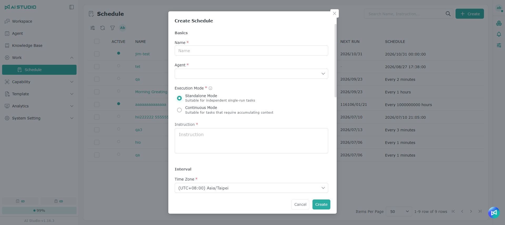
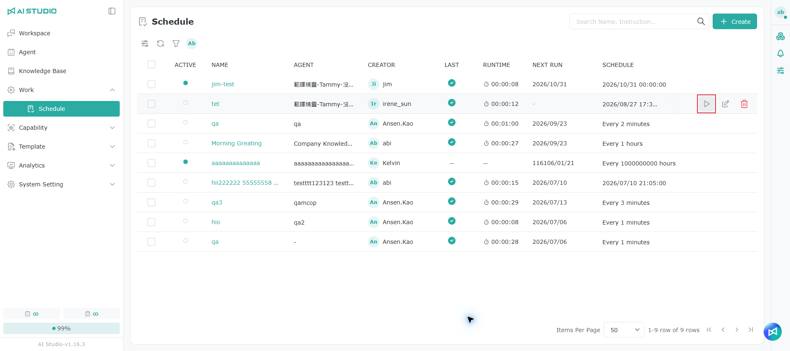

# Webhook 連携ガイド

Webhook を使うと、Agent のスケジュールの実行完了後に、実行結果を社内のプラットフォーム、自動化プロセス、サードパーティのサービスなど、指定したシステムに自動的に送信できます。結果を確認するために別途システムにログインする必要はありません。

Webhook は次のような場面に適しています。

* Agent が作成したレポートを社内システムに自動的に送信する
* スケジュールの実行完了後に、次の自動化プロセスを開始する
* 毎回のスケジュールの実行結果を記録する
* スケジュールが失敗したときに、関係者やシステムに通知する

## 始める前の準備

設定する前に、受信側システムの管理者または開発者から Webhook URL を入手してください。

Webhook URL は次の条件を満たす必要があります。

| 必要な条件            | 説明                                      |
| ---------------- | --------------------------------------- |
| HTTPS を使用する      | データの安全性を確保するため、HTTP には対応していません             |
| 公開ネットワークから接続できる  | localhost、社内ネットワークの IP、そのほかのプライベートネットワークのアドレスには対応していません |
| POST リクエストを受信できる | 受信側で JSON 形式のデータを処理できる必要があります              |
| すばやく応答できる        | 受信側は通知を受け取ったら、タイムアウトまでに HTTP 2xx を返す必要があります  |

ローカルでテストする場合は、ngrok などのツールを使って、ローカルのサービスを公開ネットワークから接続できる HTTPS URL に変換できます。

## Webhook の設定

### ステップ 1：スケジュールを作成または編集する



新しい Agent のスケジュールを作成するか、既存のスケジュールを開いて編集します。

### ステップ 2：Webhook URL を追加する


スケジュールの `webhooks` 欄に、通知を受け取る HTTPS URL を追加します。

### ステップ 3：保存してテストする



設定が終わったら、スケジュールを保存します。

**今すぐ実行** 機能でテストし、受信側が通知を正しく受け取れたかを確認することをおすすめします。

自動実行と手動の今すぐ実行のどちらでも、Webhook の通知がトリガーされます。

## 通知のタイミング

Webhook はスケジュールの実行開始時にすぐ送信されるのではなく、その回の実行が完了して確定した後に送信されます。

そのため、通知が本来のスケジュール日時より数秒〜数十秒遅れることがありますが、これは正常な動作です。

## 実行結果

スケジュールの実行結果に応じて、次のイベントが送信されます。

| 実行結果 | イベント名                    | 説明                   |
| ---- | ------------------------ | -------------------- |
| 実行成功 | `schedule.run.completed` | Agent が今回のスケジュールを完了しました |
| 実行失敗 | `schedule.run.failed`    | 今回のスケジュールの実行に失敗しました    |

成功した場合、通知には Agent の最終的な回答が含まれます。失敗した場合は、関連するエラーメッセージが含まれます。

## 受信する主な情報

<table data-search="false"><thead><tr><th>情報</th><th>説明</th></tr></thead><tbody><tr><td>スケジュール名</td><td>今回実行されたスケジュールの名前</td></tr><tr><td>スケジュール ID</td><td>スケジュールの一意の識別子</td></tr><tr><td>実行 ID</td><td>今回の実行の一意の識別子</td></tr><tr><td>実行ステータス</td><td>成功または失敗</td></tr><tr><td>実行方法</td><td>自動スケジュールまたは手動の今すぐ実行</td></tr><tr><td>実行結果</td><td>Agent の回答内容またはエラーメッセージ</td></tr><tr><td>実行日時</td><td>今回のスケジュールの実行が完了・確定した日時</td></tr><tr><td>次回の実行日時</td><td>スケジュールの次回の実行予定日時</td></tr></tbody></table>

スケジュールが 1 回のみの実行の場合や無効化されている場合、「次回の実行日時」は空になります。

実行結果の内容が 8,192 文字を超える場合は、自動的に切り詰められます。内容全体を取得する必要がある場合は、スケジュールまたは会話の照会機能で確認してください。

## 配信の仕組みと注意事項

### 通知の成功の判定方法

システムが通知を成功とみなすには、受信側がタイムアウトまでに HTTP 2xx を返す必要があります。

タイムアウトの制限は次のとおりです。

* 接続のタイムアウト：5 秒
* レスポンス読み取りのタイムアウト：10 秒

受信側が 2xx 以外のステータスを返した場合、または時間内に応答しなかった場合、その通知は失敗とみなされます。

### 通知に失敗した場合の再送

通知に失敗すると、システムは自動的に 1 回再試行します。

再試行後も失敗した場合、その通知は再送されません。そのため、Webhook を実行結果の唯一の保存方法にすることはおすすめしません。

業務プロセスで通知の欠落が許容できない場合は、スケジュールの結果を照会する仕組みや、定期的に突き合わせる仕組みを別途用意することをおすすめします。

### 重複した通知を受け取る可能性がある理由

受信側がデータを正常に処理していても、応答が遅すぎると、システムが配信に失敗したと判断し、同じ通知を再送することがあります。

同じ通知には同じ `deliveryId` が使われます。受信側は処理済みの `deliveryId` を記録し、同じデータを重複して処理しないようにしてください。

### 通知の順序

実行バッチが異なる通知は、実行の順序どおりに届くとは限りません。受信側で順序を判断する必要がある場合は、通知に含まれる実行日時を基準にしてください。

### セキュリティについて

現在、Webhook の通知には HMAC 署名による検証はありません。

受信側を保護するため、次の対策をおすすめします。

* Webhook URL を機密情報として扱う
* 推測されにくい URL のパスや検証用のパラメーターを使う
* HTTPS、POST、JSON 形式のリクエストのみを受け付ける
* Webhook URL をドキュメント、コードリポジトリ、外部向けのページで公開しない

## 技術者向けリファレンス

### HTTP リクエストの形式

* Method：`POST`
* Content-Type：`application/json`

### Request Headers

| Header               | 説明                            |
| -------------------- | ----------------------------- |
| `Content-Type`       | 常に `application/json`         |
| `User-Agent`         | 常に `ProfetAI-Webhook/1.0`     |
| `X-Webhook-Event`    | 今回の通知のイベントの種類                  |
| `X-Webhook-Delivery` | 今回の配信の一意の識別子。重複処理の防止に使えます        |

### 成功イベントの例

```
{
  "event": "schedule.run.completed",
  "deliveryId": "9f8c1a2b-3d4e-5f60-7182-9a0b1c2d3e4f",
  "deliveredAt": "2026-06-09T08:00:01",
  "data": {
    "scheduleId": "ac150044-...",
    "scheduleName": "Daily Report",
    "runId": "ac17f001-...",
    "assistantId": "agent-001",
    "sessionId": "ac150044-...",
    "status": "COMPLETED",
    "reason": "SCHEDULE_TRIGGERED",
    "content": "本日の要点：……",
    "executedAt": "2026-06-09T08:00:00",
    "nextRunDate": "2026-06-10T08:00:00"
  }
}
```

### 主なフィールドの説明

<table data-search="false"><thead><tr><th>フィールド</th><th>説明</th></tr></thead><tbody><tr><td><code>event</code></td><td>実行成功または失敗のイベント</td></tr><tr><td><code>deliveryId</code></td><td>今回の配信の一意の ID。重複した通知の除外に使えます</td></tr><tr><td><code>deliveredAt</code></td><td>通知の送信日時</td></tr><tr><td><code>data.scheduleId</code></td><td>スケジュール ID</td></tr><tr><td><code>data.scheduleName</code></td><td>スケジュール名</td></tr><tr><td><code>data.runId</code></td><td>今回の実行 ID</td></tr><tr><td><code>data.assistantId</code></td><td>実行に使われた Agent ID</td></tr><tr><td><code>data.sessionId</code></td><td>今回の実行の会話 ID。空の場合があります</td></tr><tr><td><code>data.status</code></td><td><code>COMPLETED</code> または <code>ERROR</code></td></tr><tr><td><code>data.reason</code></td><td>自動スケジュールまたは手動の今すぐ実行</td></tr><tr><td><code>data.content</code></td><td>Agent の最終的な回答またはエラーメッセージ</td></tr><tr><td><code>data.executedAt</code></td><td>今回の実行が確定した日時</td></tr><tr><td><code>data.nextRunDate</code></td><td>次回の実行予定日時。空の場合があります</td></tr></tbody></table>

## よくある質問

<details>

<summary>設定したのに通知が届かないのはなぜですか？</summary>

次の順に確認してください。

1. URL が HTTPS を使っているか
2. URL が公開ネットワークから接続できるか
3. 受信側が POST と JSON に対応しているか
4. 受信側がタイムアウトまでに HTTP 2xx を返しているか
5. スケジュールが有効になっており、正常に実行されたか

`localhost`、プライベート IP、社内ネットワークのアドレスには対応していません。

</details>

<details>

<summary>通知がスケジュールの日時どおりに届かないのはなぜですか？</summary>

Webhook は Agent の実行が完了して確定した後に送信されるため、数秒〜数十秒遅れるのは正常です。

</details>

<details>

<summary>同じ実行で通知が 2 件届いたのはなぜですか？</summary>

システムの再試行による可能性があります。2 件の通知の `deliveryId` を比べてください。ID が同じであれば同じ通知なので、受信側では 1 回だけ処理すれば十分です。

</details>

<details>

<summary>実行結果が不完全なのはなぜですか？</summary>

`content` は最大 8,192 文字までで、それを超えると切り詰められます。スケジュールまたは会話の照会機能で内容全体を取得してください。

</details>

<details>

<summary>通知が ProfetAI から送られたものか確認するには？</summary>

現在のバージョンでは署名による検証はありません。Webhook URL を大切に保管し、受信側では指定したリクエストメソッドとデータ形式のみを受け付けるよう制限してください。

</details>
