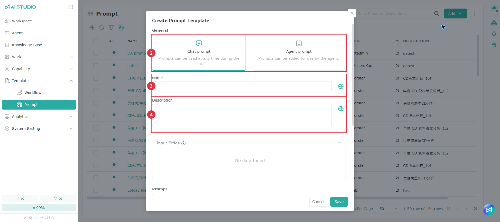
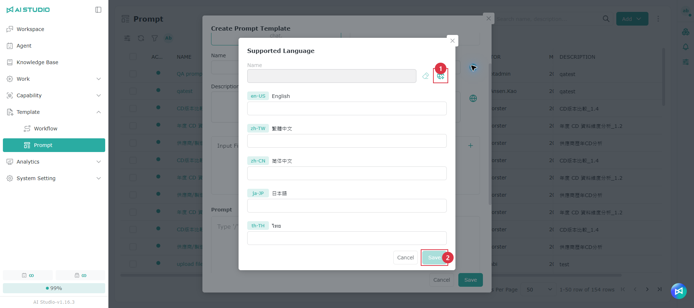
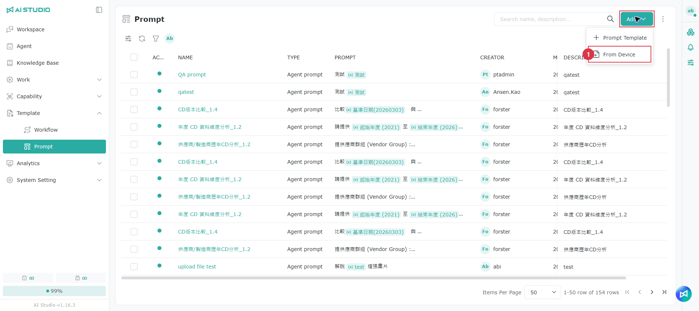
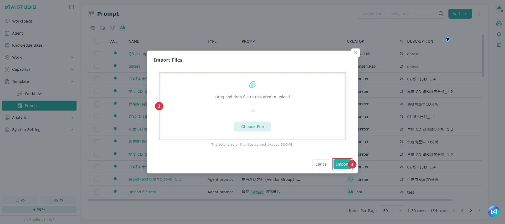

# プロンプトテンプレート

## 概要

プロンプトテンプレートは、ユーザーが質問する方法を簡単にするための機能です。よくある質問や情報の取得方法をテンプレート化しておけば、ユーザーは重要な情報を入力するだけで、プロンプトを書かなくても質の高い回答を得られます。企業はこの機能を使って回答の一貫性を高め、生成 AI の回答が社内規定に沿うようにできます。

> 注意：既定では、これらの設定を変更できるのは AI Studio 管理者のみです。

## **プロンプトテンプレートの追加**

1. **追加** をクリックして、プロンプトテンプレートの作成ウィンドウを表示します。
2. プロンプトテンプレートの種類を選択します。
3. **名前** 欄にテンプレート名を入力し、右側のボタンをクリックして多言語ラベルを作成します。[多言語設定](ti-shi-mu-ban-guan-li.md#duo-guo-yu-yan-she-ding) を参照してください。
4. **説明** 欄にテンプレートの説明を入力し、右側のボタンをクリックして多言語ラベルを作成します。[多言語設定](ti-shi-mu-ban-guan-li.md#duo-guo-yu-yan-she-ding) を参照してください。
5. **フィールド** を作成します。
6. プロンプトを設定します。
7. **OK** をクリックして作成を完了します。

### 多言語設定 

1. 画面の **地球** ボタンをクリックすると自動翻訳されます。内容は手動で編集することもできます。
2. 自動翻訳が完了したら **OK** ボタンをクリックして保存します。

> 注意：**モデル** メニューに表示される大規模言語モデルは、実際にインストールされた環境の構成によって異なります。本マニュアルに記載の選択肢は参考用です。

### **プロンプトテンプレートの種類**

* **Chat Prompt：** どの Agent との会話でも利用できます。
* **Agent Prompt：** 特定の Agent に紐づけられたプロンプトテンプレートで、その Agent でのみ利用できます。

### **フィールドの説明**

_フィールド_ はプロンプト内の変数と考えることができ、ユーザーが実際の状況に応じてプロンプトに必要な情報を入力できるようにします。フィールドには次の種類があります。

* **テキスト：** 1 行の入力欄です。文字数を設定できます。
* **複数行テキスト：** 複数行の入力欄です。文字数を設定できます。
* **リスト：** ユーザーが選べる選択肢を作成します。
* **数値：** 数値の入力欄です。最大値と最小値を設定できます。
* **ファイルのアップロード：** ユーザーがファイルをアップロードできる欄を作成します。

## プロンプトテンプレートのアップロード

1. **追加** をクリックし、**デバイスから** を選択します。
2. ファイルをアップロードします。
3. **アップロード** をクリックします。

## 権限

一覧権限については [モジュール別の権限ロール - プロンプトテンプレート一覧の権限](../ru-men-zhi-nan/quan-xian-gong-neng-jie-shao.md#ti-shi-ci-mu-ban-qing-dan) を参照してください。

権限の設定方法については [権限の操作 - Root 権限](../ru-men-zhi-nan/quan-xian-cao-zuo-gong-neng-jie-shao.md#root-quan-xian) を参照してください。

### プロンプトテンプレートの権限

ロールの権限については [モジュール別の権限ロール - プロンプトテンプレートの権限](../ru-men-zhi-nan/quan-xian-gong-neng-jie-shao.md#ti-shi-ci-mu-ban) を参照してください。

権限の設定方法については [権限の操作 - Object のロール権限](../ru-men-zhi-nan/quan-xian-cao-zuo-gong-neng-jie-shao.md#jue-se-quan-xian) を参照してください。
