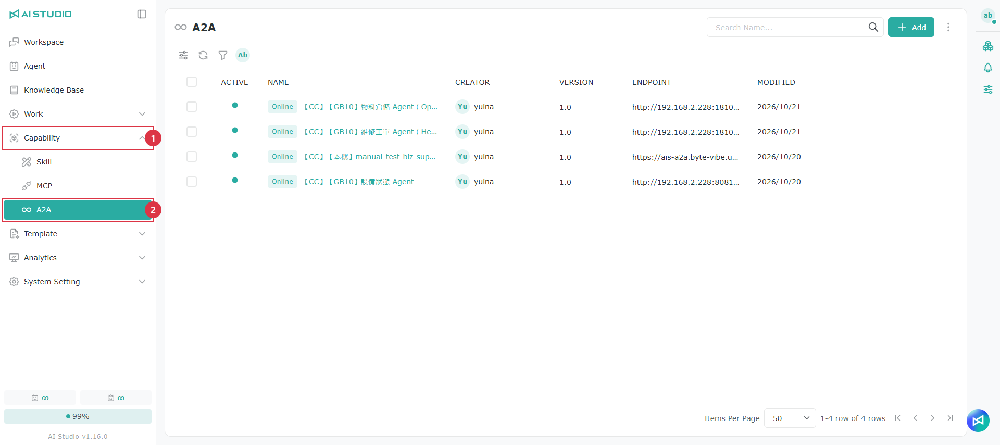
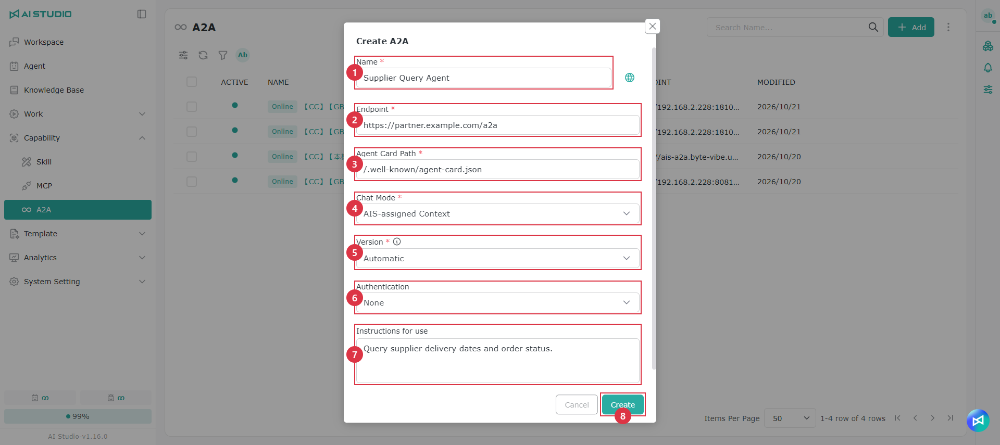
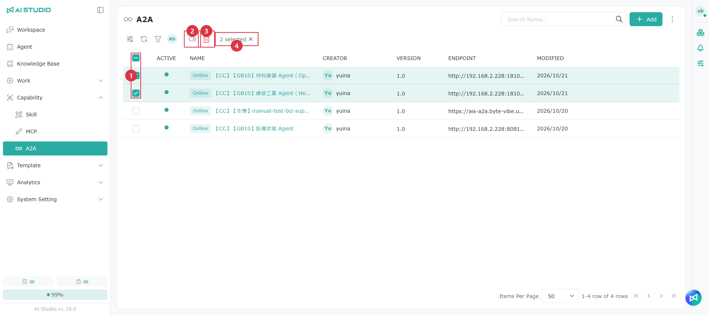
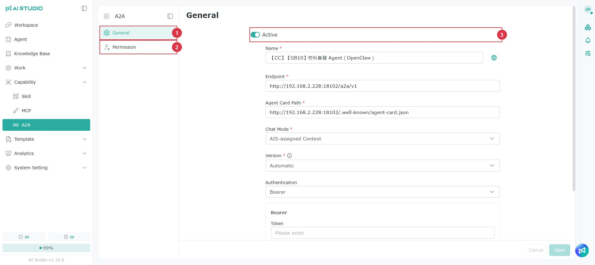

# A2A

## A2A とは

A2A（Agent-to-Agent）は、異なるプラットフォームの AI Agent が相互に呼び出すための公開標準です。A2A に対応する Agent は、それぞれ名前、機能、認証方法を記載した **Agent Card** を持っています。相手の URL と Agent Card があれば、Dify、LangGraph、n8n、AI Studio のどれで作成された Agent でも質問をやり取りできます。

AI Studio の A2A には、次の 2 つの使い方があります。

| 方向 | 説明 | 設定場所 |
| --- | --- | --- |
| 外部 Agent を呼び出す | AI Studio の Agent が質問を外部 Agent に渡し、回答を整理してユーザーに返します。たとえば、調達 Agent が仕入先の納期について、仕入先が提供する照会用 Agent に問い合わせます。 | Capability → A2A（このページ） |
| 自分の Agent を公開する | AI Studio の Agent を外部システムから呼び出せるようにします。たとえば、設備の異常診断 Agent を協力会社のシステムに公開すると、相手はキーを使って直接質問できます。 | Agent の設定ページ → インテグレーション → A2A。[インテグレーション - A2A](../agent-zhi-nan/zheng-he.md#a2a) を参照してください。 |

> 注意：外部に公開する Agent は、システムによって読み取り専用の照会操作に制限されます。一方、外部 Agent に委任するときに送られるのはテキストの質問だけです。相手が実際に何を実行するかは相手のシステムが決めるため、AI Studio では制限できません。


A2A を使う前に、システム管理者が **システム設定 → 構成 → Capability** で接続を許可するホストと公開 URL を設定する必要があります。[構成 - A2A の公開 URL と接続を許可するホスト](../xi-tong-she-ding-zhi-nan/pei-zhi.md#a2a-dui-wai-wang-zhi-yu-yun-xu-lian-xian-de-zhu-ji) を参照してください。操作時に管理者への連絡を求められる場合は、多くの場合ここが未設定です。


## A2A ページを開く

<figure><figcaption></figcaption></figure>

左側のメニューで **Capability**、**A2A** の順にクリックすると、外部 Agent を登録・管理できます。

## ページの説明

<table data-search="false"><thead><tr><th width="90">項目</th><th width="157">操作名</th><th>説明</th></tr></thead><tbody><tr><td>1</td><td>追加</td><td>外部 Agent を追加します。</td></tr><tr><td>2</td><td>検索</td><td>名前で検索します。</td></tr><tr><td>3</td><td>ツールバー</td><td>左から順に、表示列の調整、更新、絞り込み、特定の作成者の項目のみの表示です。</td></tr><tr><td>4</td><td>有効</td><td>緑の点は有効であることを示します。無効な外部 Agent は、委任先として選べる Agent の一覧に表示されません。</td></tr><tr><td>5</td><td>オンライン／オフライン</td><td>システムが定期的に行う接続確認の結果です。オフラインの場合は、相手のサービスの停止、URL の誤り、ホストが許可されていないことなどが考えられます。</td></tr><tr><td>6</td><td>その他（⋮）</td><td>A2A ページ自体の権限を設定します。管理者にのみ表示されます。後述の「権限」を参照してください。</td></tr></tbody></table>

一覧には、各外部 Agent の有効状態、名前、作成者、バージョン、エンドポイント、更新日が表示されます。

## 外部 Agent を追加する

1. 右上の **追加** をクリックします。
2. 名前、エンドポイント、Agent Card のパスを入力します。エンドポイントとパスは相手から入手してください。
3. 相手が指定する認証方法を選択し、必要に応じてキーを入力します。
4. **作成** をクリックします。一覧に戻り、**オンライン** と表示されれば接続成功です。

<figure><figcaption></figcaption></figure>

<table data-search="false"><thead><tr><th width="90">項目</th><th width="157">欄</th><th>説明</th></tr></thead><tbody><tr><td>1</td><td>名前</td><td>AI Studio 内に表示する名前です。右側の地球ボタンをクリックすると、多言語の名前を設定できます。</td></tr><tr><td>2</td><td>エンドポイント</td><td>相手が提供する A2A サービスの URL です。</td></tr><tr><td>3</td><td>Agent Card のパス</td><td>相手の Agent Card の場所です。一般的には <code>/.well-known/agent-card.json</code> です。AI Studio はこのカードを読み取り、相手の機能を把握します。</td></tr><tr><td>4</td><td>会話モード</td><td>複数ターンの会話で、どちらがコンテキストを記憶するかを決めます。選択肢は後述の表を参照してください。</td></tr><tr><td>5</td><td>バージョン</td><td>通常は Automatic のままにします。相手の Agent Card が宣言するプロトコルのバージョンで接続します。カードが 1.0 を宣言していても実際には 0.3 のみに対応する場合、接続できても回答が得られないことがあります。その場合は 0.3 に変更してください。</td></tr><tr><td>6</td><td>認証方法</td><td>相手の要件に合わせて選択します。選択肢は後述の表を参照してください。認証が不要な場合は、認証なしを選択します。</td></tr><tr><td>7</td><td>使用方法</td><td>どのような場合に使うかなど、同僚向けのメモを入力します。</td></tr><tr><td>8</td><td>作成</td><td>保存後、すぐに接続を 1 回試みます。一覧にオンラインまたはオフラインが表示されます。</td></tr></tbody></table>

### 会話モード

| 選択肢 | 説明 |
| --- | --- |
| AIS が Context を割り当てる | AI Studio が最初のターンで Context ID を作成し、以降も同じ ID を使います。判断に迷う場合は、この既定の選択肢を使ってください。 |
| サーバーが Context を割り当てる | リモートサーバーが最初のターンで Context を作成し、以降は返された Context ID を使います。LangGraph など、相手側でコンテキストを管理する必要がある場合に選択します。 |

会話モードを切り替えると、既存の Context が閉じられ、次のターンから新しい会話が始まります。

### 認証方法

キーが必要な認証方法を選ぶと、その下にキーの入力欄が表示されます。保存後はキーの元の値を再表示できません。変更する場合は新しい値を入力してください。

<figure><figcaption></figcaption></figure>

| 認証方法 | AI Studio が送信する内容 | キー欄に入力する値 |
| --- | --- | --- |
| 認証なし | 認証情報を付けません | 入力不要です。 |
| X API Key | <code>x-api-key</code> ヘッダー | 相手から提供されたキー（必須）。 |
| Bearer | <code>Authorization: Bearer …</code> | トークンそのもの（必須）。 |
| Basic | <code>Authorization: Basic …</code> | <code>ユーザー名:パスワード</code> の文字列全体。 |
| A2A API Key | <code>X-A2A-API-Key</code> ヘッダー | 省略可能です。多くの外部プラットフォームはこのヘッダーに対応していないため、相手から指定されていない場合は選ばないでください。 |

## 日常の管理

一覧の行にマウスカーソルを合わせると、右側に操作ボタンが表示されます。

<table data-search="false"><thead><tr><th width="90">項目</th><th width="157">操作名</th><th>説明</th></tr></thead><tbody><tr><td>1</td><td>再接続</td><td>すぐに接続を再試行し、オンライン／オフラインの状態を更新します。</td></tr><tr><td>2</td><td>Agent Card</td><td>相手のカードの全内容を表示します。機能や対応する入力・出力を確認できます。</td></tr><tr><td>3</td><td>編集</td><td>設定を変更したり、有効をオフにしたりします。</td></tr><tr><td>4</td><td>削除</td><td>削除後は、この外部 Agent に委任できなくなります。</td></tr><tr><td>5</td><td>名前</td><td>クリックすると詳細ページが開き、この外部 Agent の権限を管理できます。</td></tr></tbody></table>

### Agent Card を確認する

<figure><figcaption></figcaption></figure>

Agent Card ウィンドウには、相手のカードが JSON 形式で表示されます。<code>skills</code> は相手ができること、<code>examples</code> は質問例です。Agent はこの情報を基に、委任するかどうかを判断します。右上のコピーボタンをクリックすると、JSON 全体をコピーできます。

Agent Card を読み取れない旨のメッセージが表示された場合は、ブラウザーでカードの URL を直接開いて確認してください。後述の FAQ も参照してください。

### 利用を一時停止する

<figure><figcaption></figcaption></figure>

外部 Agent を一時的に使わせたくない場合は、編集ウィンドウで **有効** をオフにします。削除する必要はありません。

### 一括操作

<figure><figcaption></figcaption></figure>

<table data-search="false"><thead><tr><th width="90">項目</th><th width="157">操作名</th><th>説明</th></tr></thead><tbody><tr><td>1</td><td>選択</td><td>複数の項目を選択できます。見出しのチェックボックスで全件を選択します。</td></tr><tr><td>2</td><td>一括有効化／無効化</td><td>選択した項目の有効状態をまとめて切り替えます。</td></tr><tr><td>3</td><td>一括削除</td><td>削除前に確認が表示されます。</td></tr><tr><td>4</td><td>N 件選択済み</td><td>× をクリックすると、すべての選択を解除できます。</td></tr></tbody></table>

## 権限

外部 Agent ごとに権限リストがあります。会話で使うには、ユーザーがそのリストに登録されている必要があります。

<figure><figcaption></figcaption></figure>

一覧で名前をクリックすると、詳細ページが開きます。

* **一般**：編集ウィンドウと同じ設定です。変更後は右下の **保存** をクリックします。
* **権限**：外部 Agent を表示、利用、変更できる同僚を指定します。作成者は自動的に A2A 管理者となり、所有者として表示されます。

**追加** をクリックすると、組織、会社、部門、ロール、個人を追加し、権限を選択できます。

| 権限 | できること |
| --- | --- |
| A2A 管理者 | 変更、削除、メンバー管理。 |
| A2A 共同編集者 | 設定の変更。 |
| A2A ユーザー | 会話での利用。 |

A2A ページ自体にも、ページを開ける人や項目を追加できる人を決める権限があります。管理者が一覧右上の **⋮** から設定します。ページの権限と、各外部 Agent の権限は別々に設定します。

## 会話で Agent に使わせる

1. 質問を委任する Agent の設定ページを開き、**Coordination** で外部 Agent を追加します。追加できるのは、**Capability → A2A** に登録され、自分に利用権限がある外部 Agent のみです。
2. 会話中、Agent は外部 Agent Card の説明とスキルの質問例を基に、質問を委任するかどうかを判断します。
3. 指示事項に相手の名前を固定して書く必要はありません。誘導したい場合は、「仕入先の納期に関する質問は、外部の仕入先照会 Agent に問い合わせてください」のように説明します。

> Agent が委任できるのは、Coordination で追加した外部 Agent だけです。委任先が適切でない場合は、まず相手の Agent Card の説明とスキルの質問例が明確かどうかを確認してください。

協働に関するほかの操作は、[チャット Agent - Coordination](../agent-zhi-nan/liao-tian-agent.md#agent-xie-zuo) を参照してください。

## FAQ

外部 Agent を追加すると、システム管理者にホストの許可を依頼するよう求められる

相手のホストが許可リストに登録されていません。管理者に **システム設定 → 構成 → A2A の接続を許可するホスト** で、<code>partner.example.com</code> や <code>partner.example.com:8443</code> のように追加してもらってください。保存するとすぐに有効になります。

一覧にオフラインと表示され続ける

その行の **再接続** をクリックします。引き続きオフラインの場合は、エンドポイントの URL、相手のサービスの起動状態、ホストの許可、認証方法とキーを順に確認してください。

Agent Card をクリックすると、カードを読み取れないと表示される

カードはブラウザーが直接読み取ります。相手がクロスオリジンアクセスを許可していない、カードに認証が必要、応答が JSON ではない、といった場合にこのメッセージが表示されます。必ずしも AI Studio が接続できないことを意味しません。一覧のオンライン／オフライン状態を確認するか、ブラウザーでカードの URL を直接開いて確認してください。

追加時に、このアドレスは登録済みと表示される

同じエンドポイントをシステム全体で複数登録することはできません。他のユーザーが登録していて、共有されていない可能性があります。登録したユーザーに、その項目の権限リストへ追加してもらってください。

