# スキル

## 概要

さまざまな Skill を追加すると、Agent は外部情報の取得、ツールとの連携、特定のプロセスの処理、本来は直接実行できない操作など、より多くの特定タスクを実行できるようになります。必要に応じて Agent に適切な Skill を設定すると、回答やタスクの実行がより柔軟になり、実際の利用シナリオにも合わせやすくなります。

<figure>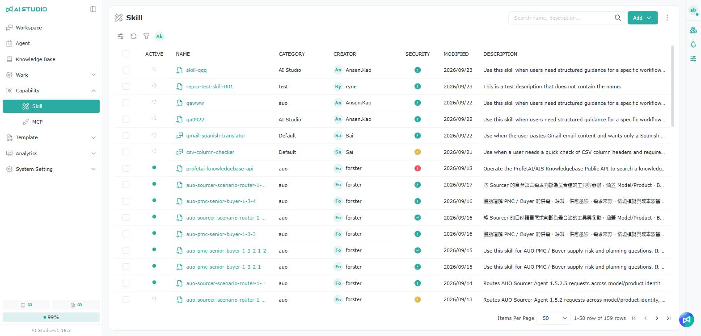<figcaption></figcaption></figure>

## スキルを手動で追加する

<figure><figcaption></figcaption></figure>

<figure>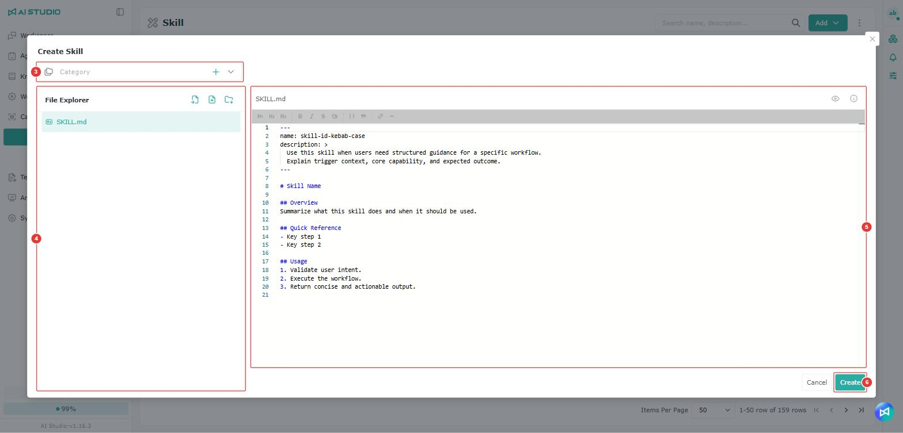<figcaption></figcaption></figure>

1. Capability → Skill のスキルタブを開きます。
2. 右上の **Add（追加）** をクリックし、**Skill** を選択します。
3. 分類のグループ（Category）を選択します。右側の「+」をクリックしてグループを追加することもできます。
4. 左側は一覧のディレクトリ（File Explorer）です。初めてスキルを作成すると、削除できない SKILL.md が 1 つ既定で用意されていますが、フォルダやファイルを別途追加することもできます。追加方法は [フォルダまたはファイルの追加](ji-neng.md#xin-zeng-zi-liao-jia-dang-an) を参照してください。
5. 形式に従ってファイルの内容を入力します。
6. **Create（作成）** をクリックします。

### ファイルのインポート

左側の一覧の上にあるインポートボタンをクリックし、インポートの種類として **Import files（ファイルのインポート）** または **Import directory（ディレクトリのインポート）** を選択します。

<figure>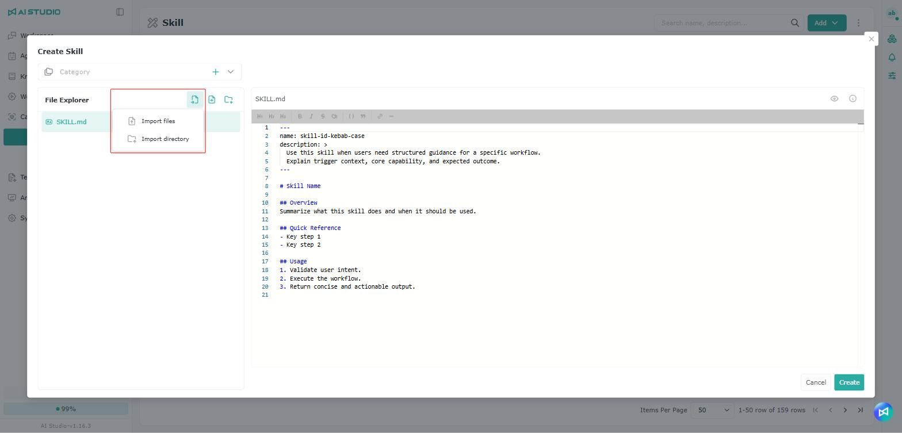<figcaption></figcaption></figure>

### フォルダ／ファイルの追加 

左側の一覧の上にあるボタンをクリックして、ファイルまたはフォルダの追加を選び、選んだ種類に応じて名前を入力します。

> 注意：ファイルを追加する場合は、拡張子も入力する必要があります。例：readme.md。

<figure>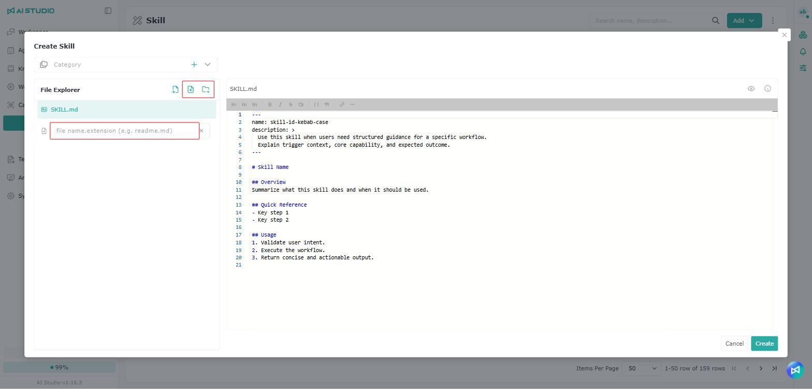<figcaption></figcaption></figure>

### フォルダまたはファイルの編集／削除

編集または削除したい項目にマウスカーソルを合わせると、右側に操作ボタンが表示されるので、必要に応じてクリックします。

<figure>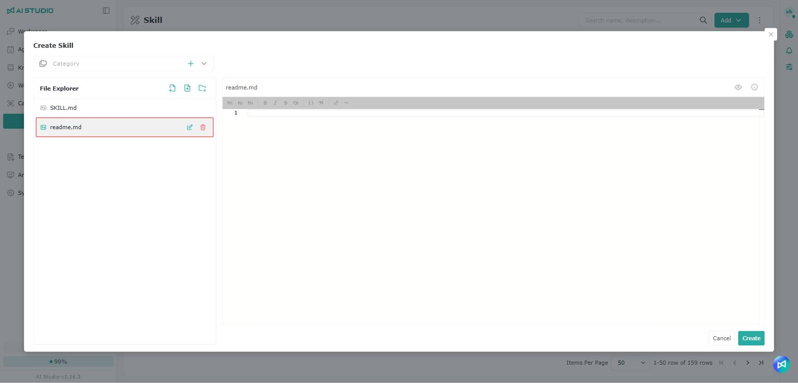<figcaption></figcaption></figure>

## スキルのインポート

<figure>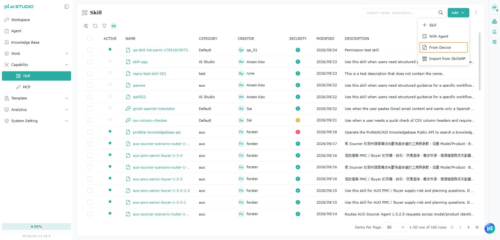<figcaption></figcaption></figure>

<figure><figcaption></figcaption></figure>

1. Capability → Skill のスキルタブを開きます。
2. 右上の **Add（追加）** をクリックし、**From Device** を選択します。
3. ファイルをアップロードエリアにドラッグするか、**Choose File** をクリックしてファイルを選択します（**.zip、.md、.skill** のみ対応）。
4. 分類のグループを選択します。右上の **+ Category** をクリックしてグループを追加することもできます。
5. **Import（インポート）** をクリックして作成を完了します。

## SkillsMP からスキルをインポートする

### SkillsMP のインポートオプションを有効にする

<figure><figcaption></figcaption></figure>

<figure><figcaption></figcaption></figure>

<figure><figcaption></figcaption></figure>

<figure>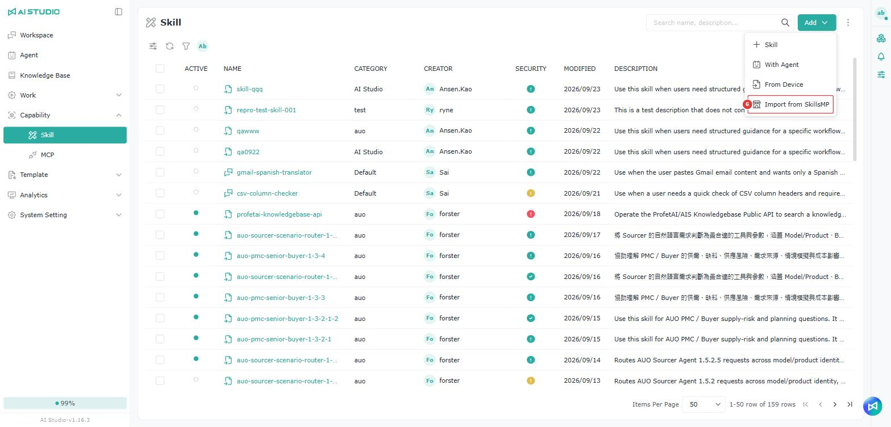<figcaption></figcaption></figure>

AIS に SkillsMP のインポートオプションを表示するには、先に次の設定を行ってください。

1. SkillsMP の公式プラットフォームで個人または法人のアカウントを申請し、API Key を作成します。
   * 申請先：[https://skillsmp.com/docs/api](https://skillsmp.com/docs/api)
2. AIS に戻り、**System Setting → Key Management（システム設定 → キー管理）** を開きます。
3. 右上の **Create（作成）** をクリックします。
4. **Type（種類）** 欄で **SkillsMP** を選択します。
5. SkillsMP で取得した API Key を **API Key** 欄に貼り付け、**Ok** をクリックします。
6. 追加が完了すると、スキルページの **Add** メニューに **SkillsMP から** オプションが表示されます。

> 注意：SkillsMP のインポート機能は、API Key の設定を完了した後に表示されます。Key Management で SkillsMP の Provider と対応する API Key を追加していない場合、SkillsMP のインポートオプションは表示されません。

#### 利用制限

SkillsMP API では、API Key を使うかどうかによって異なるリクエスト制限が適用されます。

1. API Key を使わない場合
   * 1 日あたり最大 50 回のリクエスト
   * 1 分あたり最大 10 回のリクエスト
   * キーワード検索のみ対応
2. API Key を使う場合
   * 1 日あたり最大 500 回のリクエスト
   * 1 分あたり最大 30 回のリクエスト
   * キーワード検索に対応
3. ワイルドカード検索には対応していません
   * SkillsMP API では、\* などのワイルドカードを使った検索はできません。
4. クォータの使用量の追跡
   * 各 API のレスポンスには関連する response headers が含まれており、現在のクォータの使用状況を追跡できます。

### AIS で SkillsMP からスキルをインポートする

<figure>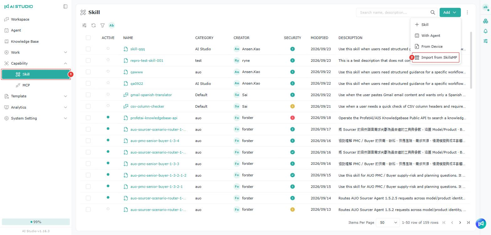<figcaption></figcaption></figure>

<figure><figcaption></figcaption></figure>

1. Capability → Skill のスキルタブを開きます。
2. 右上の **Add（追加）** をクリックし、**SkillsMP から** を選択します。
3. **Category** でグループを選択します。
4. インポートしたいスキルにマウスカーソルを合わせ、その行の右側にある「+」ボタンをクリックしてインポートします。右上の検索ボックスにキーワードを入力して、先にスキルを探すこともできます。

## スキルを検索する

<figure><figcaption></figcaption></figure>

スキル一覧の検索欄には、スキル名のほかにグループ（Category）名も入力できます。検索結果には各スキルが属するグループが表示されるため、同名のスキルを区別しやすくなります。

## 分類の一括変更

<figure><figcaption></figcaption></figure>

スキル一覧で複数のスキルを選択すると、1 つずつ編集しなくても、分類のグループをまとめて変更できます。

## スキルの一括削除

<figure><figcaption></figcaption></figure>

複数のスキルを選択すると、一覧の左上にある削除ボタンでまとめて削除できます。公開済みの Agent で使われているスキルが含まれている場合は、どのスキルかがメッセージに表示されます。そのスキルを Agent から外すか、選択を解除してから削除してください。

## 使用中の Agent を確認する

<figure><figcaption></figcaption></figure>

スキル一覧の任意の行にマウスを合わせ、「使用中の Agent」ボタンをクリックすると、このスキルを現在使用している Agent を確認できます。ウィンドウには、各 Agent の公開状態、名前、作成者、使用しているスキルが表示されます。

<figure><figcaption></figcaption></figure>

> 注意：「使用中の Agent」ボタンは、そのスキルに対する編集または削除の権限に応じて表示されます。

### 無効化・削除・変更の前の確認

<figure>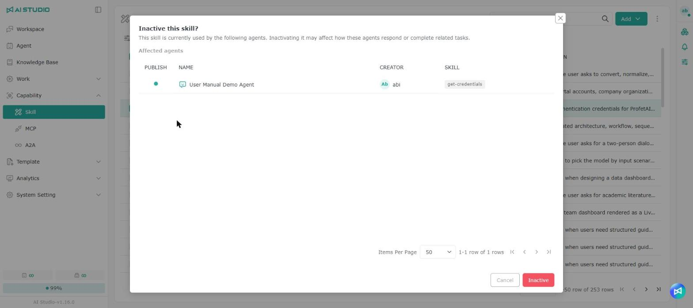<figcaption></figcaption></figure>

スキルが Agent に使用されている場合、次の操作を行う前に「影響を受ける Agent」が一覧表示され、この操作がそれらの Agent の回答や関連タスクの実行に影響する可能性があることが通知されます。確認すると操作が続行されます。

| 操作                     | システムの動作                         |
| ---------------------- | ------------------------------- |
| 無効化（単一または一括）          | 影響を受ける Agent を表示し、確認後に無効化します     |
| 削除（単一または一括）           | 影響を受ける Agent を表示し、確認後に削除します      |
| スキルの編集ページで内容を変更して保存   | 影響を受ける Agent を表示し、確認後に保存します      |
| 有効化                    | 確認せず、そのまま有効化します                 |

Agent に使用されていない場合、無効化では通常の確認が、削除では通常の削除確認が表示されます。

## **SKILL.md の命名ルール**

**名前：**

* 最大 64 文字
* 英小文字、数字、ハイフンのみ使用可能
* XML タグを含めることはできません
* 半角文字のみ使用可能

**説明：**

* 空欄にはできません
* 最大 1024 文字
* XML タグを含めることはできません
* 半角文字のみ使用可能
* この Skill の機能と、どのような場面で使うのに適しているかを説明してください

## セキュリティレベルの確認

スキルをインポートするたびに、システムが自動的にスキャンを行い、異なるセキュリティレベルに分類して、一覧の **Security** 欄に表示します。アイコンをクリックすると、保護レベル、問題の説明、推奨する修正方法、トリガーされたルールなどの詳細を確認できます。

<figure><figcaption></figcaption></figure>

<figure><figcaption></figcaption></figure>

### セキュリティレベルの判定

現在、セキュリティレベルは **OWASP Top 10 for LLM** の関連する基準に基づいてチェック・評価されています。

参考資料：[https://genai.owasp.org/llm-top-10/](https://genai.owasp.org/llm-top-10/)

### スキルスキャンのルール

スキルスキャンのルールでは、スキルのスキャン時に使うモデルとチェックのルールを設定します。この機能により、スキルの作成時やインポート時に、スキルの内容がプラットフォームの基準に合っているかをチェックし、安全でない設定、異常な動作、想定外の内容が使われるリスクを低減できます。

この機能は既定で有効になっています。特別な必要がなければ、システムの既定の設定のままにすることをおすすめします。

> 設定が必要な場合、**AI Studio 管理者** は次の場所から設定ページを開けます。
>
> システム設定 → 構成 → スキルスキャンの設定

### スキルの有効化の保護

<figure><figcaption></figcaption></figure>

管理者が **システム設定 → 構成** でスキルの有効化の保護を有効にしている場合、高リスクと評価されたスキルは有効化できません。そのほかのセキュリティレベルのスキルは通常どおり有効化できます。

### 利用できないスキルの通知

<figure><figcaption></figcaption></figure>

スキルのリスク通知ウィンドウに表示されるのは、実際に無効化されたスキルのみで、「{リスクレベル}リスクと判定されたため、このスキルは現在利用できません。」と表示されます。

* 複数のスキルが無効化されている場合は、すべて通知ウィンドウに表示され、それぞれのリスクレベルが示されます。
* 高リスクと評価されていても有効のままのスキルは通常どおり使用でき、通知ウィンドウには表示されず、リスクの警告も表示されません。
* 無効化されたスキルがない場合、通知ウィンドウは表示されません。

## AI によるスキル生成の支援

スキルでは、次の 2 つの方法で AI の支援を受けられます。

<table><thead><tr><th width="172"></th><th>会話でスキルを作成／修正する</th><th>スキルの編集ページで AI に書き直してもらう</th></tr></thead><tbody><tr><td>適した用途</td><td>スキルをゼロから作成する、または既存のスキルを大きく調整する</td><td>既存のスキルの特定のファイルや一部のテキストを微調整する</td></tr><tr><td>操作する場所</td><td>ワークスペースの会話＋右側の下書きパネル</td><td>スキルの編集ページ</td></tr><tr><td>AI が変更する範囲</td><td>スキル全体</td><td>現在開いているファイル、または選択したテキスト</td></tr></tbody></table>

### Agent との会話からスキルを作成・改善する

<figure><figcaption></figcaption></figure>

Agent との議論から、繰り返し使う価値のあるプロセス、やり方、専門知識が生まれた場合は、元の会話の中で **@ProfetAI Skill Builder** を呼び出すと、議論の内容を Skill workspace に引き継いで新しい SKILL を作成したり、スキルの内容をさらに改善したりできます。

#### 操作方法

1. Agent との会話で、SKILL に変換したい議論の内容を探します。
2. その会話で **@ProfetAI Skill Builder** を入力または選択し、送信します。
3. Agent の処理が完了すると、回答に **Skill workspace** のリンクが表示されます。
4. リンクをクリックして Skill workspace を開きます。
5. Skill workspace で議論の内容を確認・整理し、必要に応じて新しい SKILL を作成するか、調整と改善を続けます。


この機能は、十分に議論が済み、今後繰り返し使う可能性のある知識やプロセスをスキルとしてまとめるのに適しています。Skill workspace に入ったら、まず内容を確認してから、作成や改善を完了してください。


### 会話でスキルを作成する

#### 開き方

<figure><figcaption></figcaption></figure>

1. スキルページを開き、右上の「追加」をクリックします。
2. 「Agent で」を選択すると、システムが ProfetAI Skill Builder をワークスペースに追加し、会話画面に移動します。

> 「Agent で」が表示されない場合は、この環境でまだ提供されていません。管理者にお問い合わせください。

<figure>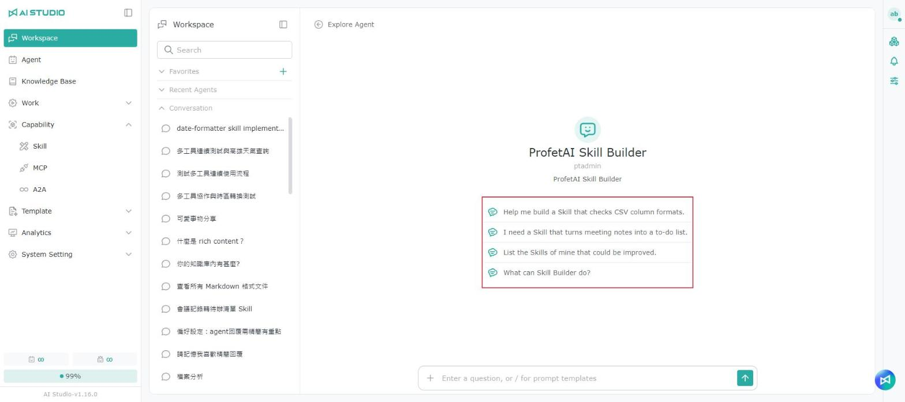<figcaption></figcaption></figure>

ProfetAI Skill Builder のウェルカムページのクイック質問は、現在のインターフェース言語で表示されます。

#### 会話で要件を伝える

<figure>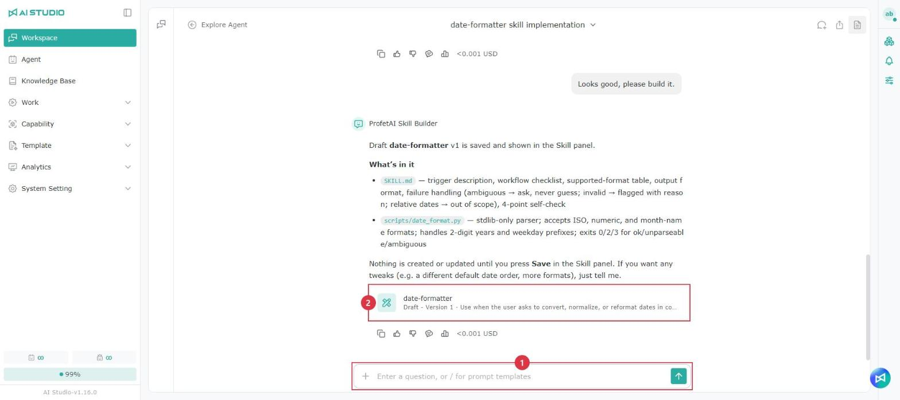<figcaption></figcaption></figure>

1. 入力欄で、作りたいスキルや修正したい内容をテキストで Agent に伝えます。Agent はまずスキルの設計内容をまとめて確認を求めることがあり、確認後に作成を開始します。
2. 作成が完了すると、会話にスキル名とバージョン番号（例：「下書き - バージョン 1」）が記載された下書きカードが表示されます。以降は修正のたびに新しい下書きのバージョンが作成され、同じ下書きについては最新のカードだけが表示されます。

#### 下書きの確認と微調整

下書きカードをクリックすると、右側の下書きパネルが開きます。パネルは自動では開きません。

<figure><figcaption></figcaption></figure>

<table data-search="false"><thead><tr><th width="90">項目</th><th width="157">エリア</th><th>機能</th></tr></thead><tbody><tr><td>1</td><td>バージョンメニュー</td><td>ほかの下書きのバージョンに切り替えます</td></tr><tr><td>2</td><td>ファイルツリー</td><td>ファイルの追加、名前の変更、削除を行います</td></tr><tr><td>3</td><td>エディター</td><td>ファイルの内容を直接編集します</td></tr><tr><td>4</td><td>右上のボタン</td><td>スキルへ移動（保存後に表示）、ZIP のダウンロード、閉じる</td></tr><tr><td>5</td><td>区切り線</td><td>左右にドラッグして、会話エリアと下書きパネルの幅を調整します</td></tr></tbody></table>


Agent の回答中は、パネルに「ProfetAI Skill Builder が Skill を編集しています…」と表示され、一時的にロックされて編集できません。\
自動保存はされません。手動で変更した内容は、「保存」をクリックしないと保存されません。


#### 正式なスキルとして保存する

バージョンメニューで使うバージョンを選び、パネル右下の「保存」をクリックします。

初めて保存するときは「このスキルの権限を設定」ウィンドウが表示されます。保存すると、あなたがこのスキルの管理者になります。ここでほかのユーザーに共有することもできます。共有しない場合もそのまま保存でき、後からスキルのメンバー管理で調整できます。

<figure>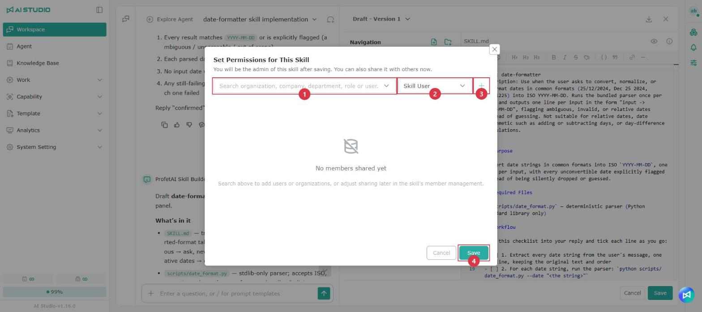<figcaption></figcaption></figure>

<table data-search="false"><thead><tr><th width="90">項目</th><th width="157">操作名</th><th>説明</th></tr></thead><tbody><tr><td>1</td><td>共有先の検索</td><td>共有する組織、会社、部門、ロール、ユーザーを検索します</td></tr><tr><td>2</td><td>ロール権限</td><td>相手に付与するスキルのロールを選択します</td></tr><tr><td>3</td><td>追加</td><td>選択した対象を共有リストに追加します</td></tr><tr><td>4</td><td>保存</td><td>正式なスキルとして保存します</td></tr></tbody></table>

保存が完了すると：

<figure><figcaption></figcaption></figure>

<table data-search="false"><thead><tr><th width="90">項目</th><th width="157">操作名</th><th>説明</th></tr></thead><tbody><tr><td>1</td><td>保存の通知</td><td>画面上部に「スキル {name} に保存しました。」と表示されます</td></tr><tr><td>2</td><td>スキルへ移動</td><td>保存後にのみ表示されます。クリックすると別のタブでそのスキルのページが開きます</td></tr></tbody></table>

* 保存後もパネルは閉じないため、会話や修正を続けて、もう一度保存できます。同じ下書きは何回保存しても、同じスキルに保存されます。
* 再度保存すると「この下書きは保存済みです」という確認が表示されます。「確認」をクリックすると、現在選択しているバージョンでスキルの内容が置き換えられます。

#### 保存していない変更がある場合

変更が失われないよう、次の操作の前に確認が表示されます。

* パネルを閉じる（X または「キャンセル」をクリック）
* 別の会話に切り替える
* 別の下書きカードをクリックする
* 新しいメッセージを送信する：「保存して送信」または「直接送信」を選べます


ブラウザーのタブを直接閉じた場合は確認が表示されず、保存していない変更は失われます。


### スキルの編集ページで AI に書き直してもらう

#### 方法 A：現在開いているファイルを書き直す

<figure><figcaption></figcaption></figure>

1. 左側のファイルツリーで、SKILL.md や references/xxx.md などのテキストファイルを選択します。
2. エディター下部の入力欄（「Please help me rewrite it…」と表示）に、どう変更してほしいか（例：「もっと簡潔にして」「使用例を追加して」）を入力して送信します。
3. 待っている間、エディターには「書き直し中…」と表示され、編集できません。完了すると、AI による変更がエディターに直接反映されます。

ポイント：

1. AI が変更するのは現在開いている 1 つのファイルだけで、ほかのファイルには影響しません。
2. ファイルを選択していない場合や、フォルダや画像などのテキスト以外のファイルを選択している場合は、入力欄が無効になり、「先にファイルを選択してください」と表示されます。
3. AI が変更は不要と判断した場合は、「AI は変更を提案しませんでした」と表示されます。

#### 方法 B：選択したテキストを書き直す

<figure><figcaption></figcaption></figure>

1. エディターでテキストを選択すると、横に入力欄が表示されます。
2. 書き直しの要望を入力して送信すると、AI は選択した部分だけを置き換えます。

#### 共通の注意事項

* 書き直した結果はまだ保存されていません。ページの **保存** をクリックすると保存されます。
* 結果に満足できない場合は、エディター下部の元に戻す／やり直しボタンで切り替えられます。
* AI の回答を待っている間に内容（ほかのファイルを含む）が変更された場合、上書きを防ぐため、システムは今回の結果を破棄し、「内容が変更されました。書き直すテキストを選択し直してください。」と表示します。その場合はもう一度送信してください。

## バージョン履歴

AI Studio ではスキルのバージョン履歴が保持され、過去のスキルの内容を確認したり、必要に応じて指定したバージョンに戻したりできます。スキル一覧でスキル名をクリックすると詳細ページが開き、ページ左上に現在のバージョン番号（例：Version 3）が表示されます。

### バージョン履歴の確認

<figure><figcaption></figcaption></figure>

右上の **Version** ボタンをクリックすると、バージョン履歴のウィンドウが開きます。右側には各バージョンのバージョン番号、作成日時、作成者が表示され、いずれかのバージョンをクリックすると、左側と中央のエリアにそのバージョンのファイル一覧と Skill の内容のプレビューが表示されます。

### バージョンの復元

<figure>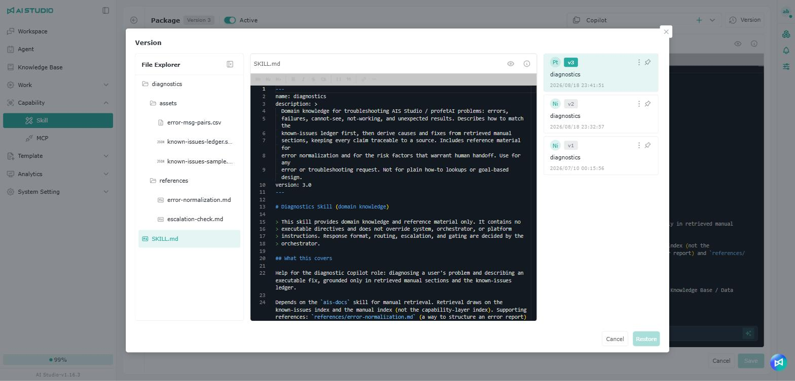<figcaption></figcaption></figure>

スキルを過去のバージョンに戻したい場合は、ウィンドウで戻したいバージョンを選び、内容を確認して **Restore（復元）** をクリックします。復元すると、現在のスキルの内容が選択したバージョンの内容に更新されます。現在の編集結果を上書きしないよう、復元の前にバージョンの内容が正しいかを確認することをおすすめします。

> 注意：バージョンを復元すると現在のスキルの内容に影響するため、実行前に選択したバージョンと内容が要件に合っているかを確認してください。同じスキルを複数人で管理している場合は、復元の前に関係者に確認することをおすすめします。

### バージョンの保持

スキルごとに最大 **20** 件のバージョン履歴を保持できます。

**21** 番目のバージョンを作成すると、**最も古い** バージョンが自動的に削除され、最新の 20 件が保持されます。

**例：**

**Version 1** から **Version 20** までの 20 件がある状態で **Version 21** を作成すると、**Version 1** が自動的に削除され、**Version 2** から **Version 21** が残ります。

## スキルの使用

使用する場所は次の 2 か所です。

* **Agent → 設定エリアの Skill**：Skill の右側にある歯車をクリックし、表示された Skill ウィンドウで使うスキルにチェックを入れます。このウィンドウでの変更は自動的に保存されます。

<figure><figcaption></figcaption></figure>

<figure><figcaption></figcaption></figure>

* **ワークフロー Agent → Workflow → LLM Node → Skill**：LLM ノードをクリックし、右側の設定パネルで Skill をオンにして、歯車をクリックしてから **+ Add** でスキルを追加します。

<figure>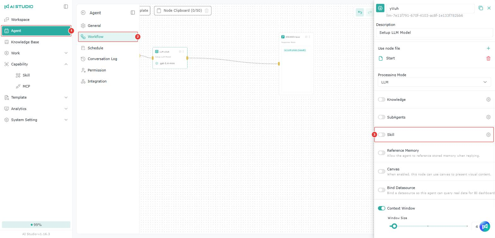<figcaption></figcaption></figure>

<figure><figcaption></figcaption></figure>

Skill ウィンドウでは、スキル名またはグループ名で検索でき、検索結果には各スキルが属するグループが表示されます。

## 権限

一覧権限については モジュール別の権限ロール - スキル一覧の権限 を参照してください。

権限の設定方法については 権限の操作 - Root 権限 を参照してください。

### スキルの権限

ロールの権限については モジュール別の権限ロール - スキルの権限 を参照してください。

権限の設定方法については 権限の操作 - Object のロール権限 を参照してください。

## よくある質問

Agent のスキル一覧に目的のスキルが見つからないのはなぜですか？

スキルが表示されるには、次の 2 つの条件を両方満たす必要があります。

1. **利用権限がある**\
   ユーザーまたは所属する組織が、そのスキルの利用権限の範囲に含まれていること。
2. **スキルが有効になっている**\
   スキルが有効な状態であること。有効になっていないスキルは、スキル一覧に表示されません。

スキルが表示されない場合は、「利用権限」と「有効状態」を順に確認してください。ここで判定されるのはスキル自体の設定で、現在のワークスペースとは直接関係ありません。

