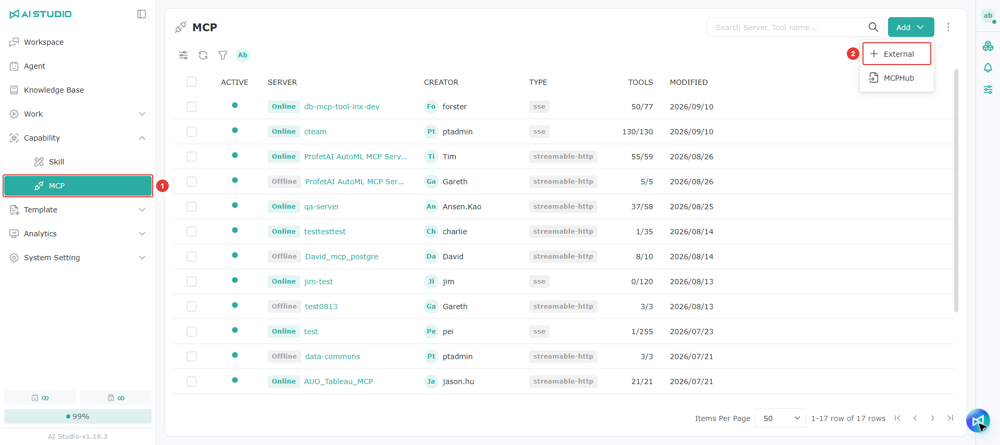
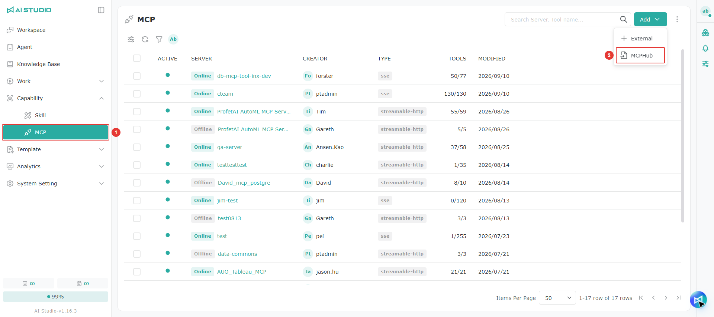
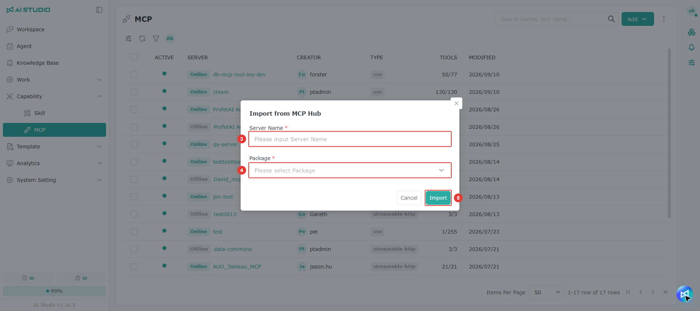
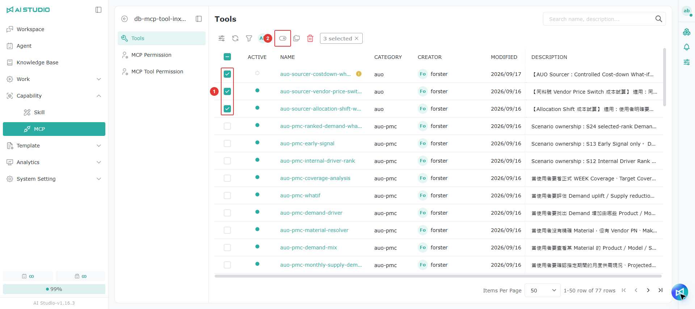
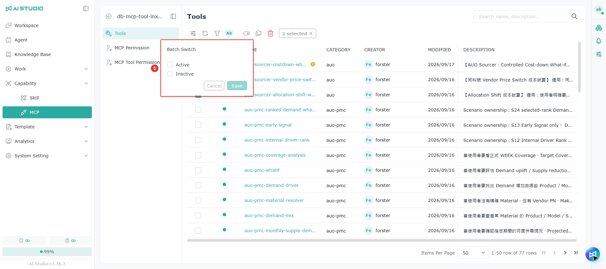
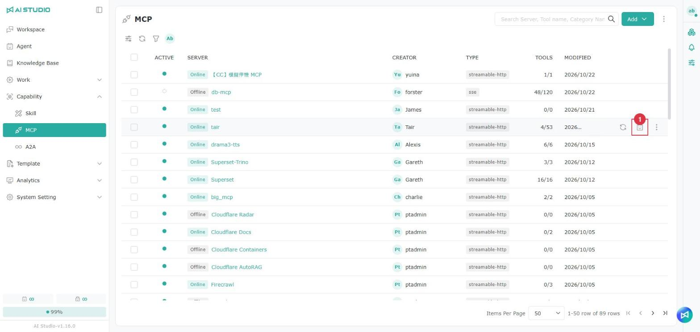
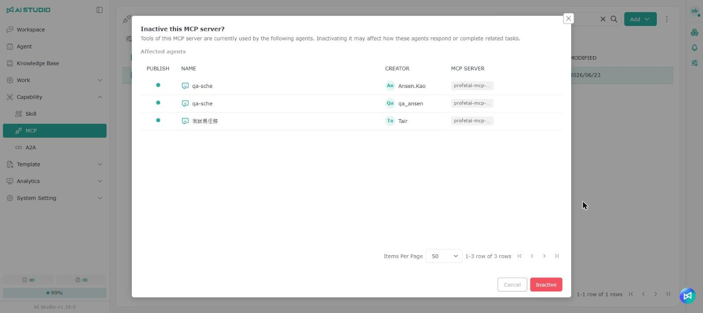

# MCP

## 概要

**MCPツール** ページには、統合済みで LLM の能力を拡張できるすべてのツール（リアルタイム検索、ファイルの解析など）の更新記録が表示されます。

ユーザーは次のことができます。

* ツールのグループ、名前、説明、作成者、作成日時、更新日を **確認** する
* 開発者が追加したツールを **追跡** する
* 利用できるツールとその機能を **参照** する

<figure><figcaption>
MCPサーバーの一覧
</figcaption></figure>

> 注意：MCPサーバーの一覧のツール数は「有効／合計」で表示されるため、各サーバーでいくつのツールが有効になっているかをすばやく確認できます。

### サーバーの詳細ページを開く

<figure><figcaption></figcaption></figure>

MCPサーバーの一覧でサーバー名をクリックすると、そのサーバーの詳細ページが開き、既定でツール一覧が表示されます。サーバーのすべての設定も詳細ページで編集します。一覧の編集ボタンはクイック編集のみです。

### サーバーや分類を検索する

<figure><figcaption></figcaption></figure>

MCPサーバーの一覧の検索欄には、サーバー名のほかに、ツール名やツールのグループ（分類）名も入力できます。条件に一致するツールを含むサーバーが一覧表示され、サーバー名の横に一致したツールの数が表示されます。ツールの数が多い場合でも、目的のツールがどのサーバーにあるかをすばやく見つけられます。たとえば、あるツールの利用権限を設定したい場合に便利です。

## MCPサーバーの追加

### サーバーを手動で追加する

1. MCP のページを開きます。
2. 追加ボタンをクリックし、**External** を選択します。
3. サーバー名を入力します。
4. エンドポイントを入力します。
5. HTTP または SSE の種類を選択します。
6. ヘッダー情報を入力します。複数入力できます。
7. 送信をクリックして作成を完了します。

### MCPHub からインポートする

1. MCP のページを開きます。
2. 追加ボタンをクリックし、**MCPHub** を選択します。
3. サーバー名を入力します。
4. 対象のフォルダを選択します。
   * フォルダは、ユーザーが MCPHub 内で作成した項目から取得されます。一覧に何も表示されない場合は、先に MCPHub で作成してください。
5. インポートをクリックして作成を完了します。

## ツールの有効化

1. MCPサーバーを新しく作成すると、すべてのツールが読み込まれますが、無効な状態になっているため、まず有効にするツールを選択します。
2. スイッチのボタンを選択します。
3. **有効** を選択し、**保存** をクリックします。

> 注意：ツールを有効にするには、先に分類を設定する必要があります。一括で有効化する際、選択したツールに分類が設定されていない場合は、分類の編集ウィンドウが表示されます。分類を入力するとツールもあわせて有効になり、入力しない場合は有効になりません。

### 分類の一括変更

ツール一覧で複数のツールを選択すると、1 つずつ編集しなくても、分類をまとめて変更できます。

## ツールの再読み込み

MCP Server 上のツールに変更があった場合は、再読み込みで最新のツール情報を取得できます。

* **ツール一覧の再読み込み**：一覧の上にある再読み込みボタンをクリックすると、MCP Server で追加または削除されたツールが同期されます。
* **個別のツールの再読み込み**：特定のツールの名前、説明、Schema だけが変更された場合は、そのツールの行の再読み込みボタンをクリックすると、最新の情報を再取得できます。

## ツールの既定パラメーター

一部のツールでは、個別のツールの再読み込みボタンの左側に設定ボタンがあり、そのツールの既定のパラメーター値を設定できます。設定すると、既定値は次の場所で使われるそのツールに適用されます。

* Agent のツール設定
* ワークフローの LLM ノードのツール設定
* ワークフローテンプレートのツール設定

パラメーターの適用の優先順位は、Agent またはノード内の設定 > ツールの既定パラメーター > ツールの Schema の既定値 です。

> 注意：ツールの既定パラメーターを変更しても、Agent やノードですでに変更された値は上書きされません。たとえば既定値が A で、ユーザーが Agent で B に変更した後、ツールの作成者が既定値を C に変更しても、Agent の値は B のままです。新しい既定値 C を適用するには、Agent のツール設定で **Reset** をクリックする必要があります。

## ツールのテスト

ツール一覧では個別のツールを直接テストでき、ツールが正常に実行され、返される結果が期待どおりであることを確認してから、Agent やワークフローに追加できます。

1. ツール一覧で、テストしたいツールの **テスト（Test）** ボタンをクリックします。
2. ツールのパラメーター欄にテスト用の値を入力します。
3. 実行をクリックして、ツールが返す結果を確認します。

> 注意：テストでは実際にツールが呼び出されます。ツールがデータを書き込んだり、外部システムに対して操作を実行したりする場合は、テスト用のパラメーターを使ってください。実行に失敗した場合は、返されたエラーメッセージをもとに、パラメーター、接続、認証の設定を確認してください。

## 使用中の Agent を確認する

<figure><figcaption></figcaption></figure>

MCPサーバーの一覧とツール一覧の各行で「使用中の Agent」ボタンをクリックすると、このサーバーのツールまたはこのツールを現在使用している Agent を確認できます。ウィンドウには、各 Agent の公開状態、名前、作成者、使用している MCPサーバーが表示されます。

<figure><figcaption></figcaption></figure>

> 注意：「使用中の Agent」ボタンは、編集または削除の権限に応じて表示されます。

### 無効化・削除・変更の前の確認

<figure><figcaption></figcaption></figure>

MCPサーバーやツールが Agent に使用されている場合、次の操作を行う前に「影響を受ける Agent」が一覧表示され、この操作がそれらの Agent の回答や関連タスクの実行に影響する可能性があることが通知されます。確認すると操作が続行されます。

| 対象        | 事前に確認が表示される操作                  |
| --------- | ------------------------------ |
| MCPサーバー   | 無効化、削除、サーバー設定の変更後の保存           |
| MCPツール    | 無効化（単一または一括）、無効になったツールの削除      |

有効化するときは確認されません。Agent に使用されていない場合、無効化では通常の確認が、削除では通常の削除確認が表示されます。

> 注意：削除できる MCPツールは、無効になったツールのみです。一括削除でまだ使用できるツールも選択している場合は、スキップされる件数が先に通知されます。

## 権限

一覧権限については [モジュール別の権限ロール - MCP 一覧の権限](../ru-men-zhi-nan/quan-xian-gong-neng-jie-shao.md#mcp-qing-dan) を参照してください。

権限の設定方法については [権限の操作 - Root 権限](../ru-men-zhi-nan/quan-xian-cao-zuo-gong-neng-jie-shao.md#root-quan-xian) を参照してください。

### MCP の権限

ロールの権限については [モジュール別の権限ロール - MCP の権限](../ru-men-zhi-nan/quan-xian-gong-neng-jie-shao.md#mcp) を参照してください。

権限の設定方法については [権限の操作 - Object のロール権限](../ru-men-zhi-nan/quan-xian-cao-zuo-gong-neng-jie-shao.md#jue-se-quan-xian) を参照してください。

### MCPツールの権限

ロールの権限については [モジュール別の権限ロール - MCPツールの権限](../ru-men-zhi-nan/quan-xian-gong-neng-jie-shao.md#mcp-gong-ju) を参照してください。

権限の設定方法については [権限の操作 - Object のアクセス権限](../ru-men-zhi-nan/quan-xian-cao-zuo-gong-neng-jie-shao.md#cun-qu-quan-xian) を参照してください。
