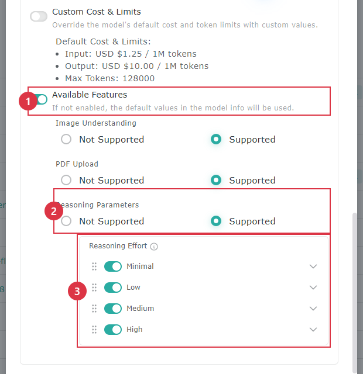

# モデル

**モデル** ページでは、AI Studio で利用できるモデルを追加・管理します。モデルのプロバイダー、接続の認証情報、モデルの種類、コストと Token の制限、対応機能、モデルの利用権限などを設定できます。

開き方：**システム設定 > モデル**

## モデル一覧

モデル一覧には次の欄があります。

| 欄     | 説明                                        |
| ----- | ----------------------------------------- |
| 有効状態  | モデルが現在有効かどうかを表示します。緑の点はモデルが有効であることを示します。     |
| 名前    | AI Studio に表示されるモデルの名前です。名前をクリックすると、モデルの詳細設定が開きます。 |
| 作成者   | このモデルを作成したユーザーです。                          |
| 更新日   | モデルが最後に変更された日付です。                          |
| タグ    | モデルが対応している機能の種類を表示します。                     |

各モデルの行の右側には **編集** と **削除** の操作があります。

### 共通の操作

* **検索**：モデル名でデータを探します。
* **作成**：モデルと接続情報を追加します。
* **欄の設定**：表示・非表示にする欄を選んだり、欄の位置を固定したりできます。
* **更新**：モデル一覧を再読み込みします。
* **フィルター**：有効状態、名前、作成者、更新日、モデルのプロバイダー、タグでモデルを絞り込みます。
* **1 ページあたりの件数**：1 ページに表示するモデルの数を調整します。
* **ページの切り替え**：最初、前、次、最後のページに移動します。

## モデルの作成

<figure><figcaption></figcaption></figure>

<figure><figcaption></figcaption></figure>

<figure><figcaption></figcaption></figure>

<figure><figcaption></figcaption></figure>

1. **作成** をクリックします。
2. モデル名を入力します。
3. モデルのプロバイダーを選択します。
4. ベースモデルを選択または入力します。
5. モデルが対応しているタグを選択します。
6. そのプロバイダーに必要なモデルの認証情報と接続情報を入力します。
7. 必要に応じて **詳細設定** を展開し、コスト、Token の制限、モデルの機能、思考レベルを調整します。
8. **テスト** をクリックし、現在の認証情報と接続設定が正常に使えることを確認します。
9. テストが完了したら **作成** をクリックしてモデルを保存します。保存しない場合は **キャンセル** をクリックします。

アスタリスク（\*）の付いた欄は必須です。必要な情報を入力するまで、**作成** ボタンは無効のままです。


API Key、AWS の認証情報、サービスアカウントの認証情報はいずれも機密情報です。操作のスクリーンショットや公開ドキュメントに含めたり、関係のないユーザーに渡したりしないでください。


## モデルのプロバイダー

現在選択できるモデルのプロバイダーは次のとおりです。

* OpenAI
* Azure
* Google
* Ollama
* Claude
* AWS Bedrock
* Google Vertex AI
* DeepSeek
* Mistral AI
* Cohere
* OpenRouter
* MixRoute
* NVIDIA NIM
* GLM
* MiniMax
* Qwen
* vLLM

プロバイダーを選ぶと、それに対応する認証情報と接続の欄が表示されます。

### よく使う欄

| 欄             | 説明                                                         |
| ------------- | ---------------------------------------------------------- |
| ベースモデル        | 既定のコスト、Token の制限、利用できる機能、思考レベルの選択肢を読み込むために使います。実際に呼び出されるモデルではありません。 |
| モデル           | モデルのプロバイダーに実際に送られるモデル名または識別子です。ベースモデルを選ぶと自動的に入力されますが、変更することもできます。 |
| タグ            | モデルが提供できる機能の種類を設定します。                                        |
| API Key       | モデルのサービスへの接続に必要な API Key です。                                  |
| API ベース URL   | モデルのサービスの API のアドレスです。                                        |
| 組織            | OpenAI の組織の識別情報です。組織の設定を使わない場合は空欄にできます。                          |
| API バージョン     | Azure のモデルサービスで使う API のバージョンです。                                |

一部のプロバイダーでは追加の情報が必要です。

* **AWS Bedrock**：Bedrock の API Key、AWS アクセスキー ID、AWS シークレットアクセスキー、AWS リージョン、AWS セッショントークンを設定できます。
* **Google Vertex AI**：GCP のプロジェクト ID、Vertex のロケーション、サービスアカウントの認証情報を設定する必要があります。
* **Ollama**：主に API ベース URL を設定します。API Key は実際のサービス環境に応じて入力します。

### モデルのプロバイダーのアイコン

モデル一覧のアイコンは、モデルの作成時または編集時に選んだプロバイダーに応じて表示されます。

<figure><figcaption></figcaption></figure>

アイコンが実際の接続先と異なる場合は、モデルの詳細設定を開き、プロバイダーが正しく選ばれているかを確認してください。モデルの実際の呼び出しは、API ベース URL、API Key、関連する接続パラメーターに基づいて行われます。

## モデルのタグ

モデルのタグは、そのモデルが実行できる作業の種類を示します。1 つのモデルに複数のタグを設定できます。

| タグ       | システムのタグ               | 用途                   |
| -------- | --------------------- | -------------------- |
| 音声生成     | `Audio Speech`        | 音声を生成します。            |
| 音声の文字起こし | `Audio Transcription` | 音声をテキストに変換します。       |
| 会話       | `Chat`                | 一般的な会話と Q&A を行います。   |
| テキスト補完   | `Completion`          | 入力内容に基づいてテキストを補完します。 |
| ベクトル埋め込み | `Embedding`           | テキストをベクトルに変換します。     |
| 画像の編集    | `Image Edit`          | 既存の画像を編集します。         |
| 画像生成     | `Image Generation`    | 画像を生成します。            |
| コンテンツの安全性 | `Moderation`          | コンテンツの安全性チェックを行います。  |
| 光学文字認識   | `OCR`                 | 画像やドキュメント内の文字を認識します。 |
| リアルタイム   | `Realtime`            | リアルタイムのやり取りに対応します。   |
| 再ランキング   | `Rerank`              | 検索結果を再ランキングします。      |
| 応答インターフェース | `Responses`         | 応答インターフェース型のモデルサービスを使います。 |
| 検索       | `Search`              | 検索タスクを実行します。         |
| ベクトルストア  | `Vector Store`        | ベクトルデータベース関連の操作に対応します。 |
| 動画生成     | `Video Generation`    | 動画を生成します。            |

モデルが対応していない作業に使われないよう、実際に対応している機能に合わせてタグを選んでください。

## 詳細設定

### コストと制限のカスタマイズ

**コストと制限のカスタマイズ** を有効にすると、システムに組み込まれたモデル情報を上書きできます。

| 欄                  | 説明                         |
| ------------------ | -------------------------- |
| 入力コスト（100 万 Token あたり） | 入力 Token 100 万個あたりのコストです。    |
| 出力コスト（100 万 Token あたり） | 出力 Token 100 万個あたりのコストです。    |
| Token の上限          | 1 回の呼び出しで使用できる最大 Token 数です。 |

有効にしない場合は、モデル情報にある元のコストと Token の制限が使われます。

### 利用できる機能

**利用できる機能** を有効にすると、モデルが特定の機能に対応しているかを指定できます。例：

* 画像の理解
* PDF のアップロード

機能をカスタマイズしない場合は、モデル情報の既定の対応状況がそのまま使われます。

### 思考レベル

思考レベル（Reasoning Effort）では、モデルが提供できる思考のレベルを設定します。この設定が表示されるかどうか、また利用できる思考レベルは、選択した **ベースモデル** によって異なります。ベースモデル自体が思考レベルに対応していない場合、詳細設定に関連する選択肢は表示されません。

1. **利用できる機能** を有効にして、モデルの機能設定をカスタマイズします。
2. **推論パラメーター** が **対応** に設定されていることを確認します。
3. **思考レベル** の一覧で、ユーザーに提供する選択肢を有効にし、必要に応じて表示順と既定の選択を調整します。

画面の Minimal、Low、Medium、High は、このベースモデルの例にすぎません。ほかのベースモデルに切り替えると、そのモデルが対応する思考レベルが表示されます。


**ベースモデル** は、既定のコスト、Token の制限、利用できる機能、思考レベルの選択肢を読み込むためだけに使われ、実際に呼び出されるモデルを決めるものではありません。実際に使われるモデルは **モデル** 欄の内容で決まります。



クラウドのモデルで完全なモデル情報がある場合は、通常システムの既定値をそのまま使えます。自前でホストしているモデル、特別な料金、モデル情報が不完全な場合にのみ、手動で上書きする必要があります。


## モデルの編集

<figure><figcaption></figcaption></figure>

モデル名をクリックすると、モデルの詳細設定ページが開きます。行の右側にも **編集** と **削除** の操作があります。

**一般** タブでは次の項目を変更できます。

* 有効状態
* モデル名
* モデルのプロバイダー
* ベースモデル
* モデルのタグ
* モデルの認証情報
* 詳細設定

変更が終わったら、まず **テスト** をクリックして接続を確認し、次に **保存** をクリックして変更を適用します。今回の変更を残さない場合は **キャンセル** をクリックします。

モデルを無効にしても一覧には残りますが、有効なモデルとしては提供されません。


モデルが Agent、ナレッジベース、構成の設定、そのほかの機能で使われている場合、モデルのプロバイダー、ベースモデル、タグを変更すると、既存の機能に影響することがあります。変更後は接続テストを行い、関連する機能が引き続き正常に動作することを確認してください。


## 接続テスト

<figure><figcaption></figcaption></figure>

モデルを作成または変更する際は、**テスト** をクリックして、モデルを正常に呼び出せるかを確認できます。

テストに失敗した場合は、次の順に確認してください。

1. モデルのプロバイダーが正しいか。
2. ベースモデルの名前または識別子が正しいか。
3. API ベース URL が正しいか。
4. API Key またはそのほかの認証情報が有効か。
5. Azure の API バージョン、AWS のリージョン、Vertex のロケーションなど、プロバイダー固有の欄が正しいか。
6. モデルのサービスが現在の環境からの接続を許可しているか。

## 機能別のモデルの推奨

AI Studio では、Agent が使用するチャットモデル、ナレッジベースの埋め込みモデル、再ランキングモデル、音声文字起こしなど、複数の箇所でモデルを設定する必要があります。モデルによって対応している機能は異なります。モデル API の購入やオンプレミス環境への導入を計画する前に、このセクションでモデルが利用シーンに合っているかを確認し、購入後に一部の機能で使えないことが判明する事態を避けてください。

> 表は推奨順に並んでいます。実際に選択できるモデルは、システム管理者の設定によって異なります。

### チャットモデル

| モデル | デプロイ | 推奨用途 | ツール使用 | 画像／PDF | 音声文字起こし | 備考 |
| --- | --- | --- | --- | --- | --- | --- |
| gpt-6.1-sol | クラウド | 主力 | ✓ | ✓ | ✗ | 推論能力が高く、約 92 万 tokens を処理可能 |
| claude-sonnet-5 | クラウド | 主力 | ✓ | ✓ | ✗ | 約 100 万 tokens を処理可能 |
| gemini-2.5-pro | クラウド | 主力 | ✓ | ✓ | ✓ | 音声文字起こしも兼用可能 |
| gpt-6-luna | クラウド | コスト重視 | ✓ | ✓ | ✗ | 現在最もコストが低い。再ランキングの第一候補 |
| gpt-5.6-luna | クラウド | コスト重視 | ✓ | ✓ | ✗ | コストは gpt-6-luna の約 2 倍 |
| gpt-5.4-mini | クラウド | 再ランキング | ✓ | ✓ | ✗ | 応答が速い |
| gemini-2.5-flash | クラウド | 音声文字起こし、再ランキング | ✓ | ✓ | ✓ | 音声文字起こしの第一候補。応答が速く低コスト |
| Qwen3.8-27B | オンプレミス | 主力 | ✓ | ✓ | ✗ | 社内で導入・検証済み。思考の長さを調整可能 |
| GLM-5 シリーズ | オンプレミス | 主力 | ✓ | バージョンによる | ✗ | GLM-5.3 以降は思考をオフにできない |
| DeepSeek-V4 | オンプレミス | 主力 | ✓ | バージョンによる | ✗ | 思考の長さを調整可能 |

### 埋め込み・再ランキング専用モデル

| モデル | デプロイ | テキスト埋め込み | マルチモーダル埋め込み | 再ランキング | 備考 |
| --- | --- | --- | --- | --- | --- |
| text-embedding-3-large | クラウド | ✓ | ✗ | ✗ | 検索品質が高く、社内で最もよく使用 |
| text-embedding-3-small | クラウド | ✓ | ✗ | ✗ | 低コスト |
| gemini-embedding-2 | クラウド | ✓ | ✓ | ✗ | テキストとマルチモーダルの両方に対応。社内で使用中 |
| Qwen3-Embedding-8B | オンプレミス | ✓ | ✗ | ✗ | 社内で導入・検証済み |
| bge-m3 | オンプレミス | ✓ | ✗ | ✗ | ハードウェア要件が低い |
| Qwen3-Reranker-8B | オンプレミス | ✗ | ✗ | ✓ | 社内で導入・検証済み |

#### 注意事項

1. **すべてのチャットモデルは、一般的な会話と再ランキングを兼用できます**。再ランキングには専用の再ランキングモデルを使うこともできます。
2. **Agent にナレッジベースをバインドする場合、モデルがツール使用に対応している必要があります。**
3. **音声文字起こしは現在オンプレミスのモデルに対応していません**。オンプレミス環境ではクラウドのモデルと組み合わせる必要があります。GPT シリーズ（gpt-6、Luna を含む）は音声入力に対応していません。
4. **ナレッジベースの埋め込みモデルを変更すると、ベクトルデータの再構築が必要です**。再構築中は、このナレッジベースを使用する Agent はここから内容を検索できません。ナレッジベースを作成する前に、使用する埋め込みモデルを決めておいてください。
5. **マルチモーダルのナレッジベースには、次の両方が必要です**：マルチモーダル埋め込みモデル（クラウドでは gemini-embedding-2 を推奨。オンプレミスでは現在推奨モデルはありません）と、画像の読み取りに対応したチャットモデル。詳しくは [画像検索](../zhi-shi-ku-zhi-nan/yi-tu-sou-tu.md) を参照してください。

### 用語の説明

購入時は、モデルメーカーのドキュメントの表記と照らし合わせて、必要な機能があるかを確認してください。

| 本ページの用語 | 意味 | メーカーのドキュメントでよく使われる表記 |
| --- | --- | --- |
| ツール使用 | 必要に応じてナレッジベース検索などのツールを呼び出せる | Function Calling、Tool Use |
| 画像の読み取り | 画像の内容を読み取れる | Vision、Image Input |
| PDF 入力 | PDF ファイルを直接読み取れる | PDF Input、File Input |
| 音声入力 | 音声を直接読み取れる。音声文字起こしに必要 | Audio Input |
| 埋め込み | テキストや画像をベクトルに変換し、ナレッジベース検索に使う | Embeddings |
| マルチモーダル | テキストや画像など複数の種類のデータを同時に処理できる | Multimodal |
| 再ランキング | 質問との関連度に応じてナレッジベースの検索結果を並べ替える | Rerank |

## モデルの削除

モデルの行の右側にある **削除** をクリックすると、そのモデルを削除できます。

<figure><figcaption></figcaption></figure>


削除する前に、そのモデルが構成の設定、Agent、ナレッジベース、そのほかの機能でまだ使われていないかを確認し、関連する機能が正常に動作しなくなるのを防いでください。


## 権限


モデルモジュールは AI Studio 管理者のみが利用できるため、一覧レベルの権限設定はありません。


### モデルの権限

ロールの権限については [モジュール別の権限ロール - モデルの権限](../ru-men-zhi-nan/quan-xian-gong-neng-jie-shao.md#mo-xing) を参照してください。

権限の設定方法については [権限の操作 - Object のロール権限](../ru-men-zhi-nan/quan-xian-cao-zuo-gong-neng-jie-shao.md#jue-se-quan-xian) を参照してください。
