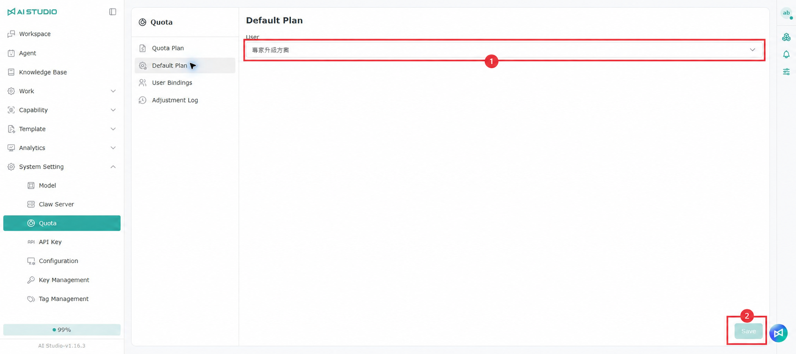
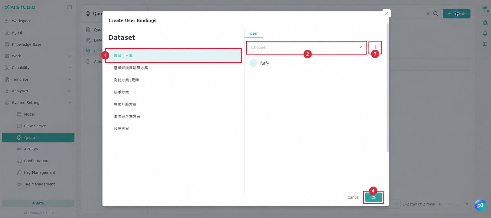
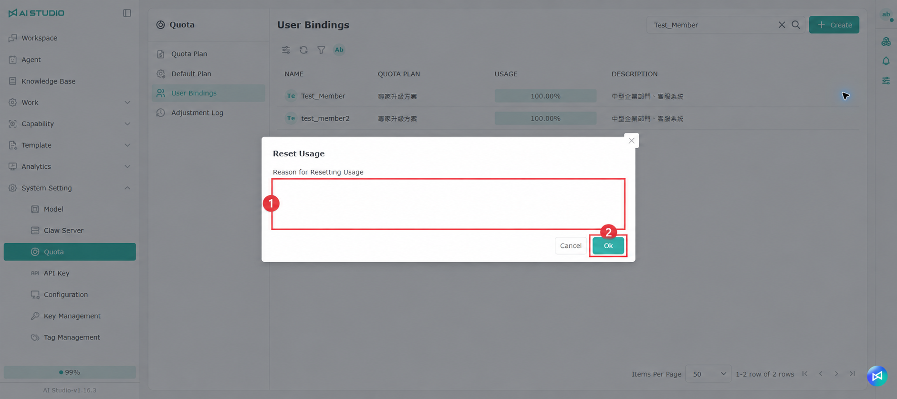
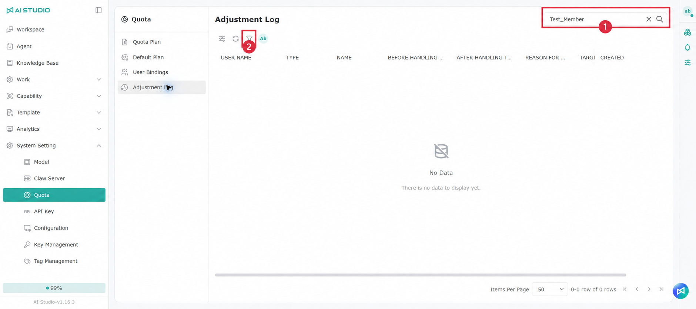

# クォータ

**クォータ** ページでは、ユーザーが利用できるシステムリソースとコストの上限を管理し、プランの作成、割り当て、使用量のリセットなどの操作を追跡します。

開き方：**システム設定 > クォータ**

ページには次のタブがあります。

* **クォータプラン**：クォータプランを作成・管理します。
* **既定のプラン**：ユーザーに既定で適用されるプランを設定します。
* **ユーザーの紐づけ**：指定したプランをユーザーに割り当て、現在の使用量を確認します。
* **調整履歴**：プランと使用量の変更履歴を照会します。

## 共通の操作

各一覧ページには次の機能があります。

* **検索**：名前、説明、そのほか表示されている欄でデータを探します。
* **作成**：クォータプランまたはユーザーの紐づけを追加します。
* **欄の設定**：表示・非表示にする欄を選んだり、欄を表の左側または右側に固定したりできます。
* **更新**：現在の一覧を再読み込みします。
* **フィルター**：欄を選んで条件を設定します。複数のフィルター条件を同時に追加できます。
* **1 ページあたりの件数**：1 ページに表示するデータの数を調整します。
* **ページの切り替え**：最初、前、次、最後のページに移動します。

## クォータプラン

このタブでは、ユーザーに割り当てられるクォータプランを作成・管理します。

<figure><figcaption></figcaption></figure>

### 欄の説明

| 欄              | 説明                           |
| -------------- | ---------------------------- |
| 名前             | クォータプランの名前です。                  |
| 使用量のリセット周期     | システムが自動的に使用量を再計算する周期です。          |
| コストの上限（米ドル）    | 各リセット周期内で使用できる最大の予算です。           |
| 作成者            | このプランを作成したユーザーです。              |
| 更新日            | プランが最後に変更された日付です。              |
| 説明             | プランの用途や補足情報です。                 |

### クォータプランの作成

1. **作成** をクリックします。
2. プラン名を入力します。
3. 必要に応じてプランの説明を入力します。
4. コストの上限（米ドル）を入力します。
5. 使用量のリセット周期を選択します。
6. **OK** をクリックして作成を完了します。保存しない場合は **キャンセル** をクリックします。

選択できるリセット周期は次のとおりです。

* 毎月
* 毎週
* 毎日
* 6 時間ごと
* 2 時間ごと
* 1 時間ごと
* リセットしない

**リセットしない** を選ぶと、システムは決まった周期で使用量を自動的にリセットしません。

### プランの編集と削除

プランの行の右側では、次の操作を行えます。

* **編集**：プラン名、説明、コストの上限、リセット周期を変更します。
* **削除**：クォータプランを削除します。


削除する前に、そのプランがまだ既定のプランに設定されていないか、ユーザーに割り当てられていないかを確認してください。


## 既定のプラン

このタブでは、ユーザーに既定で適用されるクォータプランを設定します。

### 設定方法

1. **ユーザー** 欄でクォータプランを 1 つ選択します。
2. 選択内容を確認します。
3. **保存** をクリックして設定を適用します。

プランを変更していない場合、**保存** ボタンは無効のままです。


新しい既定のプランを使う場合は、先に **クォータプラン** タブで作成してから、このタブに戻って選択してください。


## ユーザーの紐づけ

このタブでは、ユーザーに現在適用されているクォータプランを確認し、指定したユーザーにプランを割り当てます。

<figure><figcaption></figcaption></figure>

### 欄の説明

| 欄        | 説明                              |
| -------- | ------------------------------- |
| 名前       | ユーザー名またはアカウントです。                  |
| クォータプラン  | そのユーザーに現在割り当てられているプランです。          |
| 使用量      | 現在の使用量の割合を、進捗バーとパーセントで表示します。       |
| 説明       | ユーザーまたは紐づけデータの補足情報です。             |

### ユーザーの紐づけの作成

1. **作成** をクリックします。
2. 左側の **データセット** エリアのプラン一覧から、適用するクォータプランを選択します。
3. 右側のユーザーメニューでユーザーを選択します。
4. **追加** をクリックして、ユーザーを紐づけ予定の一覧に追加します。
5. 複数のユーザーを追加する場合は、ユーザーを選んで **追加** をクリックする操作を繰り返します。
6. 誤ったユーザーを選んだ場合は、紐づけ予定の一覧から削除できます。
7. プランとユーザーを確認したら、**OK** をクリックして紐づけを完了します。保存しない場合は **キャンセル** をクリックします。

### 使用量のリセット

ユーザーの行にある **使用量のリセット** をクリックすると、そのユーザーの現在の累積使用量をリセットできます。

1. 使用量をリセットするユーザーを探します。
2. その行の **使用量のリセット** をクリックします。
3. 確認ウィンドウでリセットの理由を入力します。
4. ユーザーと理由を確認して、リセットを完了します。


リセットはユーザーのクォータの計算に影響します。実行前にユーザーとリセットの理由が正しいかを確認してください。完了後は **調整履歴** で「使用量のリセット（`USAGE_RESET`）」の記録を確認できます。


## 調整履歴

このタブには、クォータプラン、ユーザーの紐づけ、使用量のリセットなどの変更が記録され、管理者が操作内容を追跡できます。

### 欄の説明

| 欄                | 説明                         |
| ---------------- | -------------------------- |
| 操作者名             | 今回の操作を行ったユーザーです。             |
| 変更の種類            | 今回の操作の種類のコードです。              |
| 名前               | 今回の変更に関係するプランまたはアカウントの名前です。  |
| 処理前の予算（米ドル）      | 操作前の予算の金額です。                 |
| 処理後の予算（米ドル）      | 操作後の予算の金額です。                 |
| 使用量のリセットの理由      | 使用量をリセットした際に入力された理由です。        |
| 対象ユーザー名          | 今回の割り当てまたはリセットの影響を受けたユーザーです。  |
| 作成日時             | この変更記録が作成された日時です。             |

### 変更の種類

| 変更の種類         | システムのコード        | 説明                     |
| ------------- | --------------- | ---------------------- |
| クォータプランの作成    | `PLAN_CREATE`   | 新しいクォータプランを作成しました。     |
| クォータプランの更新    | `PLAN_UPDATE`   | 既存のクォータプランを更新しました。     |
| クォータプランの削除    | `PLAN_DELETE`   | クォータプランを削除しました。        |
| クォータプランの割り当て  | `PLAN_ASSIGN`   | クォータプランをユーザーに割り当てました。  |
| 使用量のリセット      | `USAGE_RESET`   | ユーザーの現在の累積使用量をリセットしました。 |

検索、フィルター、欄の設定を使って、操作者、変更の種類、対象ユーザー、作成日時で記録を探せます。
