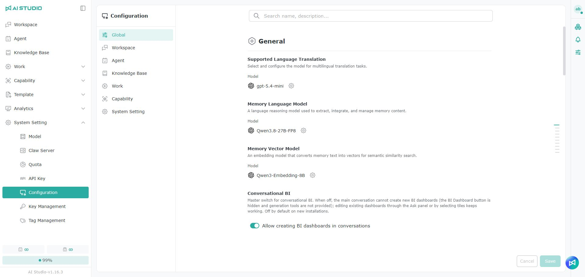
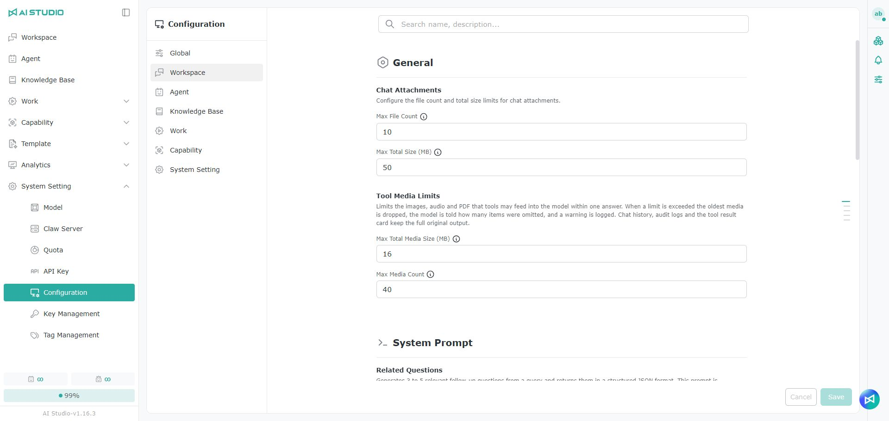
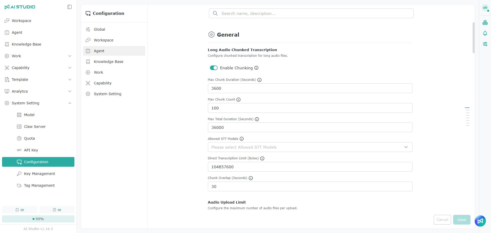
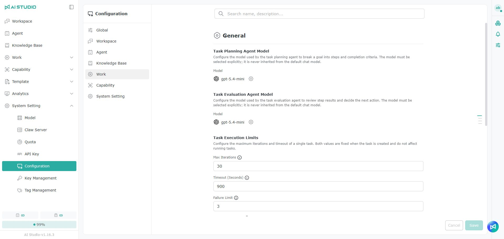

# 構成

**構成** ページでは、AI Studio の各機能のモデル、制限条件、スイッチ、システムプロンプトをまとめて管理します。

開き方：**システム設定 > 構成**


左側で「グローバル、ワークスペース、Agent、ナレッジベース、Work、Capability、システム設定」の 7 つの分類を切り替えられます。設定を変更したら、ページ右下の **保存** をクリックしてください。変更を残さない場合は **キャンセル** をクリックします。


## 共通の操作

* **検索**：設定名や説明で項目を探します。
* **モデル**：その機能で使うモデルを選択します。一部の項目では **パラメーター** を開いてモデルのパラメーターをさらに調整できます。
* **有効化スイッチ**：機能を有効にするかどうかを制御します。
* **数値の制限**：ファイル数、容量、実行回数、待機時間、そのほかの上限を設定します。
* **システムプロンプト／Prompt／Instruction**：モデルがその機能を実行する際に従うルールを設定します。項目の説明に空欄にできると書かれている場合、空欄にするとシステムに組み込まれたルールだけが使われます。
* **リセット**：編集可能なプロンプトを既定の内容に戻します。
* **保存**：今回の変更を適用します。
* **キャンセル**：保存していない変更を破棄します。


モデル、プロンプト、制限条件は、システムの機能の出力と実行方法に影響します。変更する前に利用シナリオを確認し、変更後はテストを行ってください。


## グローバル

グローバルの設定は AI Studio 全体に適用され、翻訳、メモリー、対話型 BI、Canvas、内容の要約などの機能が含まれます。

### 対応言語の翻訳

多言語の翻訳タスクで使うモデルを設定します。

### メモリーの言語モデル

メモリーの内容の抽出、統合、管理に使う言語推論モデルを設定します。

### メモリーのベクトルモデル

メモリーのテキストをベクトルに変換する embedding モデルを設定し、意味の類似度による検索を可能にします。

### 対話型 BI

ユーザーが会話の中で新しい BI Dashboard を作成できるかどうかを制御します。

無効にすると、メインの会話での BI Dashboard の作成の入口が非表示になり、関連する生成ツールも提供されません。既存の BI Dashboard は、質問パネルやタイルの選択から引き続き編集できます。

### ユーザーのメモリーツール

Agent がどのユーザー情報を覚える価値があると判断するか、またメモリーの内容を安全に追加・更新・削除・無視する方法を設定します。

### Agent のメモリーの抽出

検証済みで再利用できるタスクの実行経験を会話から抽出し、手続き型のメモリーに変換する方法を設定します。

### Canvas

Canvas 関連の設定には次のものがあります。

* **Canvas**：Canvas 機能を有効にするかどうか、使用する Canvas Skill、リクエストの振り分けルールを設定します。
* **Canvas の生成ルール**：Canvas の生成時に従う独自のルールを追加します。
* **Canvas の書き直し**：Canvas の内容を改善または書き直す際に使うモデルと追加のルールを設定します。

### キーワードと要約

キーワードと要約の生成に使うモデルと独自のルールを設定します。

## ワークスペース

ワークスペースの設定では、チャットの添付ファイル、ツールのメディア、ワークスペース内のタイトルと関連質問の生成方法を管理します。

### チャットの添付ファイル

1 回のチャットで添付できるファイル数の上限と、すべての添付ファイルの合計容量の上限（MB）を設定できます。

### ツールのメディアの制限

ツールが 1 回の回答でモデルに提供する画像、音声、PDF の数と合計容量を制限します。

制限を超えると、古いメディアから優先的に削除され、省略された項目の数がモデルに伝えられます。チャット履歴、監査記録、ツールの結果カードには、元の内容がすべて保持されます。

### 関連質問

現在の質問と回答から関連する質問を生成する際に使うモデルと追加のルールを設定します。システムは、ユーザーが続けて質問できる質問を 3〜5 件生成します。

### タイトルの生成

会話のタイトルを自動生成する際に使うモデルと追加のルールを設定します。システムは入力の言語を識別し、同じ言語でテーマに合った短いタイトルを生成します。

### 構造化クエリのルーティング

Excel のナレッジベースに対する自然な文章の質問を、構造化クエリの処理に回す必要があるかどうかと、その判断に使うモデルと追加のルールを設定します。

## Agent

Agent の設定では、音声の文字起こし、入力と出力の保護、指示の書き直しなどの機能を管理します。

### 長い音声の分割文字起こし

長い音声を分割してから文字起こしするかどうかを制御します。次の項目を設定できます。

* 分割を有効にするかどうか
* 1 つの分割の最大秒数
* 分割数の上限
* 音声の合計長さの上限
* 使用できる STT モデル
* 直接文字起こしできるファイル容量の上限
* 隣り合う分割の間で重なる秒数

### 音声のアップロード制限

文字起こしモードと単一ファイルモードで、1 回にアップロードできる音声ファイルの数を設定します。

### システムの保護ルール

すべての Agent Chat が必ず守るべき入力と出力の安全ルールを設定します。Agent 自身の保護ルールはシステムのルールと同時に適用され、システムレベルのルールは無効にできません。

**入力** と **出力** のタブでそれぞれルールを設定でき、**テスト** でルールが期待どおりかを確認できます。

### 音声

音声の文字起こしに使うモデル、モデルが処理できる音声の最大時間、システムプロンプト、Instruction を設定します。

音声関連の項目にはほかに次のものがあります。

* **忠実な音声の文字起こし**：元の意味を忠実に保つ際に使う Prompt と Instruction を設定します。
* **音声の要約**：音声の内容の要約を生成する際に使う Prompt と Instruction を設定します。

### 指示の書き直し

ユーザーの元の入力を、明確で構造化された実行可能な LLM の指示に整理する際に使うモデルと追加のルールを設定します。

### 保護ルールの式の生成

保護ルールの式を生成する際に使うモデルと追加のルールを設定します。

## ナレッジベース

ナレッジベースの設定では、ファイルのアップロード、検索の参照数、データセットの説明、クエリの拡張を管理します。

### ナレッジベースのアップロードポリシー

ナレッジベースに 1 回でアップロードできるファイルの容量の上限（MB）と、アップロードできる拡張子を設定します。

### ナレッジベースの検索の参照

ナレッジベースの検索時に既定で読み込む参考資料の数と、ユーザーが設定できる最大数を設定します。

### データセットの自動説明

各データセットに 1 行の短い説明を生成し、Agent が質問にナレッジベースを使う必要があるかを判断できるようにします。この説明は一般ユーザーには表示されません。

使用するモデル、インポート時に自動生成するかどうか、既存のデータセットを補完するかどうか、サンプルの内容、説明の長さ、バッチの数、タイムアウトなどの制限を設定できます。

### ナレッジベースのクエリの拡張

ユーザーの質問を、英語版を含む複数のクエリに既定で書き換え、それぞれで検索して、言語をまたいだ内容の検索精度を高めるかどうかを制御します。


クエリの拡張では LLM の呼び出しが 1 回増え、生成されたクエリの数に応じて複数回の検索が行われます。


## Work

Work の設定では、タスクの計画、結果の評価、実行の制限、スケジュールのルールを管理します。

### タスク計画 Agent のモデル

タスク計画 Agent が目標を実行ステップと完了条件に分解する際に使うモデルを設定します。このモデルは別途指定する必要があり、既定の会話モデルは引き継がれません。

### タスク評価 Agent のモデル

タスク評価 Agent がステップの結果を確認し、次の操作を決める際に使うモデルを設定します。このモデルは別途指定する必要があり、既定の会話モデルは引き継がれません。

### タスクの実行制限

1 つのタスクについて次の項目を設定できます。

* 最大実行回数
* タイムアウトの秒数
* 失敗を許容する回数
* コストの予算の上限（USD）

これらの制限はタスクの作成時に確定するため、設定を変更しても実行中のタスクには影響しません。

### AI Cron

AI が自然な文章のスケジュールの要件を有効な Spring CronExpression に変換する際に使うモデルとシステムプロンプトを設定します。

## Capability

Capability の設定では、スキルのスキャン、有効化、アップロードの制限、Sandbox のファイルツール、A2A の公開 URL、接続を許可するホスト、Agent Card の提案を管理します。

### スキャン後にスキルを自動的に有効化する

スキャンを通過し、安全であることが確認された Skill を自動的に有効にするかどうかを制御します。


有効にする前に、Skill のスキャンルールが正しく設定されていることを確認してください。高リスクと判定された Skill は自動的に有効化すべきではありません。セキュリティレベルの判定方法は Skill－セキュリティレベルの確認を参照してください。


### スキルパッケージのアップロード制限

Skill のパッケージに含められるバイナリファイルの数と、1 つのバイナリファイルの容量の上限（MB）を設定します。

### Sandbox のファイルツール

Sandbox のファイルツールの 1 ファイルあたりの容量の上限、1 回の呼び出しのファイル数、1 回の呼び出しの合計容量の上限（MB）を設定します。

### Skill Builder のモデル

Skill Builder Agent が使うモデルを設定します。

### スキルスキャン

Skill のアップロード時にスキャンを有効にするかどうかを制御します。セキュリティ上のリスク、隠れた動作、ポリシーに違反する内容の検出に使います。

### A2A の公開 URL と接続を許可するホスト 

<figure><figcaption></figcaption></figure>

A2A を使う前に、システム管理者が次の 2 項目を設定する必要があります。一般ユーザーが A2A の操作中に管理者への連絡を求められた場合は、多くの場合ここが未設定です。

<table data-search="false"><thead><tr><th width="90">項目</th><th width="190">設定名</th><th>説明</th></tr></thead><tbody><tr><td>1</td><td>A2A の公開 URL</td><td>外部の協力会社がこの AI Studio に接続するための URL です。例：<code>https://ais-a2a.example.com</code>。空欄の場合は Agent を公開できません。変更後は、公開済みの Agent をそれぞれ再保存（再公開）すると新しい URL に切り替わります。</td></tr><tr><td>2</td><td>A2A の接続を許可するホスト</td><td>AI Studio は、このリストにあるホストだけに接続します。複数のホストはカンマで区切り、<code>ホスト</code> または <code>ホスト:port</code> の形式で記載します。例：<code>partner.example.com</code>、<code>partner.example.com:8443</code>。ポートを省略した場合は 80／443 のみを許可します。空欄の場合はすべての接続先を許可しません。</td></tr></tbody></table>

### A2A Agent Card の提案

Agent の公開時に、**自動生成** が名前、説明、スキルの質問例を生成するためのモデルとプロンプトを設定します。

<table data-search="false"><thead><tr><th width="90">項目</th><th width="190">設定名</th><th>説明</th></tr></thead><tbody><tr><td>1</td><td>Agent Card の提案を有効にする</td><td>無効の場合、Agent の公開時に 自動生成 が失敗し、モデルも呼び出されません。先に有効化してからモデルを選択してください。</td></tr><tr><td>2</td><td>モデル</td><td>提案の生成に使う言語モデルです。歯車アイコンをクリックすると変更できます。</td></tr><tr><td>3</td><td>プロンプト</td><td>通常は変更不要です。編集によって問題が生じた場合は、右上のリセットで既定の内容に戻せます。</td></tr></tbody></table>

### スキルパッケージの書き直し

エディターで Skill のファイルを書き直す際に使うモデルと追加のルールを設定します。

## システム設定

システム設定では、既定のモデル、API の同時処理、一時リソース、実行の制限、記録の保持、公開ファイルの共有を管理します。

### 既定のモデル

既定のモデルには次の設定があります。

| 設定項目                 | 説明                                           |
| -------------------- | -------------------------------------------- |
| 既定の会話モデル             | 一般的なタスクで優先して使うモデルです。利用できない場合は、組み込みの優先順位に従ってほかの利用可能なモデルが選ばれます。 |
| 既定の embedding モデル    | ナレッジベースでテキストの内容をベクトルに変換する際に既定で使うモデルです。       |
| 既定の再ランキングモデル         | ナレッジベースの検索時に、検索結果を並べ替えるモデルです。                  |

### Assistant API の同時処理

Assistant API が同時に処理できるリクエスト数の上限を設定します。ストリーミングと非ストリーミングのリクエストはこの上限を共有し、ストリーミングのリクエストはストリーミングが終わるまで実行枠を占有し続けます。

### 一時リソースのクリーンアップ

一時的なセッションとファイルを何分後にクリーンアップするかを設定します。

### ツールの実行制限

1 回のモデルの推論で実行できるツールの最大回数を設定します。

### Agent の実行待機列

すべての Agent の実行枠が使用中の場合に、対話型のリクエストとバックグラウンドのリクエストが利用可能な枠を待つ秒数を設定します。

### 実行枠カードの詳細情報

実行枠のパネルに、会話のタイトルとユーザーの入力の要約を表示するかどうかを制御します。


実行容量は複数の組織で共有されている場合があります。有効にすると、カードにほかの組織のユーザーが入力したテキストが表示されることがあるため、データ管理のポリシーに照らして慎重に判断してください。


### ナレッジベースの検索記録の内容の保持

ナレッジベースの検索記録に含まれる引用テキストの保持日数と、1 回のクリーンアップのバッチサイズと最大バッチ数を設定します。

削除機能を有効にすると、保持期限を過ぎた引用テキストが記録から削除されます。

### 監査記録の保持

エンティティの監査記録を保持する日数を設定します。期限が過ぎると、システムが記録を削除します。

### 公開ファイルの共有

ログイン不要でファイルをダウンロードできる公開共有リンクの作成を許可するかどうかを制御し、次の項目を設定できます。

* 1 時間あたりに作成できる共有リンクの数
* 1 分あたりの公開読み取りの回数
* 1 分あたりの公開ダウンロードの回数
* 共有できるファイルの容量の上限（MB）
* 共有リンクの既定の有効日数


公開共有リンクは、リンクを持っている人なら誰でもアクセスできます。有効にする前に、ファイルの内容と共有のポリシーを確認してください。


### dMID のリスク判定の予算

1 回の自動リスク判定で使える最大秒数を設定します。時間内に判定が完了しなかったツールは高リスクとみなされ、承認が必要になります。

### dMID の対象検索の予算

1 回の読み取り専用の対象検索で使える最大秒数を設定します。時間内に対象を解決できない場合、画面には元の識別子が表示されますが、その後の承認には影響しません。

### ログ分析

AI がログを分析する際に使うモデルとシステムプロンプトを設定し、エラー、推移、可用性、飽和度、性能の情報から全体的な健全性を判断できるようにします。
