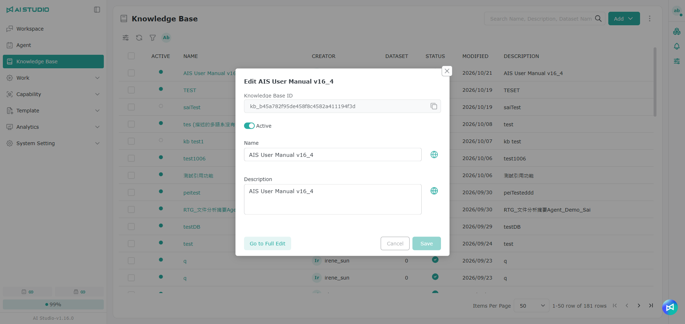
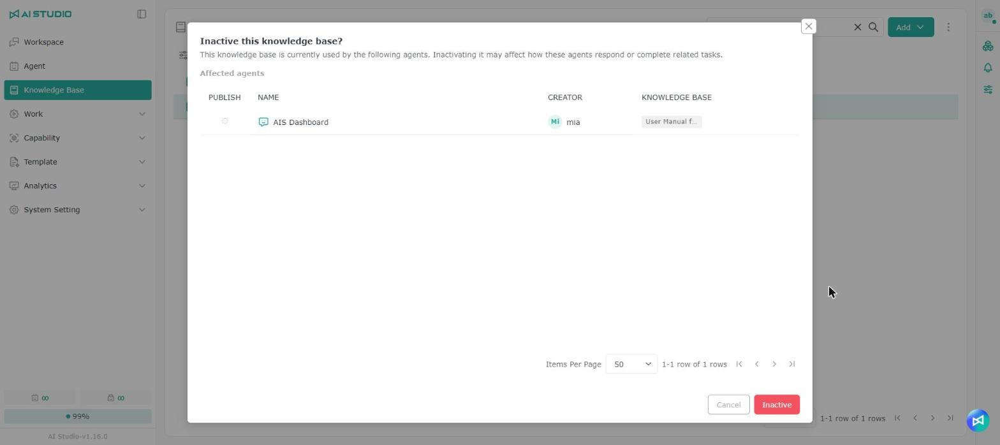

# ナレッジベースの管理

## 概要

> 注意：既定では、AI Studio 管理者、AI Studio ドメインユーザー、およびナレッジベース一覧の権限（ナレッジベース一覧管理者、ナレッジベース一覧ユーザー）を持つユーザーのみがナレッジベース機能を利用できます。ナレッジベースを利用できない場合は、管理者に権限を確認してください。

「ナレッジベース」は上位のコンテナで、その下に複数の「ナレッジ」が含まれ、「データセット」は各「ナレッジ」の下に配置されます。そのため、実際に管理する対象に合わせて命名の一貫性を保つよう、名称には「ナレッジ権限」を使っています。英語名も同じ考え方に従います。

ナレッジ内のデータセットの構成は下図のとおりです。

<figure><figcaption></figcaption></figure>

## **新しいナレッジの作成**

### **ナレッジを手動で作成する**

<figure><figcaption></figcaption></figure>

<figure><figcaption></figcaption></figure>

1. 左側のメニューで **ナレッジベース** をクリックします。
2. 画面右上の **追加** ボタンをクリックし、**+ ナレッジベース** を選択します。
3. **名前** 欄にナレッジ名を入力し、右側のボタンをクリックして多言語ラベルを作成します。[多言語設定](guan-li-zhi-shi-ku.md#duo-guo-yu-yan-she-ding) を参照してください。
4. **説明** 欄にナレッジの説明を入力し、右側のボタンをクリックして多言語ラベルを作成します。[多言語設定](guan-li-zhi-shi-ku.md#duo-guo-yu-yan-she-ding) を参照してください。
5. **埋め込みモデル** メニューをクリックし、このナレッジでテキストを意味ベクトルに変換する際に使うモデルを選択します。
6. **追加** ボタンをクリックして作成を完了します。

### 多言語設定 

<figure><figcaption></figcaption></figure>

1. 画面の **地球** ボタンをクリックすると自動翻訳されます。内容は手動で編集することもできます。
2. 自動翻訳が完了したら **保存** ボタンをクリックして保存します。

### **ナレッジのインポート**

<figure><figcaption></figcaption></figure>

<figure><figcaption></figcaption></figure>

1. 左側のメニューで **ナレッジベース** をクリックします。
2. 画面右上の **追加** ボタンをクリックし、**+ デバイスから** を選択します。
3. 埋め込みモデルでモデルを選択します。
4. アップロードするファイルを選択します。
5. インポートボタンをクリックして、インポートを完了します。

> 注意：インポートボタンをクリックすると、システムは選択したモデルをテストします。テストに成功すると、選択したモデルでそのままアップロードされます。テストに失敗した場合は、ほかの利用可能なモデルを選ぶか、そのモデルが正しく設定されているか、利用権限があるか、モデルのサービスに正常に接続できるかを確認してください。確認後、閉じるボタンをクリックしてウィンドウを閉じます。

## ナレッジの検索

<figure><figcaption></figcaption></figure>

ナレッジベース一覧の検索欄には、ナレッジ名のほかにデータセット名も入力できます。そのデータセットを含むナレッジが一覧表示されるため、ファイル名しか覚えていない場合でも、それがどのナレッジにあるかをすばやく見つけられます。たとえば、あるデータセットのアクセス権限を設定したい場合に便利です。

## ナレッジの詳細ページを開く

<figure><figcaption></figcaption></figure>

ナレッジベース一覧でナレッジ名をクリックすると、そのナレッジの詳細ページが開き、既定で「データセット」が表示されます。ナレッジのすべての設定も詳細ページで編集します。

## ナレッジのクイック編集

<figure><figcaption></figcaption></figure>

ナレッジベース一覧で行の編集ボタンをクリックすると、「Edit（ナレッジ名）」クイック編集ウィンドウが開き、次の欄を確認・変更できます。

| 欄            | 説明                                        |
| ------------ | ----------------------------------------- |
| ナレッジベース ID  | このナレッジの一意の識別子です。変更できません。右側のコピーボタンでコピーできます。 |
| 名前           | ナレッジの名前です。右側の地球ボタンで多言語を設定できます。              |
| 説明           | ナレッジの説明です。右側の地球ボタンで多言語を設定できます。              |

### ナレッジベース ID の確認とコピー 

<figure><figcaption></figcaption></figure>

ナレッジベースの API と連携する際、一部の API ではナレッジベース ID（kbId）またはデータセット ID（datasetId）の指定が必要です。

1. ナレッジベース一覧で、確認したいナレッジの編集ボタンをクリックします。
2. 「Edit（ナレッジ名）」ウィンドウの一番上にある **Knowledge Base ID** 欄を探します。形式は `kb_` で始まる文字列です。
3. 欄の右側のコピーボタンをクリックすると、ID をコピーできます。

データセット ID の確認方法も同じです。データセット一覧でそのデータセットの編集ウィンドウを開いて確認してください。

## ナレッジの有効化と無効化

<figure><figcaption></figcaption></figure>

ナレッジベース一覧の各行には有効化スイッチがあり、ナレッジの設定ページに入らなくても一覧上で有効状態を切り替えられます。複数のナレッジを選択して、まとめて状態を切り替えることもできます。

## 使用中の Agent を確認する

<figure><figcaption></figcaption></figure>

ナレッジベース一覧の任意の行にマウスを合わせ、「使用中の Agent」ボタンをクリックすると、このナレッジを現在使用している Agent を確認できます。ウィンドウには、各 Agent の公開状態、名前、作成者が表示されます。

<figure><figcaption></figcaption></figure>

> 注意：「使用中の Agent」ボタンは、そのナレッジに対する編集または削除の権限に応じて表示されます。

### 無効化・削除・埋め込みモデル変更の前の確認

<figure><figcaption></figcaption></figure>

ナレッジが Agent に使用されている場合、次の操作を行う前に「影響を受ける Agent」が一覧表示され、確認すると操作が続行されます。

| 操作              | システムの動作                                                   |
| --------------- | --------------------------------------------------------- |
| 無効化（単一または一括）   | 影響を受ける Agent を表示し、無効化によってそれらの Agent の回答や関連タスクに影響する可能性があることを通知します |
| 削除（単一または一括）    | 影響を受ける Agent を表示し、削除によってそれらの Agent の回答や関連タスクに影響する可能性があることを通知します  |
| 埋め込みモデルの変更      | 影響を受ける Agent を表示し、ベクトルの再構築中はそれらの Agent がこのナレッジから内容を検索できないことを通知します |
| 有効化             | 確認せず、そのまま有効化します                                            |

Agent に使用されていない場合、無効化では通常の確認が、削除では通常の削除確認が表示されます。

## 権限

一覧権限については [モジュール別の権限ロール - ナレッジベース一覧の権限](../ru-men-zhi-nan/quan-xian-gong-neng-jie-shao.md#zhi-shi-ku-qing-dan) を参照してください。

権限の設定方法については [権限の操作 - Root 権限](../ru-men-zhi-nan/quan-xian-cao-zuo-gong-neng-jie-shao.md#root-quan-xian) を参照してください。

### ナレッジ権限

ロールの権限については [モジュール別の権限ロール - ナレッジ権限](../ru-men-zhi-nan/quan-xian-gong-neng-jie-shao.md#zhi-shi) を参照してください。

権限の設定方法については [権限の操作 - Object のロール権限](../ru-men-zhi-nan/quan-xian-cao-zuo-gong-neng-jie-shao.md#jue-se-quan-xian) を参照してください。

### データセットの権限

ロールの権限については [モジュール別の権限ロール - データセットの権限](../ru-men-zhi-nan/quan-xian-gong-neng-jie-shao.md#shu-ju-ji) を参照してください。

権限の設定方法については [権限の操作 - Object のアクセス権限](../ru-men-zhi-nan/quan-xian-cao-zuo-gong-neng-jie-shao.md#cun-qu-quan-xian) を参照してください。
