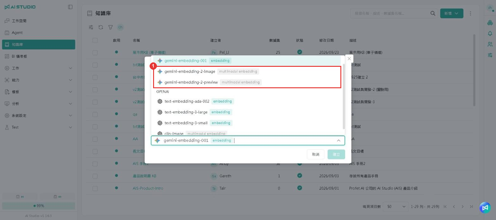
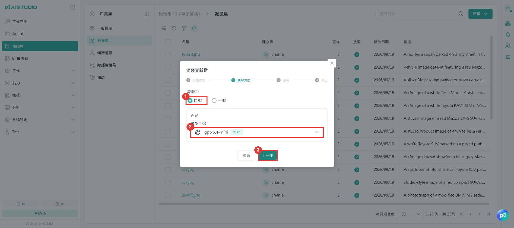
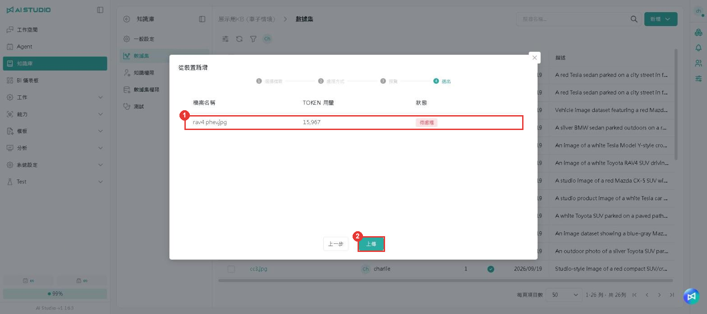
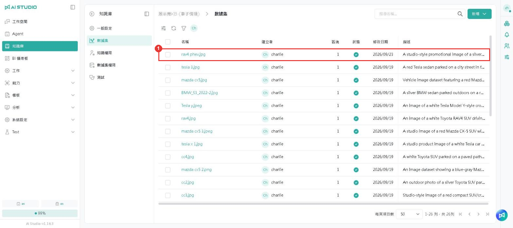
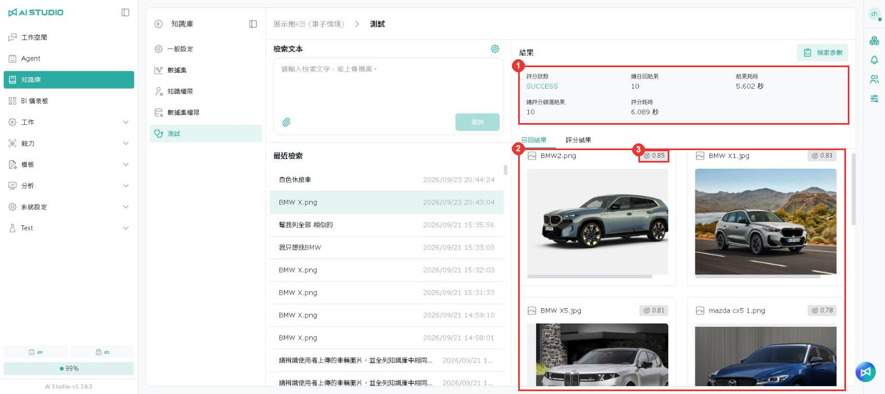
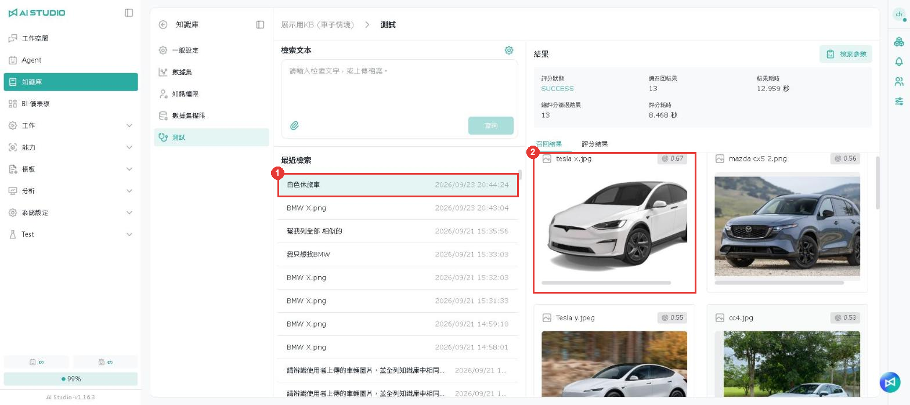

# 画像検索

## 機能の概要

ナレッジベースにはドキュメントだけでなく、画像も保存できます。画像をアップロードすると、「1 枚の画像」でナレッジベース内の見た目が似た画像を探したり、「テキストの説明」で説明に合う画像を探したりできます。

## 画像に対応した埋め込みモデルを選ぶ

ナレッジベースを作成する際、画像検索を使うには **埋め込みモデル** で **multimodal embedding** と表示されたモデルを選ぶ必要があります。**embedding** と表示されたモデルはテキストのみに対応しています。

<figure><figcaption></figcaption></figure>

| 項目 | 説明                                                                                                                         |
| -- | -------------------------------------------------------------------------------------------------------------------------- |
| 1  | multimodal embedding と表示されたモデルは画像に対応しています（例：gemini-embedding-2-image、gemini-embedding-2-preview）。実際に選択できるモデルはシステムの設定によって異なります。 |

## 画像のアップロード

ナレッジベースを開き、左側の **データセット** をクリックします。

<figure><figcaption></figcaption></figure>

| 項目 | 説明                            |
| -- | ----------------------------- |
| 1  | **追加** をクリックします                 |
| 2  | **デバイスから** を選択して、アップロード用のウィンドウを開きます |

### ステップ 1：ファイルの選択

<figure><figcaption></figcaption></figure>

| 項目 | 説明                                                                         |
| -- | -------------------------------------------------------------------------- |
| 1  | 画像をこのエリアにドラッグ＆ドロップするか、**ファイルを選択** をクリックします。1 回に最大 100 ファイル、合計 300 MB までアップロードできます |
| 2  | 選択したファイル                                                                   |
| 3  | **次へ** をクリックします                                                              |

### ステップ 2：処理方法

<figure><figcaption></figcaption></figure>

| 項目 | 説明                                                         |
| -- | ---------------------------------------------------------- |
| 1  | **自動** を選択します。画像をアップロードする場合は **自動** を使ってください                  |
| 2  | モデルを選択します。システムはこのモデルで各画像のテキストの説明を生成します                        |
| 3  | **次へ** をクリックします。**自動** を選択した場合、ステップ 3 の「プレビュー」はスキップされ、ステップ 4 に進みます |

### ステップ 4：送信

<figure><figcaption></figcaption></figure>

| 項目 | 説明                         |
| -- | -------------------------- |
| 1  | ファイル名と推定される Token 使用量を確認します |
| 2  | **アップロード** をクリックします          |

### アップロードの完了

<figure><figcaption></figcaption></figure>

| 項目 | 説明                                                   |
| -- | ---------------------------------------------------- |
| 1  | 処理が完了すると、ステータスに緑のチェックマークが表示され、**説明** 欄にシステムが自動生成した画像の説明が表示されます |

## 画像で検索する

ナレッジベースを開き、左側の **テスト** をクリックします。

<figure><figcaption></figcaption></figure>

| 項目 | 説明                         |
| -- | -------------------------- |
| 1  | クリップのアイコンをクリックし、検索に使う画像をアップロードします |
| 2  | アップロードした画像が入力欄に表示されます        |
| 3  | **照会** をクリックします               |

<figure><figcaption></figcaption></figure>

| 項目 | 説明                        |
| -- | ------------------------- |
| 1  | 今回の検索の概要です。再現件数と所要時間が含まれます   |
| 2  | 再現結果です。類似度の高い順に並びます          |
| 3  | 類似度スコアです。1 に近いほど似ていることを示します |

例：BMW の SUV の写真で検索すると、上位 3 件はすべて BMW の車種（0.85、0.83、0.81）で、ほかのブランドの車種のスコアは 0.76〜0.78 程度でした。

## テキストで画像を検索する

入力欄にテキストの説明を入力して **照会** をクリックすると、説明に合う画像を見つけられます。

<figure><figcaption></figcaption></figure>

| 項目 | 説明                           |
| -- | ---------------------------- |
| 1  | 最近の検索履歴です。クリックすると、その回の結果をもう一度確認できます |
| 2  | 説明に合う画像と類似度スコア                 |

例：「白い SUV」と入力すると、1 位は白い Tesla の SUV の画像（tesla x.jpg、0.67）でした。

## 注意事項

* **画像による画像検索とテキストによる画像検索では、スコアの範囲が異なります。** この章の例では、画像検索の結果は 0.76〜0.85 程度、テキスト検索は 0.48〜0.67 程度でした。類似度のしきい値を設定する際は、実際の検索方法ごとにテストし、同じ値を使い回さないでください。
* **見た目が似たほかのカテゴリが結果に含まれることもあります。** たとえば BMW の写真で検索した場合、ほかのブランドの SUV のスコアも 0.76〜0.78 ありました。順位とスコアの差で判断してください。
* スコアは埋め込みモデルとナレッジベースの内容によって異なるため、この章の数値は参考用です。
